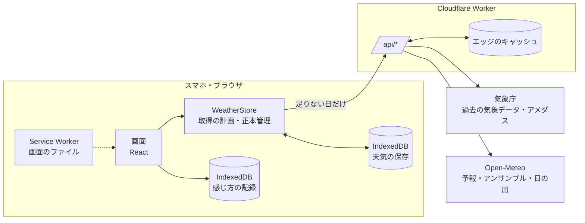

# Weather Note（Cloudflare版）

天気の実績と予報を、**対象日**と**比較日**の2つの日で並べて比べる、スマホ向けのアプリです（高知などの観測地点）。
「今日は去年の同じ日より暖かいか」「先週の売り出しの日と比べて雨はどうだったか」を、表・グラフ・時間帯で比べられます。
[weather-note](https://github.com/Watanabe-Masao/weather-note) を参考に、Cloudflare Workers で作り直したものです。

この README は、アプリの仕組みと計算の考え方を、コードを読まなくても追えるようにまとめた技術仕様です。画面の見た目と操作の決まりは [docs/design-system.md](docs/design-system.md) にあります。

**目次**

1. [全体の仕組み](#1-全体の仕組み)
2. [データの出どころ](#2-データの出どころ)
3. [データの扱い：確定・変わりうる・再確認・訂正](#3-データの扱い確定変わりうる再確認訂正)
4. [正本管理：どのデータを残すか](#4-正本管理どのデータを残すか)
5. [取得の順番と通信](#5-取得の順番と通信)
6. [比べ方：比較日の決め方](#6-比べ方比較日の決め方)
7. [計算の方法](#7-計算の方法)
8. [β版：快適の中心と範囲](#8-β版快適の中心と範囲)
9. [分析（research/）](#9-分析research)
10. [アプリとして使う（PWA）](#10-アプリとして使うpwa)
11. [API](#11-api)
12. [ファイルの構成](#12-ファイルの構成)
13. [テストと確認](#13-テストと確認)
14. [開発と公開](#14-開発と公開)
15. [出典](#15-出典)

---

## 1. 全体の仕組み



- **1つの Worker** が画面のファイルと API の両方を配ります。`/api/*` だけが Worker のコードを通り、それ以外は静的ファイルです。
- **API（Worker）** は気象庁と Open-Meteo からデータを取り、同じ形（`WeatherRow`）に揃えて返します。もう変わらないデータはエッジに長く保存し、同じ要求で外部サイトを何度も叩かないようにします。
- **アプリ** は受け取ったデータを端末（IndexedDB）に保存し、同じ日を二度取りに行きません。画面はいつも端末のデータを読むので、通信が遅くても切れても、あるものはすぐ表示されます。
- **`shared/`** の決まり（日付、確定の判定、肌感の式、信頼度、似た日）は、API とアプリが同じコードを使います。両者で判断が食い違うことはありません。

## 2. データの出どころ

| 期間 | 出どころ | 内容 |
| --- | --- | --- |
| 3日前以前 | 気象庁「過去の気象データ」（日別・時間別の表） | 確定した実績 |
| 一昨日・昨日 | 気象庁の表 ＋ アメダスの速報 | 表にまだ出ていない欄だけ速報で補う（暫定） |
| 今日 | アメダスの観測（済んだ時間） ＋ Open-Meteo の予報（これからの時間） | 時間ごとに混ざる |
| 明日〜15日先 | Open-Meteo の予報（16日分） | 予報。信頼度（A・B・C）付き |
| 日の出・日の入り | Open-Meteo | 計算値 |
| 信頼度 | Open-Meteo のアンサンブル予報（ECMWF IFS の51通り） | 予報のばらつき |

1977年1月1日以降の日を見られます（気象庁のデータの範囲）。

## 3. データの扱い：確定・変わりうる・再確認・訂正

データは2種類に分けて扱います。判定は `shared/fixed.ts` の1か所にあり、API とアプリの両方が使います。

**確定データ**：3日前以前で、気象庁がすべての値を出した実績。
- 日別：天気概況まであり、「まだ出ていない欄」がないこと。
- 月：その月の日がすべて1回ずつあり（重複・別の月の行がない）、どの日も確定であること。
- 時間別：1〜24時が**1回ずつ**あり、どの行も日付が一致し、まだ出ていない欄がないこと。件数だけでは判断しません（重複が欠けを隠すことがあるため）。

**変わりうるデータ**：それ以外（未確定の実績、一昨日〜今日、予報）。

**確定は「正本がそろった」という意味で、「もう変わらない」という意味ではありません**。気象庁が後から訂正することがあるので、次の3つを用意しています。

| 仕組み | 内容 |
| --- | --- |
| 再確認の期間 | 確定してから30日（月なら月末から30日）は、エッジには1日だけ保存し、アプリは起動ごとに1回取り直す。それより古いものは、エッジに1年、端末には永久に保存 |
| 訂正台帳 | `shared/corrections.ts` に訂正のあった期間（と地点）を1行書くと、エッジのキーと端末の保存の両方が、その期間だけ取り直す |
| 版数 | データの形（列の増減）が変わったときは `shared/versions.ts` の版数を1つ上げる。エッジと端末の両方が作り直される |

| 保存場所 | 確定データ | 変わりうるデータ |
| --- | --- | --- |
| エッジ（Worker） | 1年（再確認の期間は1日） | 保存しない。予報だけは地点ごとに30分（外部APIの負荷を抑えるため） |
| 端末（IndexedDB） | 永久（再確認の期間は起動ごとに1回取り直す） | 1回の起動につき1回取る |

［予報・速報を更新］は、端末の保存を飛ばして API に取り直す操作です。予報はエッジの30分保存の範囲で新しくなります（Open-Meteo に直接取り直すことは保証しません）。

## 4. 正本管理：どのデータを残すか

同じ日のデータが複数の出どころから届いたとき、どれを残すかは `src/data/authority.ts` の1か所で決めます。端末への保存はすべてここを通ります。

**出どころの順位**：気象庁の確定値 ＞ 気象庁の暫定値 ＞ アメダス速報 ＞ 予報

| 決まり | 内容 |
| --- | --- |
| 上書きの条件 | 順位だけでは決めない。同じ出どころなら、**要求が新しく**、**値がそろっている**方を残す。古い要求への答えや、値が欠けて返ってきたページは上書きしない |
| 確定データ | 原則として守る。ただし同じ出どころの新しく完全な値（正式な訂正）と、訂正台帳に載った訂正は反映する |
| 訂正と欠けたページの区別 | 訂正は「ページとしてそろった」気象庁の値からだけ反映する。値が空でもページがそろっていれば訂正（値の取り消し）、時刻や行が欠けたページは反映しない |
| 欠けている値 | 下位の出どころで**項目ごと**に補い、`origin` に出どころを残す。ただし予報は実測の欠けを埋めない。予報が補うのは、アメダスにない日射量と天気だけ |
| 時間ごとの出どころ | 時間別は1時間ごとに出どころ（`from`）を保存する。観測と予報が混ざった日でも、読み直したあとに各時間の出どころが変わらない |
| 読み直しの検査 | 端末の確定データは、読み込むたびに今の基準で確かめ直す。通らなければ未確定に戻して取り直す |
| 通信の競合 | ［保存データを消去］より前に出した要求の答えは捨てる。［更新］・日付の変わり目・消去のあとは、それより前に出した要求に相乗りせず新しく取り直す |

エラーは、利用者向けの決まった日本語だけを画面に出し、詳しい内容は Worker のログに残します（API 側は `SourceError`、アプリ側は `src/data/fetchJson.ts`）。

## 5. 取得の順番と通信

アプリのデータ層（`src/data/store.ts`）は、次の4つのルールで動きます。

1. **一度見た日は取り直さない**（メモリ → 端末の保存の順に探す）。
2. **進む方向を先に取る**（`plan.ts`）。表示中の7日 → 進行方向の30日 → 逆方向の7日 → 手が空いたときの先読み、の順。
3. **指が触れている間は画面を書き換えない**。届いたデータは、指を離したときに一度だけ反映する（ドラムが押し戻されないように）。
4. **日付を動かしても、変わりうるデータを取り直さない**。足りない日だけ取る。新しい「起動」（読み込み直し・日付の変わり目・［更新］）で、変わりうるデータは1回だけ取り直す。

通信は待ち行列（`queue.ts`）を通ります。

- 同じ要求は1つにまとめる（相乗り）。ただし更新・消去の区切りより前に出した要求には相乗りしない。
- 同時に走らせる数は、気象庁へ2本、予報へ1本まで。
- もう要らなくなった待ち（地点を変えた、画面を閉じた）は捨てる。
- 失敗したら 5秒 → 30秒 → 2分 の間隔で取り直す。画面には「N日分取得できませんでした［再試行］」を1つだけ出す。

画面の各部分は「欲しい日」を宣言するだけです（表示中の日、カレンダーの月、似た日の候補、β の過去60日など）。それぞれ持ち主の名前付きで、閉じれば取り下げられます。

## 6. 比べ方：比較日の決め方

比較日は、対象日からの決まり（`src/compare.ts`）で決めます。

| 比較のしかた | 比較日 |
| --- | --- |
| 前年同日 | 1年前の同じ月日（2月29日は比較なし） |
| 前年同曜日 | 1年前の同じ月日に最も近い同じ曜日（±3日以内） |
| 前日・前週・翌週 | 1日前・7日前・7日後 |
| カスタム | 対象日からの日数を自由に決める |

- **連動**：対象日を動かすと比較日も同じ決まりで動く。**個別**：比較日だけを動かせる。個別で動かして決まりから外れたら「カスタム」、決まりと一致したらその名前になる。
- 区間は日数で覚えます。連動と個別を切り替えても、画面に出ている組み合わせは変わりません。
- 端末に覚えるのは、連動・比較のしかた・日数・項目・日なた／日かげ。日付そのものは覚えません（開くと今日から）。
- **似た日から選ぶ**：過去3年の同じ季節（±15日）から、天気が近い日を探して比較日にできます（[7.4](#74-似た日)）。

## 7. 計算の方法

### 7.1 日ごとの値

- 最高・最低・平均気温、降水量、湿度、風速、日照時間は、気象庁の日別の表の値をそのまま使います（予報の日は Open-Meteo の日別値）。
- **寒暖差** ＝ 最高 − 最低。
- **日射量**（MJ/m²）は、日別の値がない地点では時間別の値を足し合わせます（夜の欠けは0として、24時間そろったときだけ）。
- **気圧の最高・最低** は時間別の値から求めます。
- 差はいつも「対象 − 比較」です。表示の桁で丸めてから差をとるので、「ほぼ同じ」なのに「−0」と出ることはありません。

### 7.2 肌感（日なた温度・日かげ温度）

風・湿度・日差しを含めた「その場の温度」を、時間ごとに計算します（`shared/feel.ts`）。

**人の高さの風**：観測の風速を、人の高さ（1.5m）の風に直します。

```
v = 観測の風速 × (1.5 ÷ 観測の高さ) ^ a
```

観測の高さは、実測なら設定の「風速計の高さ」（分からなければ10m）、予報なら10m。指数 a は設定の「周りの様子」で、開けた場所 0.14／住宅地 0.20／市街地 0.30／建物が密集 0.40 です（初期値は 0.40）。

**日かげ温度**（改良 Missenard 式。T 気温℃、H 湿度%、v 人の高さの風 m/s）：

```
A = 1.76 + 1.4 × v^0.75
日かげ温度 = 37 − (37 − T) ÷ (0.68 − 0.0014H + 1/A) − 0.29 × T × (1 − H/100)
```

**日なた温度**：日かげ温度に日差しの分を足します（オーストラリア気象局の体感温度の日射項）。

```
日なた温度 = 日かげ温度 + 0.7 × k × 日射(W/m²) ÷ (10m の風 + 10)
```

k は設定の「日差しの強さ」で、控えめ 0.12／標準 0.20／強め 0.28 です（初期値は 0.20）。日射量が測られていない時間（観測所に日射計がない、夜）は、日差しの分を足しません。

**5段階**：日なた温度または日かげ温度を、設定の境目で「寒い・肌寒い・過ごしやすい・暖かい・暑い」に分けます（初期値は 10／15／21／25℃）。境目は設定の色の帯で調整できます。

**時間帯**：朝（6〜8時）・日中（9〜11時）・昼（12〜14時）・夕方（15〜17時）・夜（18〜20時）の5つに分け、それぞれの時間の値を平均します。「その日の肌感」は日中・昼・夕方の平均で、3つそろわないときは出しません。

**時間別のデータがまだない日**：日別の最高・最低と、平均の湿度・風から、朝晩と昼の2つだけを「目安」として出します（日差しは入れません）。

### 7.3 信頼度（予報の A・B・C）

予報の日に付ける、アプリ独自の目安です（気象庁の週間予報の信頼度とは別物）。同じ予報を少しずつ条件を変えて計算した51通り（アンサンブル）の、ばらつきから決めます（`shared/confidence.ts`）。

| 要素 | A | B | C |
| --- | --- | --- | --- |
| 気温：最高・最低の標準偏差の大きい方 | 1.5℃以下 | 3℃以下 | 3℃より大きい |
| 雨：1mm以上降る計算の割合 | 20%未満か80%より多い | 20〜80% | 35〜65%（降るかどうかで割れている） |

気温と雨のうち低い方を、その日の信頼度にします。計算が5通りに満たない日には付けません。

### 7.4 似た日

対象日と天気が近い過去の日を、過去3年の同じ季節（対象日の月日の前後15日）から探します（`shared/similar.ts`）。

```
距離 = |最高の差| + |最低の差| + 2 × |雨の階級の差| + 2 × 天気の違い + 0.5 × |寒暖差の差|
近さ = 100 × e^(−距離 ÷ 8)
```

- 雨の階級：0／1mm未満／1〜10／10〜30／30mm以上。
- 天気：晴れ系・曇り系・雨系のどれか。違えば1、分からなければ0.5。
- 近い順に10日を出します。曜日（同じ曜日・土日祝・平日）で絞り込めます。

## 8. β版：快適の中心と範囲

**β版は研究中の機能です**。肌感とは別の計算で、画面では「β」の印を付けて区別します。どの値にも［根拠］の画面があり、使った式・入力・出どころ・推定の幅をすべて見られます。

### 8.0 考え方

このアプリは、**その瞬間にその人が「快適」と感じる中心の温度**を推定し、今の温度がそこからどれだけ離れているかを見ます。

- 人の感覚には閾値があります。中心のまわりには「どちらでもない」と感じる**範囲**があり、範囲の中では多少温度が変わっても感じ方は変わりません。範囲を出たところで「やや暖かい」「暖かい」と段階的に進みます。**感じ方は温度に比例しません**。
- その**中心の位置**も、**範囲の広さ**も、いつも同じではありません。暑い日が続けば中心は上がり（慣れ）、湿度や天気の落ち着き具合で範囲は広がったり狭まったりします。
- だから求めるべきものは「温度と感じ方の直線」ではなく、「中心と範囲がどう動いているか」です。

```
        寒い  涼しい やや涼しい  どちらでもない  やや暖かい 暖かい 暑い
  ─────┼──────┼───────┼───────────────┼───────┼──────┼─────▶ その場の温度
     μ−h−2g μ−h−g    μ−h       μ       μ+h    μ+h+g  μ+h+2g
                         └── 快適の範囲 ──┘
            （μ も h も、慣れ・湿度・気温の振れで動く）
```

### 8.1 最近の基準（慣れ）

人は最近の気温に慣れます。その「慣れの基準」を、過去の日平均気温の移動平均で表します（建物の快適性の規格 EN 16798-1 の「屋外気温の移動平均 θrm」と同じ形。`src/beta/adaptation.ts`）。

```
最近の基準 A = Σ w_k × T_k ÷ Σ w_k     （T_k は k 日前の日平均気温、k = 1〜60）
w_k = (1 − α) × α^(k−1)
```

- **α（慣れの速さ）**：前の基準をどれだけ残すか（規格の向き）。標準は0.8です。研究メモでいう「更新率」（前日の重み）は 1 − α、両者で同じ意味になる半減期は ln 0.5 ÷ ln α（α＝0.8 なら約3.1日）。本人が選ぶものではなく、記録が30件たまったら、モデルの当てはまりがいちばんよい α を候補（0.6〜0.95）から選びます。
- 過去60日を見ます（慣れが遅い α でも、重みのほぼ全部が入る長さ）。
- データのある日の重みで割り直します。欠けた日を推測で埋めることはしません。
- 前日のデータがあり、重みの80%以上がそろったときだけ計算します。足りなければ「履歴不足」、まだ取得中なら「読み込み中」と表示します。
- 予報の日を含む基準には「予報含む」と付けます。

気温の日別グラフには、基準を細い線（チップ「最近の基準β」）で描きます。

### 8.2 快適の中心と範囲のモデル

`src/beta/comfort.ts`。位置と広さが動く順序モデルです。

**中心と範囲**

```
快適の中心     μ = m0 + mA × (A − 15) + mH × (1週間の湿度 − 65) ÷ 10
範囲の半分の幅 h = exp( l0 + lV × (1週間の気温の振れ − 2) + lH × (今の湿度 − 65) ÷ 10 )
外の1段階の幅  g = exp(q0)
境目のぼやけ   s = exp(r0)
```

- A は最近の基準、「1週間の湿度」は前の7日の湿度の平均、「1週間の気温の振れ」は前の7日の日平均気温の標準偏差です。
- 7段階の境目は μ ± h、μ ± (h + g)、μ ± (h + 2g) の6つ。範囲の中（μ ± h）が「どちらでもない」です。

**答えの確率**：境目はくっきりではなく、s の幅でぼやけます（ロジスティック）。

```
P(答え ≤ k) = σ( (境目_k − (E′ − μ)) ÷ s )      σ(x) = 1 ÷ (1 + e^−x)
E′ = E + wS × [風 強い] + wN × [風 なし]
```

E はその場の温度（日なた温度・日かげ温度、半々ならその平均。観測所の風・湿度・日差しはここに入っています）。wS・wN は、その場で感じた風が観測所の風と違う分のずれです。

**記録がないときの出発点（事前分布）**：本人の肌感の境目 t0〜t3 から作ります。

| 要素 | 出発点 | 意味 |
| --- | --- | --- |
| m0 | (t1 + t2) ÷ 2 | 中心＝「過ごしやすい」の真ん中 |
| mA | 0.33 | EN 16798-1 の適応快適温度の、移動平均に対する傾き |
| h | (t2 − t1) ÷ 2 | 範囲の半分＝「過ごしやすい」の半分の幅 |
| g | 外側の境目の間隔の平均 | 範囲の外の1段階 |
| mH・lV・lH・wS・wN | 0 | 要因の効き方は、記録が示すまで 0 |

**推定**：記録が増えるたびに、事後分布の最頻値（Nelder–Mead 法）と、その周りの近似（ラプラス近似）による95%区間を求め直します。要因の区間が 0 をまたいでいれば「まだ分からない」、またがなければ「効いている」と表示します。何が中心や範囲を動かしているかは、データが決めます。

**画面**：時間帯の要約の最後に、各日の「最近の基準」「快適の中心」「快適の範囲」と、日中の日なた・日かげ温度が中心から何℃か（範囲の中か、外ならどれだけ外か）を、対象日と比較日で並べます。

### 8.3 感じ方の記録

「快適の中心と範囲 β」の［今の感じ方を記録］（対象日が今日のとき）から記録します。

**選ぶもの（4つ）**

| 項目 | 選択肢 |
| --- | --- |
| 感じ方 | 寒い・涼しい・やや涼しい・どちらでもない・やや暖かい・暖かい・暑い（ASHRAE 55 の7段階、−3〜+3） |
| いる場所 | 日なた・日かげ・半々 |
| 風 | 強い・弱い・なし |
| 今の天気 | 快晴・晴れ・薄曇り・曇り・雨・雪 |

**自動で添えるもの**

- 送信した時刻と、画面を開いた時刻（通知から開くと、この2つがずれることがある）。
- その時刻の観測所の気温・湿度・風速・日射と、それぞれの出どころ（アメダス・予報）。
- その時刻の予報の天気（予報と実際の天気を突き合わせるため）。
- その時刻の日なた温度・日かげ温度。
- 最近の基準（α・半減期付き）と、基準との差。
- 過去60日の日平均気温。
- 直近7日の最高・最低・平均気温、湿度、日照、日射、降水、天気（出どころ付き）。
- **データからの予測**（[8.4](#84-記録の画面の予測)）。

記録は天気の保存とは別のデータベースに置きます。［保存データを消去］では消えず、天気データの版数を上げても作り直されません。設定から件数の確認・CSV の書き出し・消去ができます。

### 8.4 記録の画面の予測

記録の画面には、必ずデータからの予測を出します。

- 中身：7段階それぞれの確率の棒（最も確率の高い段階を塗り、本人の答えを枠で示す）、期待値、その瞬間の快適の中心と範囲、その場の温度が中心から何℃か。
- 予測は**送信した時刻**の観測値・選んだ場所と風で計算し直し、中心・範囲・確率と一緒に記録に残します。
- 予測は、感じ方を選んでから見せます。先に見せると答えが予測に引っ張られ（アンカリング）、学習の元になるずれが歪むためです。
- 成績（送信時の予測と答え）を、設定と根拠の画面に集計します。
  - 当たり：最も確率の高い段階が答えだった割合。
  - 対数損失：答えに付けていた確率の −log の平均。当てずっぽう（7段階に等分）は 1.95。
  - 偏り（答え − 期待値の平均）、平均のずれ（全体と直近10件）。
  - 集計するのは送信時に出した予測なので、後から当てはめ直した値ではなく、その時点の正直な成績です。

### 8.5 CSV の列

設定 ＞ 快適の中心と範囲 β ＞［CSVを書き出す］。Excel で開けるよう、BOM 付きの UTF-8 です。主な列は次のとおりです。

| 列 | 内容 |
| --- | --- |
| `at_jst`, `opened_at_jst` | 送信した時刻、画面を開いた時刻 |
| `sensation`, `sensation_label` | 答え（−3〜+3）と言葉 |
| `exposure`, `wind_felt`, `sky_reported` | いる場所、風、今の天気 |
| `comfort_mu`, `comfort_half_range`, `comfort_step`, `comfort_blur` | 送信時の快適の中心 μ、範囲の半分 h、外の1段階 g、ぼやけ s |
| `comfort_offset`, `comfort_beyond` | その場の温度 − 中心、範囲の外にはみ出した分（中なら0） |
| `pred_mode`, `pred_expected`, `p_m3` 〜 `p_p3`, `pred_n`, `pred_alpha`, `pred_error` | 予測（最も確率の高い段階・期待値・各段階の確率）、学習に使った件数、α、答え − 期待値 |
| `sky_forecast`, `sky_forecast_code` | その時刻の予報の天気 |
| `temp`, `humidity`, `wind`, `solar_w_m2` と `*_from` | 観測所の値と出どころ |
| `sun_temp`, `shade_temp` | 日なた温度、日かげ温度 |
| `baseline`, `baseline_alpha`, `update_rate`, `half_life_days` | 最近の基準と α の3つの言い方 |
| `dep_air`, `dep_sun`, `dep_shade` | 基準との差 |
| `history_60d` | 過去60日の日平均気温（新しい順、`;` 区切り） |
| `d1_*` 〜 `d7_*` | 1〜7日前の平均・最高・最低・湿度・日照・日射・降水・天気・出どころ |

## 9. 分析（research/）

アプリの外で、CSV を使って行う分析です（numpy と scipy だけを使います）。アプリの動きには影響しません。詳しくは [research/README.md](research/README.md)。

- **`compare_models.py`**：最近の気温の効き方の形を比べます。
  - 比べる形：直線・対数・べき乗・上昇と下降で非対称な対数。
  - α の候補ごとに当てはめ、早い 70% の記録で学び、遅い 30% で確かめます（RMSE・MAE）。BIC も出し、順序ロジットの対数損失も出せます。
- **`bayes_index.py`**：前日・直近1週間の湿度・日照・雨・天気、申告した風・空が感じ方にどう効くかを、ベイズ線形回帰で推定します。
  - 各要因の効き方を、95% 信用区間付きで出します。
  - 周辺尤度で、その場の温度だけのモデルと比べます。
  - 要因のまとまりごとの寄与に分けた指数を作り、係数を JSON で書き出せます。
  - 予報の天気と見た空の突き合わせ表も出せます。

アプリの中のモデル（快適の中心と範囲）は、要因を少なく絞っています。ここで別の要因や形が、新しい期間でもはっきり効き続けたときに、モデルの要因に加えるかを決めます。

## 10. アプリとして使う（PWA）

ホーム画面に追加すると、アプリとして全画面で開けます。

- **iPhone**：Safari でサイトを開き、共有ボタン →［ホーム画面に追加］。
- **Android**：Chrome のメニュー →［アプリをインストール］。

Service Worker（`public/sw.js`）は、画面のファイルだけを扱います。

| 対象 | 扱い |
| --- | --- |
| ページ | ネットを優先する（新しい版が次に開いたときに届く）。電波がないときだけ、保存した版を使う |
| 名前にハッシュの付いたファイル | もう変わらないので、保存した版を優先する |
| API | 扱わない。天気データは IndexedDB と正本管理の決まりのまま |

電波がなくても、保存してあるデータで起動し、「オフラインです」と表示します。

## 11. API

| パス | 内容 |
| --- | --- |
| `GET /api/stations` | 観測地点の一覧 |
| `GET /api/daily?station=47893&month=2025-11` | 気象庁の日別実績（1か月分） |
| `GET /api/hourly?station=47893&from=2025-11-01&to=2025-11-07` | 気象庁の時間別実績（最大14日、今日より前） |
| `GET /api/recent?station=47893&date=2026-11-09` | 一昨日・昨日の速報（アメダス） |
| `GET /api/current?station=47893` | 今日の観測（アメダス） |
| `GET /api/forecast?station=47893` | 16日間の予報（今日＋15日）と信頼度（Open-Meteo）。エッジに30分保存 |
| `GET /api/sun?station=47893&date=2026-11-10` | 日の出・日の入り（今日＋15日まで） |

エラーは `{ "error": "日本語の文言" }` で返します（入力の誤りは 400、取得の失敗は 502）。

## 12. ファイルの構成

| 場所 | 内容 |
| --- | --- |
| `src/` | 画面（React + TypeScript、Vite でビルド） |
| `src/data/` | データ層：`store.ts`（4つのルール）、`plan.ts`（取る順番）、`queue.ts`（通信の待ち行列）、`authority.ts`（正本管理）、`db.ts`（IndexedDB）、`fetchJson.ts`（API の呼び出しとエラーの文言） |
| `src/ui/` | 画面の部品。共通の部品は `kit.tsx` |
| `src/design/` | デザインの値（色・大きさ・動き）と数値の書き方 |
| `src/beta/` | β版：最近の基準（`adaptation.ts`）、快適の中心と範囲のモデル（`comfort.ts`）、感じ方の記録（`reports.ts`）、根拠の画面 |
| `worker/src/` | API（Cloudflare Worker）：気象庁・Open-Meteo からの取得と変換、エッジのキャッシュ |
| `shared/` | 画面と API で共有：型、日付、確定の判定、訂正台帳、版数、肌感の式、信頼度、似た日、祝日 |
| `public/` | そのまま配るファイル：PWA（manifest・アイコン・Service Worker）、キャッシュの指定（`_headers`） |
| `research/` | CSV を使う分析（Python） |
| `docs/design-system.md` | 画面の決まり（色・数値・部品・操作・β の表示） |
| `test/` | 単体テスト（気象庁・Open-Meteo の実データを `fixtures/` に保存） |

## 13. テストと確認

`npm run check` で、型チェック・単体テスト・ビルドをまとめて行います。単体テストで確かめていることは次のとおりです。

- 気象庁・Open-Meteo の実データの読み取り、API のキャッシュとエラー。
- データ層の受け入れ基準（同じ日を取り直さない、進む方向から取る、指が触れている間は書き換えない、端末からの復元）。
- 正本管理（順位、取得時刻、完全性、訂正、項目ごとの補完と出どころ、通信の競合）。
- 確定の判定（時刻の重複・欠け）、訂正台帳。
- 比較日の決まり、信頼度、肌感、似た日。
- β：最近の基準、快適の中心と範囲のモデル（範囲の中は平らで外で段階が進むか、動く中心・広がる範囲・感じた風を作った記録から復元できるか）、記録と CSV。

新しく足したテストの多くは、直す前の動きに戻すと失敗することも確かめています。画面の操作は、モックの API を使ったブラウザでの操作テスト（スマホ幅）でも確かめています。

## 14. 開発と公開

Node.js 22 を使います。

```sh
npm ci
npm run dev       # 画面と API をローカルで起動（Vite + Cloudflare プラグイン）
npm run check     # 型チェック、テスト、ビルド
```

**公開**：Cloudflare Workers Builds で、main へのマージごとに自動で公開されます。プルリクエストごとにプレビューの URL も作られます。

1. Cloudflare のダッシュボードで「Workers & Pages」→「作成」→ リポジトリをインポートし、このリポジトリを選ぶ。
2. ビルドコマンド `npm run build`、デプロイコマンド `npx wrangler deploy` を指定する。
3. 自分だけが開けるようにする場合は、Cloudflare Access でこのサイトを保護する。

## 15. 出典

- 実績：[気象庁ホームページ](https://www.jma.go.jp/)（過去の気象データ、アメダス）のデータを加工して表示しています。
- 予報・アンサンブル・日の出日の入り：[Open-Meteo](https://open-meteo.com/)（CC BY 4.0）。
- 移動平均による慣れの基準：EN 16798-1（屋外気温の移動平均 θrm）。
- 感じ方の7段階：ASHRAE 55 の温冷感尺度。
