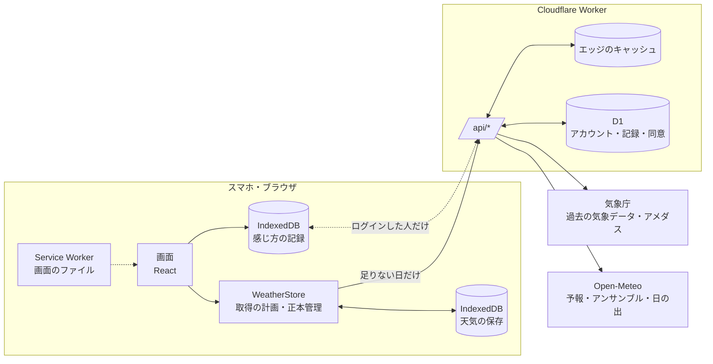

# Weather Note（Cloudflare版）

天気の実績と予報を、**対象日**と**比較日**の2つの日で並べて比べる、スマホ向けのアプリです（高知などの観測地点）。
「今日は去年の同じ日より暖かいか」「先週の売り出しの日と比べて雨はどうだったか」を、表・グラフ・時間帯で比べられます。
[weather-note](https://github.com/Watanabe-Masao/weather-note) を参考に、Cloudflare Workers で作り直したものです。

この README は、アプリの仕組みと計算の考え方を、コードを読まなくても追えるようにまとめた技術仕様です。画面の見た目と操作の決まりは [docs/design-system.md](docs/design-system.md) にあります。

**目次**

1. [全体の仕組み](#1-全体の仕組み)
2. [データの出どころ](#2-データの出どころ)
3. [データの扱い：確定・変わりうる・再確認・訂正](#3-データの扱い確定変わりうる再確認訂正)
4. [正本管理：どのデータを残すか](#4-正本管理どのデータを残すか)
5. [取得の順番と通信](#5-取得の順番と通信)
6. [比べ方：比較日の決め方](#6-比べ方比較日の決め方)
7. [計算の方法](#7-計算の方法)
8. [β版：ちょうどよい温度と範囲](#8-β版ちょうどよい温度と範囲)
9. [分析（research/）](#9-分析research)
10. [アプリとして使う（PWA）](#10-アプリとして使うpwa)
11. [API](#11-api)
12. [ファイルの構成](#12-ファイルの構成)
13. [テストと確認](#13-テストと確認)
14. [開発と公開](#14-開発と公開)
15. [出典](#15-出典)

---

## 1. 全体の仕組み



- **1つの Worker** が画面のファイルと API の両方を配ります。`/api/*` だけが Worker のコードを通り、それ以外は静的ファイルです。
- **API（Worker）** は気象庁と Open-Meteo からデータを取り、同じ形（`WeatherRow`）に揃えて返します。もう変わらないデータはエッジに長く保存し、同じ要求で外部サイトを何度も叩かないようにします。
- **アプリ** は受け取ったデータを端末（IndexedDB）に保存し、同じ日を二度取りに行きません。画面はいつも端末のデータを読むので、通信が遅くても切れても、あるものはすぐ表示されます。
- **`shared/`** の決まり（日付、確定の判定、肌感の式、信頼度、似た日）は、API とアプリが同じコードを使います。両者で判断が食い違うことはありません。

## 2. データの出どころ

| 期間 | 出どころ | 内容 |
| --- | --- | --- |
| 3日前以前 | 気象庁「過去の気象データ」（日別・時間別の表） | 確定した実績 |
| 一昨日・昨日 | 気象庁の表 ＋ アメダスの速報 | 表にまだ出ていない欄だけ速報で補う（暫定） |
| 今日 | アメダスの観測（済んだ時間） ＋ Open-Meteo の予報（これからの時間） | 時間ごとに混ざる |
| 明日〜15日先 | Open-Meteo の予報（16日分） | 予報。信頼度（A・B・C）付き |
| 日の出・日の入り | Open-Meteo | 計算値 |
| 信頼度 | Open-Meteo のアンサンブル予報（ECMWF IFS の51通り） | 予報のばらつき |

1977年1月1日以降の日を見られます（気象庁のデータの範囲）。

## 3. データの扱い：確定・変わりうる・再確認・訂正

データは2種類に分けて扱います。判定は `shared/fixed.ts` の1か所にあり、API とアプリの両方が使います。

**確定データ**：3日前以前で、気象庁がすべての値を出した実績。
- 日別：天気概況まであり、「まだ出ていない欄」がないこと。
- 月：その月の日がすべて1回ずつあり（重複・別の月の行がない）、どの日も確定であること。
- 時間別：1〜24時が**1回ずつ**あり、どの行も日付が一致し、まだ出ていない欄がないこと。件数だけでは判断しません（重複が欠けを隠すことがあるため）。

**変わりうるデータ**：それ以外（未確定の実績、一昨日〜今日、予報）。

**確定は「正本がそろった」という意味で、「もう変わらない」という意味ではありません**。気象庁が後から訂正することがあるので、次の3つを用意しています。

| 仕組み | 内容 |
| --- | --- |
| 再確認の期間 | 確定してから30日（月なら月末から30日）は、エッジには1日だけ保存し、アプリは起動ごとに1回取り直す。それより古いものは、エッジに1年、端末には永久に保存 |
| 訂正台帳 | `shared/corrections.ts` に訂正のあった期間（と地点）を1行書くと、エッジのキーと端末の保存の両方が、その期間だけ取り直す |
| 版数 | データの形（列の増減）が変わったときは `shared/versions.ts` の版数を1つ上げる。エッジと端末の両方が作り直される |

| 保存場所 | 確定データ | 変わりうるデータ |
| --- | --- | --- |
| エッジ（Worker） | 1年（再確認の期間は1日） | 保存しない。予報だけは地点ごとに30分（外部APIの負荷を抑えるため） |
| 端末（IndexedDB） | 永久（再確認の期間は起動ごとに1回取り直す） | 1回の起動につき1回取る |

［予報・速報を更新］は、端末の保存を飛ばして API に取り直す操作です。予報はエッジの30分保存の範囲で新しくなります（Open-Meteo に直接取り直すことは保証しません）。

## 4. 正本管理：どのデータを残すか

同じ日のデータが複数の出どころから届いたとき、どれを残すかは `src/data/authority.ts` の1か所で決めます。端末への保存はすべてここを通ります。

**出どころの順位**：気象庁の確定値 ＞ 気象庁の暫定値 ＞ アメダス速報 ＞ 予報

| 決まり | 内容 |
| --- | --- |
| 上書きの条件 | 順位だけでは決めない。同じ出どころなら、**要求が新しく**、**値がそろっている**方を残す。古い要求への答えや、値が欠けて返ってきたページは上書きしない |
| 確定データ | 原則として守る。ただし同じ出どころの新しく完全な値（正式な訂正）と、訂正台帳に載った訂正は反映する |
| 訂正と欠けたページの区別 | 訂正は「ページとしてそろった」気象庁の値からだけ反映する。値が空でもページがそろっていれば訂正（値の取り消し）、時刻や行が欠けたページは反映しない |
| 欠けている値 | 下位の出どころで**項目ごと**に補い、`origin` に出どころを残す。ただし予報は実測の欠けを埋めない。予報が補うのは、アメダスにない日射量と天気だけ |
| 時間ごとの出どころ | 時間別は1時間ごとに出どころ（`from`）を保存する。観測と予報が混ざった日でも、読み直したあとに各時間の出どころが変わらない |
| 読み直しの検査 | 端末の確定データは、読み込むたびに今の基準で確かめ直す。通らなければ未確定に戻して取り直す |
| 通信の競合 | ［保存データを消去］より前に出した要求の答えは捨てる。［更新］・日付の変わり目・消去のあとは、それより前に出した要求に相乗りせず新しく取り直す |

エラーは、利用者向けの決まった日本語だけを画面に出し、詳しい内容は Worker のログに残します（API 側は `SourceError`、アプリ側は `src/data/fetchJson.ts`）。

## 5. 取得の順番と通信

アプリのデータ層（`src/data/store.ts`）は、次の4つのルールで動きます。

1. **一度見た日は取り直さない**（メモリ → 端末の保存の順に探す）。
2. **進む方向を先に取る**（`plan.ts`）。表示中の7日 → 進行方向の30日 → 逆方向の7日 → 手が空いたときの先読み、の順。
3. **指が触れている間は画面を書き換えない**。届いたデータは、指を離したときに一度だけ反映する（ドラムが押し戻されないように）。
4. **日付を動かしても、変わりうるデータを取り直さない**。足りない日だけ取る。新しい「起動」（読み込み直し・日付の変わり目・［更新］）で、変わりうるデータは1回だけ取り直す。

通信は待ち行列（`queue.ts`）を通ります。

- 同じ要求は1つにまとめる（相乗り）。ただし更新・消去の区切りより前に出した要求には相乗りしない。
- 同時に走らせる数は、気象庁へ2本、予報へ1本まで。
- もう要らなくなった待ち（地点を変えた、画面を閉じた）は捨てる。
- 失敗したら 5秒 → 30秒 → 2分 の間隔で取り直す。画面には「N日分取得できませんでした［再試行］」を1つだけ出す。

画面の各部分は「欲しい日」を宣言するだけです（表示中の日、カレンダーの月、似た日の候補、β の過去60日など）。それぞれ持ち主の名前付きで、閉じれば取り下げられます。

## 6. 比べ方：比較日の決め方

比較日は、対象日からの決まり（`src/compare.ts`）で決めます。

| 比較のしかた | 比較日 |
| --- | --- |
| 前年同日 | 1年前の同じ月日（2月29日は比較なし） |
| 前年同曜日 | 1年前の同じ月日に最も近い同じ曜日（±3日以内） |
| 前日・前週・翌週 | 1日前・7日前・7日後 |
| カスタム | 対象日からの日数を自由に決める |

- **連動**：対象日を動かすと比較日も同じ決まりで動く。**個別**：比較日だけを動かせる。個別で動かして決まりから外れたら「カスタム」、決まりと一致したらその名前になる。
- 区間は日数で覚えます。連動と個別を切り替えても、画面に出ている組み合わせは変わりません。
- 端末に覚えるのは、連動・比較のしかた・日数・項目・日なた／日かげ。日付そのものは覚えません（開くと今日から）。
- **似た日から選ぶ**：過去3年の同じ季節（±15日）から、天気が近い日を探して比較日にできます（[7.4](#74-似た日)）。

## 7. 計算の方法

### 7.1 日ごとの値

- 最高・最低・平均気温、降水量、湿度、風速、日照時間は、気象庁の日別の表の値をそのまま使います（予報の日は Open-Meteo の日別値）。
- **寒暖差** ＝ 最高 − 最低。
- **日射量**（MJ/m²）は、日別の値がない地点では時間別の値を足し合わせます（夜の欠けは0として、24時間そろったときだけ）。
- **気圧の最高・最低** は時間別の値から求めます。
- 差はいつも「対象 − 比較」です。表示の桁で丸めてから差をとるので、「ほぼ同じ」なのに「−0」と出ることはありません。

### 7.2 肌感（日なた温度・日かげ温度）

風・湿度・日差しを含めた「その場の温度」を、時間ごとに計算します（`shared/feel.ts`）。

**人の高さの風**：観測の風速を、人の高さ（1.5m）の風に直します。

```
v = 観測の風速 × (1.5 ÷ 観測の高さ) ^ a
```

観測の高さは、実測なら設定の「風速計の高さ」（分からなければ10m）、予報なら10m。指数 a は設定の「周りの様子」で、開けた場所 0.14／住宅地 0.20／市街地 0.30／建物が密集 0.40 です（初期値は 0.40）。

**日かげ温度**（改良 Missenard 式。T 気温℃、H 湿度%、v 人の高さの風 m/s）：

```
A = 1.76 + 1.4 × v^0.75
日かげ温度 = 37 − (37 − T) ÷ (0.68 − 0.0014H + 1/A) − 0.29 × T × (1 − H/100)
```

**日なた温度**：日かげ温度に日差しの分を足します（オーストラリア気象局の体感温度の日射項）。

```
日なた温度 = 日かげ温度 + 0.7 × k × 日射(W/m²) ÷ (10m の風 + 10)
```

k は設定の「日差しの強さ」で、控えめ 0.12／標準 0.20／強め 0.28 です（初期値は 0.20）。日射量が測られていない時間（観測所に日射計がない、夜）は、日差しの分を足しません。

**7段階**：日なた温度または日かげ温度を、設定の6つの境目で「極寒・寒い・涼しい・ちょうどよい・暖かい・暑い・猛暑」に分けます（初期値は 5／10／15／21／25／29℃）。この7段は β の「感じ方の記録」（ASHRAE 55 の7段階）と同じ並びです。ただし境目は**表示のための区分**で、人の温冷感を測って決めた値ではありません。そのため β のモデルには使いません（β の出発点は固定値で、境目を動かしても β は変わりません。8章）。境目は設定の色の帯で調整できます。

**表示の段数（7段／5段／3段）**：計算はいつも7段で、表示だけをまとめます（設定 › 表示 › 肌感の段階）。狭い場所や一目で見たいときのための簡易表示です。

| 7段 | 極寒 | 寒い | 涼しい | ちょうどよい | 暖かい | 暑い | 猛暑 |
| --- | --- | --- | --- | --- | --- | --- | --- |
| 5段 | 寒い | 寒い | 涼しい | ちょうどよい | 暖かい | 暑い | 暑い |
| 3段 | 寒い側 | 寒い側 | 寒い側 | ちょうどよい | 暑い側 | 暑い側 | 暑い側 |

5段の境目は7段の内側4つ（初期値 10／15／21／25℃）、3段の境目はちょうどよいの両端（15／21℃）です。以前の5段階の設定（境目4つ）は、内側の4つとして引き継ぎ、外側の2つは隣の幅と同じだけ広げます（10／15／21／25 → 5／10／15／21／25／29）。

**時間帯**：朝（6〜8時）・日中（9〜11時）・昼（12〜14時）・夕方（15〜17時）・夜（18〜20時）の5つに分け、それぞれの時間の値を平均します。「その日の肌感」は日中・昼・夕方の平均で、3つそろわないときは出しません。

**時間別のデータがまだない日**：日別の最高・最低と、平均の湿度・風から、朝晩と昼の2つだけを「目安」として出します（日差しは入れません）。

### 7.3 信頼度（予報の A・B・C）

予報の日に付ける、アプリ独自の目安です（気象庁の週間予報の信頼度とは別物）。同じ予報を少しずつ条件を変えて計算した51通り（アンサンブル）の、ばらつきから決めます（`shared/confidence.ts`）。

| 要素 | A | B | C |
| --- | --- | --- | --- |
| 気温：最高・最低の標準偏差の大きい方 | 1.5℃以下 | 3℃以下 | 3℃より大きい |
| 雨：1mm以上降る計算の割合 | 20%未満か80%より多い | 20〜80% | 35〜65%（降るかどうかで割れている） |

気温と雨のうち低い方を、その日の信頼度にします。計算が5通りに満たない日には付けません。

### 7.4 似た日

対象日と天気が近い過去の日を、過去3年の同じ季節（対象日の月日の前後15日）から探します（`shared/similar.ts`）。

```
距離 = |最高の差| + |最低の差| + 2 × |雨の階級の差| + 2 × 天気の違い + 0.5 × |寒暖差の差|
近さ = 100 × e^(−距離 ÷ 8)
```

- 雨の階級：0／1mm未満／1〜10／10〜30／30mm以上。
- 天気：晴れ系・曇り系・雨系のどれか。違えば1、分からなければ0.5。
- 近い順に10日を出します。曜日（同じ曜日・土日祝・平日）で絞り込めます。

## 8. β版：ちょうどよい温度と範囲

数式・単位・成立条件・欠損の扱い・検証の状態の**正本**は [research/comfort-model/mathematical-contract.md](research/comfort-model/mathematical-contract.md)（MATH-01〜08 と決定の記録）です。この章はその要約です。

**β版は研究中の機能です**。肌感とは別の計算で、画面では「β」の印を付けて区別します。どの値にも［根拠］の画面があり、使った式・入力・出どころ・推定の幅をすべて見られます。

### 8.0 考え方

このアプリは、**その瞬間にその人が「ちょうどよい」（暑くも寒くもない）と感じる中心の温度**を推定し、今の温度がそこからどれだけ離れているかを見ます。

- 「ちょうどよい」は温冷感の中立（暑くも寒くもない）で、「快適」とは別のものとして扱います（暖かいけれど快適、ということもあるため）。快適かどうかは、必要になったら別の質問として記録します。
- 人の感覚には閾値があります。中心のまわりには「ちょうどよい」と感じる**範囲**があり、範囲の中では多少温度が変わっても感じ方は変わりません。範囲を出たところで「やや暖かい」「暖かい」と段階的に進みます。**感じ方は温度に比例しません**。
- その**中心の位置**も、**範囲の広さ**も、いつも同じではありません。暑い日が続けば中心は上がり（慣れ）、湿度や天気の落ち着き具合で範囲は広がったり狭まったりします。
- だから求めるべきものは「温度と感じ方の直線」ではなく、「中心と範囲がどう動いているか」です。

```
        極寒   寒い   涼しい ちょうどよい 暖かい  暑い   猛暑
  ─────┼──────┼───────┼───────────────┼───────┼──────┼─────▶ その場の温度
     μ−h−2g μ−h−g    μ−h       μ       μ+h    μ+h+g  μ+h+2g
                         └── ちょうどよい範囲 ──┘
            （μ も h も、慣れ・湿度・気温の振れで動く）
```

### 8.1 最近の基準（慣れ）

人は最近の気温に慣れます。その「慣れの基準」を、過去の日平均気温の移動平均で表します（建物の快適性の規格 EN 16798-1 の「屋外気温の移動平均 θrm」と同じ形。`src/beta/adaptation.ts`）。

```
最近の基準 A = Σ w_k × T_k ÷ Σ w_k     （T_k は k 日前の日平均気温、k = 1〜60）
w_k = (1 − α) × α^(k−1)
```

- **α（慣れの速さ）**：前の基準をどれだけ残すか（規格の向き）。標準は0.8です。研究メモでいう「更新率」（前日の重み）は 1 − α、両者で同じ意味になる半減期は ln 0.5 ÷ ln α（α＝0.8 なら約3.1日）。本人が選ぶものではなく、記録が30件たまったら、モデルの当てはまりがいちばんよい α を候補（0.6〜0.95）から選びます。
- 過去60日を見ます（慣れが遅い α でも、重みのほぼ全部が入る長さ）。
- データのある日の重みで割り直します。欠けた日を推測で埋めることはしません。
- 前日のデータがあり、重みの80%以上がそろったときだけ計算します。足りなければ「履歴不足」、まだ取得中なら「読み込み中」と表示します。
- 予報の日を含む基準には「予報含む」と付けます。

気温の日別グラフには、基準を細い線（チップ「最近の基準β」）で描きます。

### 8.2 ちょうどよい温度と範囲のモデル（複数のモデルを比べる）

`src/beta/engine/`（正本の項目ごとのファイル。入口は `src/beta/comfort.ts`）。位置と広さが動く順序モデルを、要因の組み合わせを変えて何通りも作り、並べて比べます。

**どのモデルにも共通の形**

```
ちょうどよい温度     μ  = m0 + Σ 係数 × 中心の要因
範囲の半分の幅 h  = exp( l0 + Σ 係数 × 範囲の要因 )
その場の温度   E′ = E + Σ 係数 × その場の要因 + 風のずれ
外の1段階の幅  g  = exp(q0)
境目のぼやけ   s  = exp(r0)

P(答え ≤ k) = σ( (境目_k − (E′ − μ)) ÷ s )      σ(x) = 1 ÷ (1 + e^−x)
境目 = μ ± h、μ ± (h + g)、μ ± (h + 2g)
```

- E はその場の温度です（日なた温度・日かげ温度、半々ならその平均）。観測所の風・湿度・日差しは、ここにすでに入っています。
- 範囲の中（μ ± h）が「ちょうどよい」で、その外は g ごとに1段階ずつ進みます。境目は s の幅でぼやけます。
- 風のずれ（wS・wN）は、その場で感じた風が、観測所の風と違う分です。

**要因の3つの種類**：何が感じ方を変えるかは、効く場所で分けます。

| 種類 | 意味 | 例 |
| --- | --- | --- |
| 中心の要因 | 「ちょうどよい」と感じる温度そのものを動かす | 慣れ、季節の向き、前日の変化、湿度 |
| 範囲の要因 | 「ちょうどよい」の幅を広げる・狭める | 1週間の気温の振れ、湿度 |
| その場の要因 | 人ではなく、その場の温度を動かす | 日中の日射の余熱、前夜の冷え込み |

**要因の一覧**（値がないときは「ふつう」として0）

| 要因 | 中身 |
| --- | --- |
| 最近の基準 | A − 15（℃） |
| 最近の基準（頭打ち） | min(30, max(10, A)) − 15（℃）。10〜30℃の外では動かない |
| 前日の気温の変化 | 前日の平均気温 − A（急な変化） |
| 季節の向き | 前の14日の日平均気温の傾き（℃/週）。＋は暖かくなる途中（春らしい）、−は寒くなる途中（秋らしい） |
| 暦の春らしさ（確認用） | cos(2π × (年の日 − 80) ÷ 365.25)。3月下旬が＋1、9月下旬が−1 |
| 湿度 | 1週間の平均・前日・今（10%ごと） |
| 1週間の気温の振れ | 前の7日の日平均気温の標準偏差 |
| 日照・雨 | 前日と1週間（日照は3時間ごと、雨は log(1+mm)） |
| 晴れている | 記録では見た空、日の表示ではその日の天気 |
| 日中の日射の余熱 | その日の朝からの日射量の合計（5MJ/m²ごと）。夜（18〜5時）だけ |
| 余熱 × 直近6時間の風 | 余熱が、それまでに吹いた風でどれだけ逃げるか |
| 前夜の冷え込み | 前日の最低気温 − A。昼だけ |
| 前夜の冷え込み × 前夜の風 | 前夜（18〜6時）の平均風速と掛け合わせる。風の強い冬の夜に地面がより冷え、翌日に残る、という仮説 |

風は「その瞬間の値」ではなく「それまでに吹いた量」（直近6時間・前夜の平均）として扱います。その瞬間の風速だけが体感を作っているわけではない、という仮説です。

**比べるモデル**

| モデル | 中心の要因 | 範囲の要因 | その場の要因 |
| --- | --- | --- | --- |
| M0 一定 | — | — | — |
| M1 慣れ | 最近の基準 | — | — |
| M2 慣れ＋1週間 | 最近の基準・1週間の湿度 | 振れ・今の湿度 | — |
| M3 慣れ＋前日 | 最近の基準・前日の変化・前日の湿度・日照・雨 | 振れ・前日の湿度 | — |
| M4 慣れ＋季節の向き | 最近の基準・季節の向き | 振れ・季節の向き | — |
| M5 全部 | 上のすべて＋1週間の日照・雨・晴れ | 振れ・湿度・日照・晴れ・季節の向き | 余熱・余熱×風・前夜の冷え・冷え×風 |
| M6 暦の季節（確認用） | 最近の基準・暦の春らしさ | 振れ・暦の春らしさ | — |
| M7 日射の余熱 | 最近の基準・季節の向き | 振れ | 余熱・余熱×風 |
| M8 地面の熱 | 最近の基準・季節の向き | 振れ | 余熱・余熱×風・前夜の冷え・冷え×風 |
| M9 慣れ（頭打ち） | 最近の基準（頭打ち） | — | — |

**春の15℃と秋の15℃**：同じ15℃でも、春は寒い冬の後なので最近の基準が低く、中心も低いので暖かく感じます。秋は暑い夏の後なので基準が高く、涼しく感じます。季節の向きは、さらに「暖かくなる途中か、寒くなる途中か」の違いを表します。暦の季節のモデル（M6）は確認用で、これが気温の履歴のモデルより強い証拠を得たら、春と秋の違いは気温の履歴だけでは説明しきれない（服装や日の長さなど）、ということになります。

**慣れの限界（M1 と M9）**：連日35℃が続いても、35℃が快適になるわけではありません。慣れには限界があります。M1 は最近の基準に比例して中心がどこまでも動きますが、M9 は基準が10〜30℃の外では中心が動きません（10〜30℃は EN 16798-1 が適応モデルを使う移動平均の範囲）。どちらが正しいかは決め打ちせず、記録で比べます。

**記録がないときの出発点（事前分布）**：固定の値から始めます。肌感の境目（表示の設定）からは作りません。境目は表示のための区分で温冷感を測った値ではないこと、また表示の設定を動かすと研究用のモデルまで動いてしまうことが理由です。

| 要素 | 出発点 | 幅 | 意味・根拠 |
| --- | --- | --- | --- |
| m0 | 18℃（最近の基準が15℃のとき） | ±4℃ | ちょうどよい温度。屋外の中立温度は研究によって大きく違うので、幅を広くとる |
| 最近の基準の係数 | 0.33 | ±0.15 | EN 16798-1 の適応快適温度の、移動平均に対する傾き |
| h | 3℃ | 対数で ±0.5 | ちょうどよい範囲の半分 |
| g | 4℃ | 対数で ±0.5 | 範囲の外の1段階 |
| その他の要因の係数 | 0 | 広め | 記録が示すまで効き方は 0 |

**尺度の注意**：最近の基準 A は日平均の気温、感じ方と比べる E は日なた温度・日かげ温度で、同じ物差しではありません。両者の差は m0（切片）と係数が吸収しますが、係数をそのまま「気温1℃あたり」と読むときは、この違いに注意が必要です。

**推定**：記録が増えるたびに、各モデルの事後分布の最頻値（準ニュートン法 BFGS）と、その周りの近似（ラプラス近似、コレスキー分解）を求め直します。重い計算は Web Worker で行うので、画面は止まりません。要因の95%区間が 0 をまたいでいれば「まだ分からない」、またがなければ「効いている」と表示します。

**比べ方と予測**

- 各モデルの「証拠の強さ」（周辺尤度のラプラス近似）を比べます。要因が多いほど不利になるので、当てはめすぎたモデルは得をしません。ここから各モデルの重みを出します。
- 画面の予測は、全モデルの予測を重みで混ぜたものです（ベイズモデル平均）。
- 送信のたびに、各モデルの予測も記録に残します。答えを知る前の予測同士の成績（対数損失・当たり）でも比べます。
- 慣れの速さ α は、記録が30件たまったら、M2 の証拠の強さがいちばん大きくなる値を候補（0.6〜0.95）から選びます。

**画面**：時間帯の要約の最後に、各日の「最近の基準」「ちょうどよい温度」「ちょうどよい範囲」と、日中の日なた・日かげ温度が中心から何℃か（範囲の中か、外ならどれだけ外か）を、対象日と比較日で並べます。根拠の画面には、モデルの比較表（要因・重み・成績）と、選んだモデルの各要素（初め・今・95%区間）を出します。

### 8.3 感じ方の記録

「ちょうどよい温度と範囲 β」の［今の感じ方を記録］（対象日が今日のとき）から記録します。

**選ぶもの（4つ）**

| 項目 | 選択肢 |
| --- | --- |
| 感じ方 | 極寒・寒い・涼しい・ちょうどよい・暖かい・暑い・猛暑（ASHRAE 55 の7段階にならった −3〜+3。肌感の7段と同じ言葉） |
| いる場所 | 日なた・日かげ・半々 |
| 風 | 強い・弱い・なし |
| 今の天気 | 快晴・晴れ・薄曇り・曇り・雨・雪 |

**自動で添えるもの**

- 送信した時刻と、画面を開いた時刻（通知から開くと、この2つがずれることがある）。
- その時刻の観測所の気温・湿度・風速・日射と、それぞれの出どころ（アメダス・予報）。
- その時刻の予報の天気（予報と実際の天気を突き合わせるため）。
- その時刻の日なた温度・日かげ温度。
- 最近の基準（α・半減期付き）と、基準との差。
- 過去60日の日平均気温。
- 直近7日の最高・最低・平均気温、湿度、日照、日射、降水、平均風速、天気（出どころ付き）。
- その日の朝からの日射量の合計（実測の時間数も。アメダスにない時間は予報の値）。
- 直近6時間・12時間の平均風速と、前夜（前日18時〜6時）の平均風速。
- **データからの予測**（[8.4](#84-記録の画面の予測)）。

記録は天気の保存とは別のデータベースに置きます。［保存データを消去］では消えず、天気データの版数を上げても作り直されません。設定から件数の確認・CSV の書き出し・消去ができます。

### 8.4 記録の画面の予測

予測は、送信した時点で必ず計算して、記録に残します（評価のため）。ただし画面に何を出すかは、学習の段階で変わります。

**予測が言っていることを3つに分ける**（「ちょうどよい」という1つの言葉にまとめない）：

| 何を | 式 | 意味 |
| --- | --- | --- |
| 範囲の中の位置 | z = (E′ − μ) / h | 範囲の端が ±1。同じ「ちょうどよい」の予測でも、寒い側寄り（z ≈ −0.8）か中ほど（z ≈ 0）かで、「寒い」と答えたときの意味が違う。95%区間も出す |
| 答えそのもののばらつき | E_θ[Var(Y │ θ)] | モデルが正しくても、同じ条件で答えが散らばる分（段の標準偏差） |
| 推定の不確かさ | Var_θ[E(Y │ θ)] | 記録が少なく、その人のことがまだ絞り込めていない分 |

- 確率は、パラメータの不確かさを積分した予測分布です：P(Y=k │ x, D) = ∫ P(Y=k │ x, θ) p(θ │ D) dθ。ラプラス近似の共分散（記録がないときは初期値の幅）からモデルごとに200通りのパラメータを引いて平均し、モデルの重みで混ぜます。記録が少ないうちは、確率は自然に広がります（初期値から「確信のある予測」を作らない）。
- 寒い側（−3〜−1）・ちょうどよい（0）・暑い側（+1〜+3）の確率の合計も出します。
- 記録には、予測の版（`version`）と、答えた尺度の版（`scaleVersion`）を残します。言葉を変えた尺度（2026-11 に「寒い〜暑い」→「極寒〜猛暑」）の前後を、分析で区別するためです。

**入力の品質**（`quality.ts`、MATH-02・03）：

- 欠けた入力を「典型的な値」として扱いません。その時点で入力が欠けているモデルは予測に参加せず、残りで重みを付け直します（M0 は必ず残る）。学習でも、各モデルは自分の入力がそろった記録だけを使い、モデルの重みは全モデルの入力がそろった記録どうしで比べます。
- 記録ごとに、気温の状態（確定・観測・予報・なし）、観測から記録までの分数、品質の印を出します。気温が予報の値の記録、観測が120分以上前の記録、最近の基準の履歴がない記録は、**保存しますが学習には使いません**。記録画面では送信前にそう表示し、設定には使った件数と使わなかった件数（理由）を出します。
- 記録には、日なた温度・日かげ温度の計算方式の版（`transform`）と、気象データを取得した時刻（`retrievedAt`）も残します。

**学習の段階**：件数ではなく中身で決めます（`learningOf`）。境目の数値は暫定で、データがたまったら見直します。

| 段階 | 条件 | 画面 |
| --- | --- | --- |
| 未学習 | 記録0件 | 予測は「初期値による参考」として答えの分布だけ。中心の温度は出さない |
| 情報不足 | ちょうどよいより寒い側と暑い側の両方の答えがない／温度の幅が5℃未満／記録した日が3日未満 | 答えの分布と、足りないもの。中心は「未特定」 |
| 暫定 | 中心 μ の95%区間が4℃より広い | 中心を区間つきで |
| 検証可能 | 区間が4℃以内 | 事前の予測の検証を始める |
| 検証済み | 検証可能の間に出した事前予測が20件以上あり、その RPS が「その人の過去の答えの割合」より良い | 同じ |

- **今日のちょうどよい温度は、その日最初の記録をするまで見せません**（要約の β の行と根拠の画面。「記録後に表示」）。先に見ると、答えがその数字に引っ張られるためです（記録画面で、感じ方を選ぶまで予測を見せないのと同じ理由）。ほかの日はいつでも見られます。
- 要約の β の行も、未学習・情報不足の間は中心・範囲・中心からの差を「未特定」とし、最近の基準（天気から計算できるもの）だけを出します。
- 成績（送信時の予測と答え）は、設定と根拠の画面に集計します。
  - 主な指標は RPS です。その人のそれまでの答えの割合（基準）と比べ、改善の割合（スキル）を出します。
  - そのほか、対数損失・当たり・偏り・平均のずれを出します。
  - 根拠の画面には、較正（寒い側・ちょうどよい・暑い側の予測の確率と、実際の割合）と、10件ごとの時系列も出します。
  - 直近10件が一方に0.5段以上ずれ続けたら、「感じ方が変わったかもしれない」と知らせます。
  - 評価するのは、今の尺度の版（3）で答えた記録だけです。集計するのは送信時に出した予測なので、後から当てはめ直した値ではなく、その時点の正直な成績です。後から学習し直しても、記録に残した予測は書き換えません。
- RPS（順位確率スコア）は、6つの累積確率の差の二乗和を **6で割った** 値（0〜1、0が最良）と定めます。

**答える前の予測の決まり**（記録の画面）：

- 予測は、本人の答えに引きずられないものでなければなりません。そのため予測を出すのは、感じ方を選んだ後だけです（先に見せると、答えが予測に寄ってしまうため）。予測の計算に、選んだ感じ方は使いません。
- 予測は、送信した時点の観測値で計算し直して記録します（通知の時刻や画面を開いた時刻ではありません）。
- アプリを開いた直後（通知から開いたときなど）は、モデルがまだこの人の記録で学習し終えていないことがあります。また、今日の観測がまだ届いていないこともあります。どちらかが揃うまでは［記録する］を押せません（「これまでの記録から学習中…」「今日の観測を読み込み中…」と表示）。学習前の初期値の予測が、本物の予測として残るのを防ぐためです。電波がなく観測を取れなかったときは、予測なしで記録します。

### 8.5 CSV の列

設定 ＞ ちょうどよい温度と範囲 β ＞［CSVを書き出す］。Excel で開けるよう、BOM 付きの UTF-8 です。主な列は次のとおりです。

| 列 | 内容 |
| --- | --- |
| `at_jst`, `opened_at_jst`, `notified_at_jst` | 送信した時刻、画面を開いた時刻、通知の時刻（通知から開いたとき） |
| `sensation`, `sensation_label` | 答え（−3〜+3）と言葉 |
| `exposure`, `wind_felt`, `sky_reported` | いる場所、風、今の天気 |
| `comfort_mu`, `comfort_half_range`, `comfort_step`, `comfort_blur` | 送信時のちょうどよい温度 μ、範囲の半分 h、外の1段階 g、ぼやけ s |
| `comfort_offset`, `comfort_beyond` | その場の温度 − 中心、範囲の外にはみ出した分（中なら0） |
| `pred_mode`, `pred_expected`, `p_m3` 〜 `p_p3`, `pred_n`, `pred_alpha`, `pred_error` | 混ぜた予測（最も確率の高い段階・期待値・各段階の確率）、学習に使った件数、α、答え − 期待値 |
| `pred_models` | 各モデルの予測（`id:重み:最も確率の高い段階:中心:範囲の半分` を `;` 区切り） |
| `rad_day_mj`, `rad_day_measured_h` | その日の朝からの日射量の合計、そのうち実測の時間数 |
| `wind_6h`, `wind_12h`, `wind_last_night` | 直近6時間・12時間・前夜の平均風速 |
| `sky_forecast`, `sky_forecast_code` | その時刻の予報の天気 |
| `temp`, `humidity`, `wind`, `solar_w_m2` と `*_from` | 観測所の値と出どころ |
| `sun_temp`, `shade_temp` | 日なた温度、日かげ温度 |
| `baseline`, `baseline_alpha`, `update_rate`, `half_life_days` | 最近の基準と α の3つの言い方 |
| `dep_air`, `dep_sun`, `dep_shade` | 基準との差 |
| `history_60d` | 過去60日の日平均気温（新しい順、`;` 区切り） |
| `d1_*` 〜 `d7_*` | 1〜7日前の平均・最高・最低・湿度・日照・日射・降水・風速・天気・出どころ |
| `id` | 記録のID |
| `scale_version`, `model_version` | 答えた尺度の版（1：寒い〜暑い、2：極寒〜猛暑で0が「快適」、3：0が「ちょうどよい」）、予測の版 |
| `learning_state` | 予測したときの学習の段階（untrained / sparse / provisional / testable / verified） |
| `p_cold`, `p_neutral`, `p_warm` | 寒い側・ちょうどよい・暑い側の確率 |
| `pred_z`, `pred_z_lo`, `pred_z_hi`, `pred_mu_lo`, `pred_mu_hi` | 範囲の中の位置 z とその95%区間、中心 μ の95%区間 |
| `sd_answer`, `sd_param` | 答えそのもののばらつき、推定の不確かさ（段の標準偏差） |
| `input_status`, `input_lag_min`, `input_flags`, `train_excluded_reason` | 気温の状態、観測から記録までの分、品質の印、学習に使わなかった理由（使ったときは空） |
| `pred_models_excluded`, `pred_inputs_missing` | 入力が欠けて予測に参加しなかったモデルと、その入力 |
| `feel_transform`, `retrieved_at` | 日なた温度・日かげ温度の計算方式の版、気象データを取得した時刻 |

後から足した列は `id` の後ろに並べるので、前からある列の位置は変わりません。

### 8.6 アカウントと記録の保存（ログイン）

感じ方の記録と「ちょうどよい温度と範囲 β」は、管理者が発行したアカウントでログインした人だけが使えます。天気の表示はログインなしで使えます（公開データなので守るものがありません）。

**アカウントの発行**：自分で登録する入口はありません。管理者が［設定 › アカウント › ユーザー管理］でログインIDを決めると、サーバーがパスワード（16文字、見間違えやすい文字を除いた乱数）を作り、その場で一度だけ表示します。それを本人に渡します。

- パスワードを忘れたら［再発行］。古いパスワードは使えなくなり、その人のログイン中の端末もすべてログアウトされます。
- ［停止］すると、すぐにログアウトされ、ログインもできなくなります。［再開］で戻ります。
- 最初の管理者は、初期設定コード（Cloudflare の秘密の値 `SETUP_CODE`）を知っている人が一度だけ作れます。アカウントが1つでもできると、初期設定は閉じます。

**守り方**

| 何を | どう守るか |
| --- | --- |
| パスワード | 保存するのはソルト付きの PBKDF2（SHA-256）の値だけ。データベースを見てもパスワードは分からない。パスワードは人が決めず、いつもサーバーが作る（推測できない長さ） |
| 総当たり | 同じIDで5回間違えると15分ロック。エラーは「IDかパスワードが違います」だけで、IDが存在するかも分からない（存在しないIDでも同じだけ計算する） |
| ログインの状態 | 外から読めない Cookie（HttpOnly・Secure・SameSite=Strict、`/api` だけ）。サーバーには Cookie の値のハッシュだけを保存。180日、使うたびに延長 |
| 他のサイトからの操作 | 送信は JSON のみ、Origin が自分のサイトでなければ拒否 |
| 他の人の記録 | 誰の記録かはサーバーがログイン情報から決める。画面から送られた ID は使わない |
| データベース | インターネットから直接は届かない。触れるのはこの Worker のコードだけ。1人2万件・1回200件・1件64KB まで |
| 管理の操作 | 管理者のアカウントだけ（サーバーで役割を確認） |

**記録の同期**：同じIDでログインした端末どうしで、記録がそろいます。

- サーバーは、人ごとに変更の番号（seq）を付けて記録します。端末は前回の同期の後に変えた記録を送り（100件ずつ）、前回見た番号より後の変更を受け取ります（200件ずつ）。
- サーバーも端末も、自分の写しより新しい（`updatedAt` が大きい）ものだけを受け取ります。どの端末がどの順で同期しても、最後は同じ記録になります。削除も変更の1つ（`deleted`）として届きます。
- 2台が同時に送っても、番号は1つの処理（トランザクション）の中で振るので重なりません。
- 同期するとき：ログインしたとき、アプリを開いたとき、記録を変えて3秒後、電波が戻ったとき、前面に戻ったとき、［今すぐ同期］。

**1台を複数の人で使うとき**：記録には持ち主（`owner`）が付きます。ログインしている人の記録だけを送り、表示し、計算に使います。ログイン前に作った記録は、最初にログインした人のものになります。ログアウトすると、サーバーに届いている自分の記録はこの端末から消えます（サーバーには残り、再ログインで戻ります）。届いていない記録は端末に残し、次のログインで送ります。

**分析の土台**：データベース（Cloudflare D1）の表は次のとおりです。表はWorkerが起動時に作ります（`ensureSchema`）。

| 表 | 中身 |
| --- | --- |
| `users` | ID、ログインID、名前（任意）、役割、パスワードのハッシュ、**研究用の番号**（ログインIDとは無関係の乱数）、同期の番号、ロック、停止 |
| `sessions` | ログイン中の端末（Cookie のハッシュ、期限） |
| `reports` | 記録。**本文をそのまま**（JSON）と、分析で絞り込む列（日時・地点・感じ方・いる場所・風・空）。持ち主と番号 |
| `consents` | 研究への同意の**履歴**（同意・取り消し、版、時刻）。上書きせず積み重ねる |
| `research_reports`（ビュー） | 最新の答えが「同意」の人の、削除されていない記録だけ。名前・ログインIDは含まず、研究用の番号で並ぶ |

- 研究への協力は［設定 › アカウント › 研究への協力］で本人が選びます。初めは「協力しない」です。取り消すと、以後の分析（ビュー）から外れます。
- 管理者は［ユーザー管理 › 研究用CSVを書き出す］で、ビューの中身を CSV にできます。列は 8.5 と同じで、先頭に `research_id` が付きます。
- 本文をそのまま残しているので、あとで分析したい項目が増えても、記録を取り直す必要はありません。

### 8.7 記録の入口と通知

**いつでも記録**：ログインしている間は、画面右上に［記録］があります。どの画面・どの日を見ていても、今の感じ方を記録できます（要約の［今の感じ方を記録］も同じ画面です）。

**通知**：［設定 › アカウント › 記録の通知］で、記録を促す通知の時刻（最大6つ）と曜日を決めます。時刻と曜日はアカウントの設定で、同じIDの端末すべてに届きます。通知を受け取る端末では、［この端末で受け取る］を押して許可します。

- iPhone・iPad は、ホーム画面に追加したアプリでだけ通知を受け取れます（iOS 16.4 以降）。
- 通知を押すと、記録の画面が開きます。通知の時刻（`notifiedAt`）も記録に入るので、通知から記録までの時間を分析できます。予測は、これまでどおり送信した時点で計算し直します。
- 初期の時刻は、肌感マップの5つの時間帯の真ん中（朝 7:00・日中 10:00・昼 13:00・夕方 16:00・夜 19:00）です。記録が、比べられる時間帯の中に入るようにするためです。設定では時間帯ごとに押して足し外しでき、ほかの時刻も足せます。通知の文言も時間帯に合わせます（「昼の感じ方は？」）。
- 設定した時点で過ぎていた時刻は、次の日から通知します。ログアウトすると、その端末の通知は止まります。

**送り方（Web Push）**：

| 部分 | 内容 |
| --- | --- |
| 定時の実行 | Cloudflare の Cron Trigger で5分ごと（`wrangler.jsonc`）。時刻から15分以内の通知を送る。送った枠は `notify_log` に記録し、同じ枠を二度送らない |
| 鍵（VAPID） | サーバーが初めて使うときに自動で作り、データベースに保存する。手作業はいらない |
| 暗号化 | 通知の中身は、受け取る端末だけが読めるように暗号化する（RFC 8291 aes128gcm、ライブラリなし、WebCrypto のみ）。RFC の例と同じ結果になることをテストで確認 |
| 届かない端末 | 通知サービスが「もうない」（404・410）と答えた端末、続けて失敗する端末は登録から外す |

表：`push_subscriptions`（端末ごとの通知の宛先）、`notify_settings`（時刻・曜日）、`notify_log`（送った枠と端末数）、`server_keys`（VAPID の鍵）。

## 9. 分析（research/）

**βモデルの検証**：[research/comfort-model/](research/comfort-model/README.md) に、数学的正本と、合成データによる検証（答えの分かっている仮想の人で、取り戻せるか・推定できないと言えるか・学習の段階の境目）があります。

**研究用の分析データ**：[research/data/](research/data/README.md) で、同意した人の記録を管理者が読み取り専用で取り出し、DuckDB と Parquet の表（答え・気象・予測・計算・成績を分けたもの）にします。データはコミットしません。撤回した人は過去の写しからも消えます。

アプリの外で、CSV を使って行う分析です（numpy と scipy だけを使います）。アプリの動きには影響しません。詳しくは [research/README.md](research/README.md)。

- **`compare_models.py`**：最近の気温の効き方の形を比べます。
  - 比べる形：直線・対数・べき乗・上昇と下降で非対称な対数。
  - α の候補ごとに当てはめ、早い 70% の記録で学び、遅い 30% で確かめます（RMSE・MAE）。BIC も出し、順序ロジットの対数損失も出せます。
- **`bayes_index.py`**：前日・直近1週間の湿度・日照・雨・天気、申告した風・空が感じ方にどう効くかを、ベイズ線形回帰で推定します。
  - 各要因の効き方を、95% 信用区間付きで出します。
  - 周辺尤度で、その場の温度だけのモデルと比べます。
  - 要因のまとまりごとの寄与に分けた指数を作り、係数を JSON で書き出せます。
  - 予報の天気と見た空の突き合わせ表も出せます。

アプリの中のモデル（ちょうどよい温度と範囲）は、要因を少なく絞っています。ここで別の要因や形が、新しい期間でもはっきり効き続けたときに、モデルの要因に加えるかを決めます。

## 10. アプリとして使う（PWA）

ホーム画面に追加すると、アプリとして全画面で開けます。

- **iPhone**：Safari でサイトを開き、共有ボタン →［ホーム画面に追加］。
- **Android**：Chrome のメニュー →［アプリをインストール］。

Service Worker（`public/sw.js`）は、画面のファイルだけを扱います。

| 対象 | 扱い |
| --- | --- |
| ページ | ネットを優先する（新しい版が次に開いたときに届く）。電波がないとき、サーバーがエラーを返したとき、4秒待っても返事がないとき（電波が弱いとき）は保存した版を使う。遅れて届いた返事で保存した版は更新する |
| 名前にハッシュの付いたファイル（`/assets/*`） | もう変わらないので、保存した版を優先する。**全部**をインストール時に保存する（後から読むβの計算用ワーカーも） |
| アイコン・manifest | 保存した版をすぐ使い、裏で新しくする |
| API | 扱わない。天気データは IndexedDB と正本管理の決まりのまま（保存した API の返事を使うと、正本管理の鮮度の決まりを飛び越えてしまうため） |

**版の入れ替え**：ビルドのときに、`/assets/` の全ファイルの一覧と、その一覧から作った版番号を `sw.js` に書き込みます（`vite.config.ts` の `serviceWorkerManifest`）。

- 公開するたびに `sw.js` の中身が変わるので、ブラウザは新しい Service Worker を入れます。新しい版はファイルをすべて保存してから切り替わります。
- 古い保存は消しますが、**1つ前の版だけは残します**。公開の直前に開いていた画面が、自分の版のファイル（サーバーからはもう消えている）を後から読めるようにするためです。保存は増え続けず、最大で2版分です。
- βの計算用ワーカーが読めなかったとき（保存前にオフラインになった、など）は、画面の側で計算します。「計算中」のまま止まることはありません。

電波がなくても、保存してあるデータで起動し、「オフラインです」と表示します。

## 11. API

| パス | 内容 |
| --- | --- |
| `GET /api/stations` | 観測地点の一覧 |
| `GET /api/daily?station=47893&month=2025-11` | 気象庁の日別実績（1か月分） |
| `GET /api/hourly?station=47893&from=2025-11-01&to=2025-11-07` | 気象庁の時間別実績（最大14日、今日より前） |
| `GET /api/recent?station=47893&date=2026-11-09` | 一昨日・昨日の速報（アメダス） |
| `GET /api/current?station=47893` | 今日の観測（アメダス） |
| `GET /api/forecast?station=47893` | 16日間の予報（今日＋15日）と信頼度（Open-Meteo）。エッジに30分保存 |
| `GET /api/sun?station=47893&date=2026-11-10` | 日の出・日の入り（今日＋15日まで） |

| `GET /api/auth/me` | ログイン中の人（いなければ `null`）と、初期設定ができるか |
| `POST /api/auth/login` | `{ loginId, password }` でログイン（Cookie が付く） |
| `POST /api/auth/logout` | ログアウト |
| `POST /api/auth/setup` | `{ code, loginId, name }` で最初の管理者を作る（初期設定コードが必要、一度だけ）。パスワードを返す |
| `POST /api/me/consent` | `{ granted }` 研究への協力の答え（履歴に積む） |
| `POST /api/reports/sync` | `{ push: [記録…], since: 番号 }` 送って受け取る。答え `{ taken, total, reports, seq, more }` |
| `GET /api/me/notify` ・ `POST /api/me/notify` | 通知の設定（`{ enabled, times, days }`）と、受け取る端末の数 |
| `GET /api/push/key` | 通知の公開鍵（VAPID） |
| `POST /api/push/subscribe` ・ `POST /api/push/unsubscribe` | この端末の通知の登録・解除 |
| `POST /api/push/test` | 自分の端末にテストの通知を送る |
| `GET /api/admin/users` | 管理者：ユーザーの一覧（記録の件数、研究への協力） |
| `POST /api/admin/users` | 管理者：`{ loginId, name }` でアカウントを作る。パスワードを返す（この1回だけ） |
| `POST /api/admin/users/reset` | 管理者：`{ id }` パスワードの再発行（その人のログインはすべて終わる） |
| `POST /api/admin/users/disable` | 管理者：`{ id, disabled }` 停止・再開 |
| `GET /api/admin/research?offset=&dataset=` | 管理者：研究用のビューの記録（1000件ずつ）。取り出すたびに記録を残す。最初のページに撤回した人の番号（`withdrawn`）を付ける |
| `GET /api/admin/exports` | 管理者：研究用データの書き出しの記録（直近200回） |
| `POST /api/admin/users/delete` | 管理者：`{ id, confirm }`（confirm はログインID）でアカウントとその人の記録をすべて消す。研究用の写しから外すため、撤回として記録する |

エラーは `{ "error": "日本語の文言" }` で返します（入力の誤りは 400、取得の失敗は 502。アカウントでは、ログインが必要 401、権限がない 403、ロック中 429、データベースの準備がない 503）。

## 12. ファイルの構成

| 場所 | 内容 |
| --- | --- |
| `src/` | 画面（React + TypeScript、Vite でビルド） |
| `src/data/` | データ層：`store.ts`（4つのルール）、`plan.ts`（取る順番）、`queue.ts`（通信の待ち行列）、`authority.ts`（正本管理）、`db.ts`（IndexedDB）、`fetchJson.ts`（API の呼び出しとエラーの文言） |
| `src/ui/` | 画面の部品。共通の部品は `kit.tsx` |
| `src/design/` | デザインの値（色・大きさ・動き）と数値の書き方 |
| `src/beta/` | β版：最近の基準（`adaptation.ts`）、ちょうどよい温度と範囲のモデル（`engine/`：正本の項目ごとのファイル。入口は `comfort.ts`）、感じ方の記録（`reports.ts`）、記録の同期（`sync.ts`・`useSync.ts`）、根拠の画面 |
| `src/account/` | アカウント：ログイン中の人（`account.ts`）、設定のアカウント欄、ユーザー管理の画面 |
| `worker/src/` | API（Cloudflare Worker）：気象庁・Open-Meteo からの取得と変換、エッジのキャッシュ、アカウントと記録の保存（`accounts.ts`、D1） |
| `shared/` | 画面と API で共有：型、日付、確定の判定、訂正台帳、版数、肌感の式、信頼度、似た日、祝日 |
| `public/` | そのまま配るファイル：PWA（manifest・アイコン・Service Worker）、キャッシュの指定（`_headers`） |
| `research/` | CSV を使う分析（Python） |
| `docs/design-system.md` | 画面の決まり（色・数値・部品・操作・β の表示） |
| `test/` | 単体テスト（気象庁・Open-Meteo の実データを `fixtures/` に保存） |

## 13. テストと確認

`npm run check` で、型チェック・単体テスト・ビルドをまとめて行います。単体テストで確かめていることは次のとおりです。

- 気象庁・Open-Meteo の実データの読み取り、API のキャッシュとエラー。
- データ層の受け入れ基準（同じ日を取り直さない、進む方向から取る、指が触れている間は書き換えない、端末からの復元）。
- 正本管理（順位、取得時刻、完全性、訂正、項目ごとの補完と出どころ、通信の競合）。
- 確定の判定（時刻の重複・欠け）、訂正台帳。
- 比較日の決まり、信頼度、肌感、似た日。
- β：最近の基準、ちょうどよい温度と範囲のモデル。作った記録で、次を確かめています。
  - 範囲の中では感じ方が平らで、外に出ると段階が進むか。
  - 前日の変化・春と秋・夜の余熱とそれが風で逃げる効果・感じた風を取り戻せるか。
  - 本当の要因を持つモデルに重みが集まり、何も効いていないときは単純なモデルが勝つか。
  - 記録と CSV の中身。

新しく足したテストの多くは、直す前の動きに戻すと失敗することも確かめています。画面の操作は、モックの API を使ったブラウザでの操作テスト（スマホ幅）でも確かめています。

## 14. 開発と公開

**βモデルの回帰テスト**：`test/data/comfort-golden.test.ts` が、決まった入力に対するモデルの出力を固定しています。出力の値は `comfort-golden.json` に入っています。モデルを意図して変えたときは、次のコマンドで値を書き直します。そのときは、理由を PR と正本の「変更の記録」に書き、`MODEL_VERSION` を上げます。

```
UPDATE_GOLDEN=1 npx vitest run test/data/comfort-golden.test.ts
```

Node.js 22 を使います。

```sh
npm ci
npm run dev       # 画面と API をローカルで起動（Vite + Cloudflare プラグイン）
npm run check     # 型チェック、テスト、ビルド
```

**公開**：Cloudflare Workers Builds で、main へのマージごとに自動で公開されます。プルリクエストごとにプレビューの URL も作られます。

1. Cloudflare のダッシュボードで「Workers & Pages」→「作成」→ リポジトリをインポートし、このリポジトリを選ぶ。
2. ビルドコマンド `npm run build`、デプロイコマンド `npx wrangler deploy` を指定する。
3. データベース（D1、名前 `weather-note`）は、最初の公開のときに自動で作られます。表は Worker が作るので、手作業はいりません。
4. **初期設定コード**：「Workers & Pages」→ weather-note-cf →「設定」→「変数とシークレット」で、種類「シークレット」、名前 `SETUP_CODE`、値に推測されにくい文字列を入れて保存する。アプリの［設定 › アカウント › 初期設定（最初の1回）］で、このコードと管理者のログインIDを入れると、管理者ができてパスワードが表示されます。管理者ができた後は、`SETUP_CODE` を消しても構いません。

## 15. 出典

- 実績：[気象庁ホームページ](https://www.jma.go.jp/)（過去の気象データ、アメダス）のデータを加工して表示しています。
- 予報・アンサンブル・日の出日の入り：[Open-Meteo](https://open-meteo.com/)（CC BY 4.0）。
- 移動平均による慣れの基準：EN 16798-1（屋外気温の移動平均 θrm）。
- 感じ方の7段階：ASHRAE 55 の温冷感尺度。
