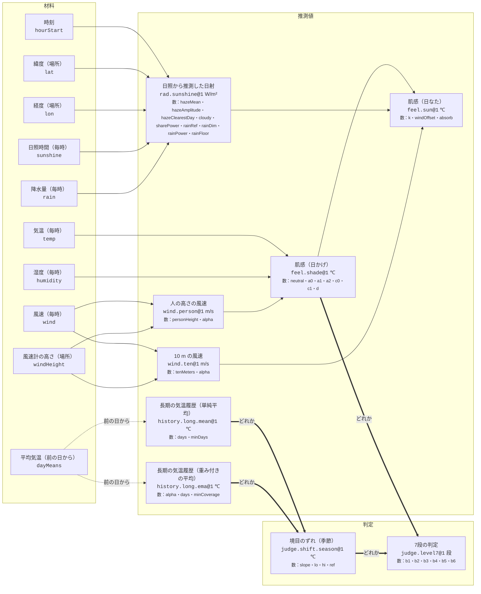
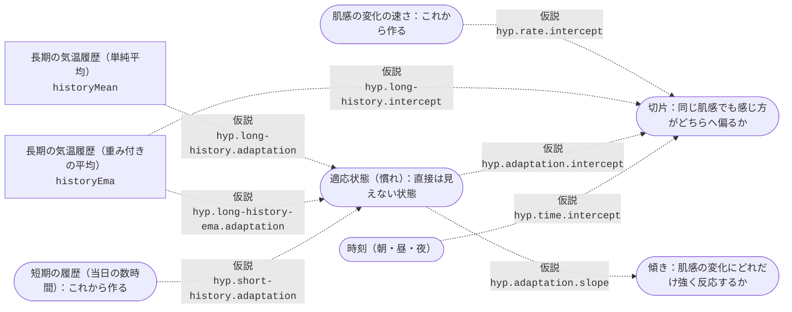

# core の依存の図

`src/core/map.ts` が計算式の `needs`・`series`・`params` から作る図（`npm run core-map`）。手で直さない。計算式を足す・変えると、テストがこの文書との違いを知らせる。

## 計算上の依存

どの値から計算するか。コード（計算式の `needs`・`series`・`choices`）からだけ作る。線があることは、効くことが確かめられたという意味ではない。

## 仮説上の影響

何が何に効くと考えているか（研究上の主張、`src/core/hypotheses.ts`）。状態は、答えの1歩先の予測で比べた結果だけが変える（仮説 → 確かめ中 → 支持／支持されない）。

## 確かめられた関係

まだない。学習あり版の比べた結果（効果の大きさと幅つき）から作る。手で書かない。
