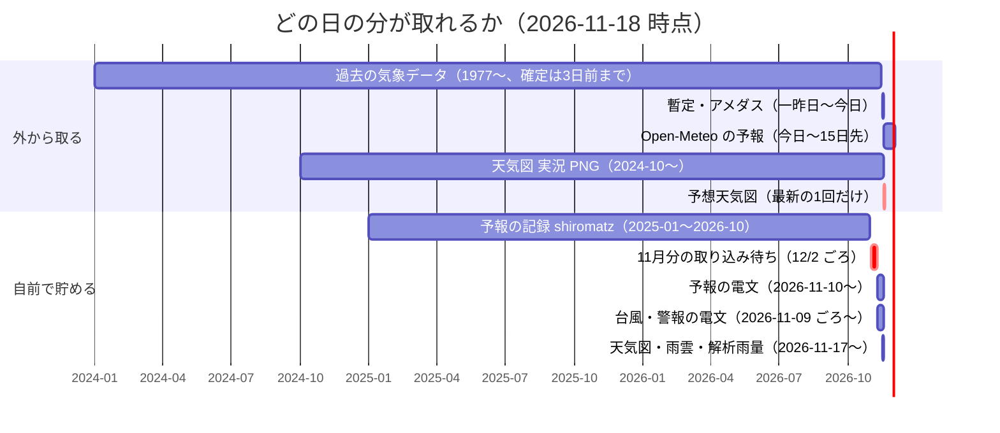
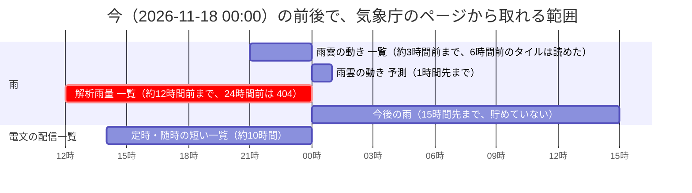

# データの地図：外から取るもの・自前で貯めるもの

Weather Note が使うデータを、**外から取りに行くもの**（取りに行ったときの姿だけを使う）と、**自前で貯めるもの**（取りに行ったものを D1・R2 に残す）に分けてまとめます。どれも「どこから・いつの分が取れるか（有効区間）・何に使うか・後から取り直せるか」を書きます。

- 最終更新：2026-11-18（#281 までを反映）
- 決まりの本体：要件定義書「予報の履歴」（R1〜R7）、[README](../README.md)、[docs/thread-rules.md](thread-rules.md)
- 量・止まったときの見張り：`/api/health`（毎時の見張りが判断して管理者に知らせる、`worker/src/healthWatch.ts`）

## 1. 外から取りに行くもの

画面を開いたとき（または定時の処理で）取りに行き、エッジや端末に一時的に置くだけのものです。自前で貯めるものは 2 章。

| データ | 出どころ | 取れる範囲（有効区間） | 取り方・間隔 | 画面での使い道 | 後から取り直せるか |
| --- | --- | --- | --- | --- | --- |
| 日別・時間別の実績 | 気象庁「過去の気象データ」（www.data.jma.go.jp/obd/stats/etrn） | 1977-01-01〜3日前（確定）、一昨日・昨日は暫定 | 必要な日だけ。確定は端末に永久、エッジに1年 | 表・グラフ・1日モードの実績、予報の移り変わりの「実績」 | できる（気象庁が長く公開） |
| アメダスの最新 | 気象庁 防災情報のアメダス（www.jma.go.jp/bosai/amedas） | 今日と、表がまだ出ていない一昨日・昨日 | 開いたとき | 今日の済んだ時間、速報で表を補う | 数日で表に置き換わる（表で取り直せる） |
| 16日間の予報・信頼度 | Open-Meteo（予報・アンサンブル ECMWF IFS 51通り） | 今日〜15日先 | 地点ごとにエッジで30分共有 | 予報の日・これからの時間、信頼度 A・B・C | 過去の予報は Open-Meteo の Previous Runs で引ける（R3、まだ使っていない） |
| 日の出・日の入り | Open-Meteo（予報／過去は archive） | 1977〜15日先（計算値） | 必要な日だけ | 1日の流れ・明るさ | できる（計算値） |
| 天気図（実況） | 気象庁ホームページ（yoho/data/wxchart/quick） | 2024-10〜今（3時間ごとの PNG）。2022-12〜は保存用天気図 PDF、2002-01〜は日々の天気図 PDF（どちらも約3か月遅れ）、それより前は国会図書館 | 画像をそのまま表示 | 1日モード③の天気図 | 気象庁が残す範囲ならできる（保存もしている、2 章） |
| 予想天気図 | 気象庁 weather_map の一覧（list.json） | **いちばん新しい1回分だけ**（24・48時間後） | エッジで30分共有 | 先の日の天気図 | できない（保存している、2 章） |
| 近づいている台風 | 気象庁 防災情報の台風 JSON | **今の分だけ** | 開いたとき、エッジで30分共有 | 台風のカード・目安の通知 | できない（電文を保存している、2 章） |
| 台風の実際の進路 | 気象庁 RSMC Tokyo ベストトラック（bst_all.zip） | 1976〜、年に数回の更新 | GitHub Actions でまとめて `public/data/typhoon-tracks.json` に | 台風の日・過去の台風 | できる |
| 祝日 | 内閣府「国民の祝日」CSV | 公表された年まで | 年に1回、手で `shared/holidays.ts` に | 比較日の決め方 | できる |
| 使用量 | Cloudflare の GraphQL（読み取り専用のトークン） | 今月 | `/api/health` を作るとき | 管理：無料枠に対する使用量 | できる（今月分） |

## 2. 自前で貯めているもの

定時の処理（5分ごと、`worker/src/index.ts` の scheduled）で取りに行き、D1（表）か R2（ファイル）に残します。**どれも、取りに行かなければ後から取れないもの**です。

| データ | いつから | 間隔・範囲 | 置き場所 | 中身 | 使い道 | 見張り |
| --- | --- | --- | --- | --- | --- | --- |
| 予報の電文（府県天気予報 VPFD51・週間 VPFW50・概況 VPFG50） | 2026-11-10（初回に7日分さかのぼった） | 発表ごと（府県 5・11・17時、週間 11・17時ほか）。使っている地点の予報区 | D1 `forecast_telegrams`（原文）、読んだ値は `forecast_issues`・`forecast_entries`。原文は R2 `telegrams/forecast/` にも | 天気・3時間ごとの天気・降水確率・最高最低と予測範囲・信頼度・概況 | 1日モード③「この日の予報の移り変わり」（R6） | 届かない回・取れない回（R5-3）、毎時の見張り |
| 予報の記録（shiromatz、気象庁の予報 JSON の記録、CC BY-SA 4.0） | 2025-01〜2026-10 取り込み済み | 1か月ずつ（管理画面から）。11月分は 12/2 ごろ | D1 `forecast_issues`・`forecast_entries`（`source = shiromatz`）、取り込みの記録 `forecast_imports` | 電文と同じ形の値（3時間ごとの天気は無い） | 11/9 以前の日の予報の移り変わり、電文の取りこぼしの補い | 取り込める月が出たら知らせる（#262） |
| 台風の電文（VPTW6x） | 2026-11-09 ごろ（初回に7日分） | 発表ごと（全国） | D1 `typhoon_telegrams`、R2 `telegrams/typhoon/` | 予想進路・予報円・暴風警戒域・中心気圧など | 台風の「当時の発表」 | 取れない回が続いたら知らせる |
| 警報・注意報の電文（高知県 VPWW53・VPWW55〜61） | 2026-11-10 ごろ（初回に7日分） | 発表ごと | D1 `warning_telegrams`、R2 `telegrams/warning/` | 警報・注意報（R06 の大雨・土砂・高潮・暴風・波浪・大雪・その他） | その日に何が出ていたかの記録（読み取りはこれから） | 取得の失敗を `/api/health` に |
| 随時の気象防災速報（高知県 竜巻注意情報 VPHW50・51、記録的短時間大雨情報 VPOA50、府県気象防災速報 VPBS50） | #281 のマージから | 出たときだけ | 警報と同じ表 | 竜巻注意・記録的短時間大雨・顕著な大雨など | 同上 | 同上 |
| 天気図（実況・予想天気図） | 2026-11-17 | 実況は3時間ごと、予想は発表ごと | R2 `wxchart/quick/`・`wxchart/forecast/`、D1 `wxchart_saved` | PNG のまま | 予想天気図をあとから見る（気象庁は最新しか置かない） | 1時間止まると注意 |
| 雨雲レーダー（高解像度降水ナウキャストの実況、その瞬間の強さ mm/h） | 2026-11-17（#276） | 30分ごと（毎時0分・30分）、高知のまわり 段階8 の 3×3（四国全体） | R2 `radar/hrpns/`、D1 `radar_saved` | 地図タイルの PNG（気象庁のまま） | 雨雲の動きの記録（画面はこれから） | 1時間止まると注意、2時間で異常（一覧は約3時間で消える） |
| 解析雨量（1時間雨量 mm、雨量計で直したもの） | #281 のマージから | 30分ごと、同じ範囲、一覧の member（none・immed）ごと | R2 `radar/rasrf/`、D1 `radar_saved` | 地図タイルの PNG（気象庁のまま） | どこでどれだけ降ったかの記録、予報との比べ合わせ（画面はこれから） | 雨雲レーダーと共通（一覧は約12時間で消える） |
| アカウント・感じ方の記録・同意・通知 | アプリの開始から | 利用者の操作ごと | D1 | 本人の記録（研究への協力の同意つき） | β・記録・研究用の分析 | アカウント処理の失敗を `/api/health` に |
| 処理の記録 | — | 5分ごと・毎時 | D1 `cron_runs`・`*_fetch_log`・`health_checks`・`health_alerts` ほか | 何を取れたか・取れなかったか | 見張り（取れなかったと、もともと無いを分ける） | — |

時刻の決まり（要件 R4）：発表・対象の時刻は日本時間、取得の記録は UTC。気象庁の名前が UTC のもの（雨雲の画像など）は、記録には日本時間で書き、元の名前は R2 の置き場所に残す。雨の強さ（mm/h）・量（mm）・確率（%）は混ぜない。地点ごとの読む場所は `shared/stationPlaces.ts` の1つの表（今は高知だけ）。

## 3. 有効区間の地図

### 3.1 日の単位（2024年から先の日まで）

1977 年からの実績、2002 年からの天気図 PDF は図の左の外にあります（1 章の表）。

### 3.2 日の単位（この2か月を拡大）

予報の電文が 11/10 から始まっているのは、最初の取得（11/17）のときに配信の長い一覧（7日分）をさかのぼって取ったためです。11/1〜11/9 の予報は、外部の記録の11月分を取り込むまで「記録なし」と出ます。

### 3.3 時間の単位（今の前後）

気象庁のページに残る時間が短いものほど、自前で貯めないと消えます。

電文の長い一覧（regular_l・extra_l）は7日分です。7日を過ぎた電文がまだ読めるかは、調査（#267）で確かめています。

## 4. まだ貯めていないが、後では取れないもの

下調べ：#279（`research/keep-candidates/README.md`）。

| データ | 状態 |
| --- | --- |
| 地方1か月予報（VPCK50、四国）・早期天候情報（VPAW51）・2週間気温予報（VPCK70） | 貯める方向。ファイル名の官署と置き場所を確かめてから予報の取り込みに足す |
| 今後の雨（降水短時間予報、15時間先） | 量が解析雨量の10倍以上なので後で決める |
| 天気分布予報（5km） | 置き場所を確かめてから |
| 暑さ指数（環境省） | 利用規約に同意して使う仕組み。過去分は後から取れるので、夏の前に決める |

## 5. 出典

- 気象庁：過去の気象データ、アメダス、防災情報XML（予報・台風・警報・気象防災速報の電文）、気象庁ホームページ（天気図・雨雲の動き・解析雨量・台風情報、公共データ利用規約 第1.0版）、RSMC Tokyo ベストトラック
- 予報の記録：shiromatz/Japan-Meteorological-Agency-Weather-Forecast（気象庁の予報 JSON の記録、CC BY-SA 4.0）
- Open-Meteo（CC BY 4.0）
- 内閣府「国民の祝日」
