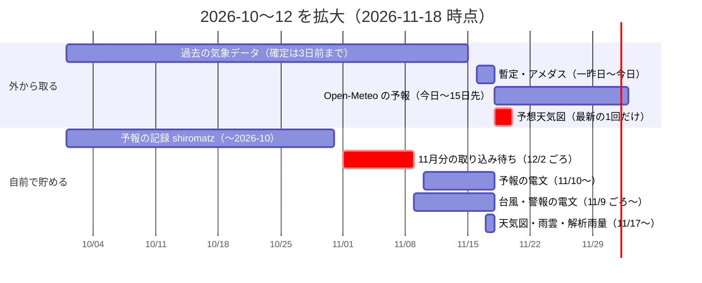
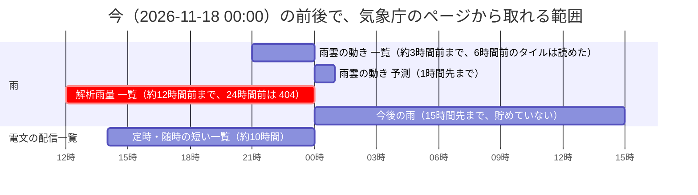

# データの地図：外から取るもの・自前で貯めるもの

Weather Note が使うデータを、**外から取りに行くもの**（取りに行ったときの姿だけを使う）と、**自前で貯めるもの**（取りに行ったものを D1・R2 に残す）に分けてまとめます。どれも「どこから・いつの分が取れるか（有効区間）・何に使うか・後から取り直せるか」を書きます。

- 最終更新：2026-11-18（#281 までを反映）
- 決まりの本体：要件定義書「予報の履歴」（R1〜R7）、[README](../README.md)、[docs/thread-rules.md](thread-rules.md)
- 量・止まったときの見張り：`/api/health`（毎時の見張りが判断して管理者に知らせる、`worker/src/healthWatch.ts`）
- 毎朝の点検：朝7時（日本時間）より後の最初の見張りで、この24時間の取得ごとの回数（うまくいった回／全部、新しく保存した数）と異常・気づいたことを、管理者に1通（`worker/src/dailyDigest.ts`）

## 1. 外から取りに行くもの

画面を開いたとき（または定時の処理で）取りに行き、エッジや端末に一時的に置くだけのものです。自前で貯めるものは 2 章。

| データ | 出どころ | 取れる範囲（有効区間） | 取り方・間隔 | 画面での使い道 | 後から取り直せるか |
| --- | --- | --- | --- | --- | --- |
| 日別・時間別の実績 | 気象庁「過去の気象データ」（www.data.jma.go.jp/obd/stats/etrn） | 1977-01-01〜3日前（確定）、一昨日・昨日は暫定 | 必要な日だけ。確定は端末に永久、エッジに1年 | 表・グラフ・1日モードの実績、予報の移り変わりの「実績」 | できる（気象庁が長く公開） |
| アメダスの最新 | 気象庁 防災情報のアメダス（www.jma.go.jp/bosai/amedas） | 今日と、表がまだ出ていない一昨日・昨日 | 開いたとき | 今日の済んだ時間、速報で表を補う | 数日で表に置き換わる（表で取り直せる） |
| 16日間の予報・信頼度 | Open-Meteo（予報・アンサンブル ECMWF IFS 51通り） | 今日〜15日先 | 地点ごとにエッジで30分共有 | 予報の日・これからの時間、信頼度 A・B・C | 過去の予報は Open-Meteo の Previous Runs で引ける（R3、まだ使っていない） |
| 日の出・日の入り | Open-Meteo（予報／過去は archive） | 1977〜15日先（計算値） | 必要な日だけ | **β の報告に残す値だけ**（夜の決め方の入力）。画面には出さない（2026-11-19：画面はどこもアプリの計算 `src/data/sun.ts` shownSun、太陽の上端が地平線・大気差込み、国立天文台と1分以内） | できる（計算値） |
| 天気図（実況） | 気象庁ホームページ（yoho/data/wxchart/quick） | 2024-10〜今（3時間ごとの PNG）。2022-12〜は保存用天気図 PDF、2002-01〜は日々の天気図 PDF（どちらも約3か月遅れ）、それより前は国会図書館 | 画像をそのまま表示 | 1日モード③の天気図 | 気象庁が残す範囲ならできる（保存もしている、2 章） |
| 予想天気図 | 気象庁 weather_map の一覧（list.json） | **いちばん新しい1回分だけ**（24・48時間後） | エッジで30分共有 | 先の日の天気図 | できない（保存している、2 章） |
| 近づいている台風 | 気象庁 防災情報の台風 JSON | **今の分だけ** | 開いたとき、エッジで30分共有 | 台風のカード・目安の通知 | できない（電文を保存している、2 章） |
| 台風の実際の進路 | 気象庁 RSMC Tokyo ベストトラック（bst_all.zip） | 1976〜、年に数回の更新 | GitHub Actions でまとめて `public/data/typhoon-tracks.json` に | 台風の日・過去の台風 | できる |
| 雨雲の動き・今後の雨（見るだけ） | 気象庁 防災情報の地図タイル（jmatile：nowc の一覧 N1・N2、rasrf の一覧） | 雨雲の動きは約3時間前〜1時間先（5分ごと、強さ mm/h）、今後の雨は解析が約12時間前まで・予報が15時間先まで（1時間の量 mm） | 開いたとき。一覧はエッジで1分共有、タイルは Worker が地点のまわりだけ中継してエッジに1日（`/api/rain-now`・`/api/rain-tile/…`） | 管理者の「雨の見込み（確認用）」（置き場所はこれから） | 雨雲の動きの実況・解析雨量は保存している（2 章）。予測は取り直せない |
| 祝日 | 内閣府「国民の祝日」CSV | 公表された年まで | 年に1回、手で `shared/holidays.ts` に | 比較日の決め方 | できる |
| 使用量 | Cloudflare の GraphQL（読み取り専用のトークン） | 今月 | `/api/health` を作るとき | 管理：無料枠に対する使用量 | できる（今月分） |

## 2. 自前で貯めているもの

定時の処理（5分ごと、`worker/src/index.ts` の scheduled）で取りに行き、D1（表）か R2（ファイル）に残します。**どれも、取りに行かなければ後から取れないもの**です。

| データ | いつから | 間隔・範囲 | 置き場所 | 中身 | 使い道 | 見張り |
| --- | --- | --- | --- | --- | --- | --- |
| 予報の電文（府県天気予報 VPFD51・週間 VPFW50・概況 VPFG50） | 2026-11-10（初回に7日分さかのぼった） | 発表ごと（府県 5・11・17時、週間 11・17時ほか）。使っている地点の予報区 | D1 `forecast_telegrams`（原文）、読んだ値は `forecast_issues`・`forecast_entries`。原文は R2 `telegrams/forecast/` にも | 天気・3時間ごとの天気・降水確率・最高最低と予測範囲・信頼度・概況 | 1日モード③「この日の予報の移り変わり」（R6） | 届かない回・取れない回（R5-3）、毎時の見張り |
| 予報の記録（shiromatz、気象庁の予報 JSON の記録、CC BY-SA 4.0） | 2025-01〜2026-10 取り込み済み | 1か月ずつ（管理画面から）。11月分は 12/2 ごろ | D1 `forecast_issues`・`forecast_entries`（`source = shiromatz`）、取り込みの記録 `forecast_imports` | 電文と同じ形の値（3時間ごとの天気は無い） | 11/9 以前の日の予報の移り変わり、電文の取りこぼしの補い | 取り込める月が出たら知らせる（#262） |
| 台風の電文（VPTW6x） | 2026-11-09 ごろ（初回に7日分） | 発表ごと（全国） | D1 `typhoon_telegrams`、R2 `telegrams/typhoon/` | 予想進路・予報円・暴風警戒域・中心気圧など | 台風の「当時の発表」 | 取れない回が続いたら知らせる |
| 警報・注意報の電文（高知県 VPWW53・VPWW55〜61） | 2026-11-10 ごろ（初回に7日分） | 発表ごと | D1 `warning_telegrams`、R2 `telegrams/warning/` | 警報・注意報（R06 の大雨・土砂・高潮・暴風・波浪・大雪・その他） | その日に何が出ていたかの記録（読み取りはこれから） | 取得の失敗を `/api/health` に |
| 随時の気象防災速報（高知県 竜巻注意情報 VPHW50・51、記録的短時間大雨情報 VPOA50、府県気象防災速報 VPBS50） | #281 のマージから | 出たときだけ | 警報と同じ表 | 竜巻注意・記録的短時間大雨・顕著な大雨など | 同上 | 同上 |
| 天気図（実況・予想天気図） | 2026-11-17 | 実況は3時間ごと、予想は発表ごと | R2 `wxchart/quick/`・`wxchart/forecast/`、D1 `wxchart_saved` | PNG のまま | 予想天気図をあとから見る（気象庁は最新しか置かない） | 1時間止まると注意 |
| 雨雲レーダー（高解像度降水ナウキャストの実況、その瞬間の強さ mm/h） | 2026-11-17（#276） | 30分ごと（毎時0分・30分）、高知のまわり 段階8 の 3×3（四国全体） | R2 `radar/hrpns/`、D1 `radar_saved` | 地図タイルの PNG（気象庁のまま） | 雨雲の動きの記録（画面はこれから） | 1時間止まると注意、2時間で異常（一覧は約3時間で消える） |
| 解析雨量（1時間雨量 mm、雨量計で直したもの） | #281 のマージから | 30分ごと、同じ範囲、一覧の member（none・immed）ごと | R2 `radar/rasrf/`、D1 `radar_saved` | 地図タイルの PNG（気象庁のまま） | どこでどれだけ降ったかの記録、予報との比べ合わせ（画面はこれから） | 雨雲レーダーと共通（一覧は約12時間で消える） |
| アメダスの10分ごとの観測（高知 74182、気象庁 bosai の地点の JSON） | #（この PR）のマージから（初回に8日分さかのぼる） | 3時間ごとのファイル（10分ごと18回分）を、その3時間が終わって20分後から | R2 `amedas/point/74182/`（gzip）、D1 `amedas_saved` | 原本のまま（気温・湿度・気圧・雨・風向風速・突風・日照・**視程（10分ごと）・天気（自動観測、1時間ごと）**など28項目） | 視程の10分値の記録（過去の気象データの10分値の表には視程の列が無い。視程と天気の1時間値は時別値の表にある。KC-04）。画面はこれから | 半日止まると注意、2日で異常（気象庁は約10日で消す） |
| 空気質（Open-Meteo Air Quality、もとは CAMS。PM2.5・PM10・黄砂 dust・エアロゾルの光学的厚さ AOD） | #（この PR）のマージから。過去は 2023-01-01 まで1か月ずつさかのぼる | 1時間に1回まで、終わった日（昨日まで）の1時間ごとの値。高知（雨雲と同じ位置） | D1 `air_quality_hourly` | モデルの値（観測ではない。#208 の決まり3の材料にはしない）。予報の履歴は持たない | 月の見え方の空気の濁り β（AOD から）、空気質の表示（過ぎた日、`/api/air`）。出典 Open-Meteo.com（CC BY 4.0）・Copernicus CAMS | 2日止まると注意（2023-01 から取り直せる） |
| 空気質の予測（Open-Meteo Air Quality、CAMS 全球 約45km。PM2.5・PM10・黄砂・AOD） | 2026-11-25 から | 1時間に1回まで（日付が変われば すぐ）、今日から5日分を取り、値のある時刻・項目だけ書き換え（CAMS 全球を明示。9時・21時の計算で、Open-Meteo への取り込みにはさらに遅れがある） | D1 `air_quality_forecast` | モデルの値。いつも最新の値（予報の履歴は持たない）。欠けた時間・項目と、取れなかった回は前の値を残す。昨日より前の行は消し、昨日の分は終わった日の値が届くまでの代わりに残す | 空気質の表示（今日と先の日、`/api/air`）。ふだん（手前30日の分位）は `air_quality_hourly` から。出典 Open-Meteo.com（CC BY 4.0）・Copernicus CAMS | 記録 `air_forecast_fetch_log`（30日）。3時間で注意、1日で異常（`airForecastStale`） |
| 大気汚染の実測（環境省 そらまめくんの API、速報値。高知市 介良局 39201350） | #（この PR）のマージから。1年前までさかのぼる | 6時間に1回まで：検索の API で今月と先月を取り直し（速報値の直しも入る）、古い側へ3か月ずつ。毎回（1時間に1回）直近7日の CSV（`data/sokutei/NoudoTime/39201350/7day.csv`、今日の分も約1時間遅れで出る。検索の API は前日の夜まで、11/25） | D1 `soramame_hourly` | PM2.5（µg/m³）・光化学オキシダント（ppm）・SPM（mg/m³）・NO2・SO2（ppm）・風向（16方位）・風速（m/s）の1時間値。時は 01〜24 | 空気の質の画面（PM2.5 の実測）と内訳のヒートマップ（全項目とふだん）、`/api/air-measured`。だれにでも（11/25 渡辺さん：商用利用でないのでそのまま使ってよい。それまでは管理者だけ）。データの著作権は環境省・高知市など | 2日で注意、2週間で異常（API は今月から1年。それより古い速報値は取れない） |
| 長い先の予報の電文（四国の地方1か月予報 VPCK50・早期天候情報 VPAW51、全国の2週間気温予報 VPCK70） | #285 のマージから | 発表ごと（1か月予報は週1回、2週間気温予報は毎日、早期天候情報は出たときだけ）。配信の一覧を30分ごとに読む | R2 `telegrams/longrange/`（gzip）、D1 `longrange_telegrams`（原文は持たない） | 原文のまま（高知の値の読み取りはこれから） | 季節の見通しの移り変わり | 12時間止まると注意 |
| アカウント・感じ方の記録・同意・通知 | アプリの開始から | 利用者の操作ごと | D1 | 本人の記録（研究への協力の同意つき） | β・記録・研究用の分析 | アカウント処理の失敗を `/api/health` に |
| 処理の記録 | — | 5分ごと・毎時 | D1 `cron_runs`・`*_fetch_log`・`health_checks`・`health_alerts` ほか | 何を取れたか・取れなかったか | 見張り（取れなかったと、もともと無いを分ける） | — |

時刻の決まり（要件 R4）：発表・対象の時刻は日本時間、取得の記録は UTC。気象庁の名前が UTC のもの（雨雲の画像など）は、記録には日本時間で書き、元の名前は R2 の置き場所に残す。雨の強さ（mm/h）・量（mm）・確率（%）は混ぜない。地点ごとの読む場所は `shared/stationPlaces.ts` の1つの表（今は高知だけ）。

## 3. 有効区間の地図

### 3.1 日の単位（2024年から先の日まで）

1977 年からの実績、2002 年からの天気図 PDF は図の左の外にあります（1 章の表）。

### 3.2 日の単位（この2か月を拡大）

予報の電文が 11/10 から始まっているのは、最初の取得（11/17）のときに配信の長い一覧（7日分）をさかのぼって取ったためです。11/1〜11/9 の予報は、外部の記録の11月分を取り込むまで「記録なし」と出ます。

### 3.3 時間の単位（今の前後）

気象庁のページに残る時間が短いものほど、自前で貯めないと消えます。

電文の長い一覧（regular_l・extra_l）は7日分です。7日を過ぎた電文がまだ読めるかは、調査（#267）で確かめています。

## 4. まだ貯めていないが、後では取れないもの

下調べ：#279（`research/keep-candidates/README.md`）。

| データ | 状態 |
| --- | --- |
| 地方1か月予報・早期天候情報・2週間気温予報 | #285 で貯めはじめた（2 章）。早期天候情報の官署 370000 は、最初に出たときに実物で確かめる |
| 今後の雨（降水短時間予報、15時間先） | 量が解析雨量の10倍以上なので後で決める |
| 天気分布予報（5km） | 今は追わない（地図が要る使い道が出たら）。地域時系列予報の JSON は府県天気予報の電文と同じ中身と見て、別に貯めない（#283） |
| 暑さ指数（環境省） | 利用規約に同意して使う仕組み。過去分は後から取れるので、夏の前に決める |

## 5. データベースの表の置き場所（2026-11-19）

D1 は1つ（バインディング `DB`）、原本のファイルは R2（`ARCHIVE`）です。気象用とユーザー用を別の D1 に分ける案（「データベース最適化・分離設計提案書 v1.0」）は、**今は分けない**と決めました（渡辺さん OK）。理由は3つです。容量と書き込みに余裕がある（11/19 で 63MB・月の書き込み 1.3%）。1つの Worker が両方につながる限り、権限の切り分けはほとんど進まない。動いているまま移し替える手間とリスクが大きい。

代わりに、次の3つを進めます。表を下の3つに分け、読み書きの入口もこの分け方にそろえる（いつか分けるときの準備）。取り戻せない欠けを後で埋めたら「取り戻した」の印を付ける（欠けた事実は消さない）。表の作りの変更に版を付ける。

**分けるのを考え直す目安**：次のどれかになったら、提案書の第2段階以降を検討します。
- データベースが 2GB を超えた。
- 研究協力者などが増え、ユーザー情報を別に守る必要が出た。
- 気象とユーザーで、元に戻す単位（Time Travel）を分ける必要が出た。

| 分け | 表 | 中身 |
| --- | --- | --- |
| 気象 | `forecast_telegrams`・`forecast_issues`・`forecast_entries`・`forecast_fetch_log`・`forecast_imports`・`forecast_alerts`・`forecast_type_log`・`typhoon_telegrams`・`typhoon_fetch_log`・`typhoon_json_log`・`typhoon_alerts`・`warning_telegrams`・`warning_fetch_log`・`longrange_telegrams`・`longrange_fetch_log`・`radar_saved`・`radar_fetch_log`・`amedas_saved`・`amedas_fetch_log`・`air_quality_hourly`・`air_quality_fetch_log`・`air_quality_forecast`・`air_forecast_fetch_log`・`soramame_hourly`・`soramame_fetch_log`・`wxchart_saved`・`wxchart_fetch_log`・`archive_copies`・`source_listed`・`data_gaps`・`data_absent` | 公開の気象情報と、その取得の記録・欠け。人を指す列は持たない |
| ユーザー | `users`・`sessions`・`session_reauth`・`schema_version`・`reports`・`consents`・`research_withdrawals`・`push_subscriptions`・`server_keys`・`notify_settings`・`notify_log`・`typhoon_notify_settings`・`typhoon_notify_log`・`export_log`・`export_tokens` | アカウント・肌感の記録・同意・通知。研究に出すときは研究用の番号で（#55） |
| 運用 | `cron_runs`・`health_checks`・`health_alerts`・`app_errors`・`refetch_log`・`schema_migrations`・`weekly_audit`・`forecast_type_runs`・`offsite_copies`・`offsite_state`・`offsite_log` | 定時処理・見張り・エラー・取り直し・週の点検・ドライブの控えの記録。数と時刻が主。エラーの文言と押した管理者は管理者の画面だけに出す |

**表の作りの変更**（2026-11-19）：表は各ファイルの `CREATE TABLE IF NOT EXISTS` で作り、作ったあとの変更（列を足すなど）は `worker/src/migrate.ts` の `migrate` で部分ごとの版として1回ずつ当て、`schema_migrations` に残す。版は足すだけで、当て終わった版は書き換えない（直すときは次の版）。消す・作り直す変更は元に戻せないので、個別に確かめてから。アカウントの `schema_version`（v1）は前からのもので、そのまま。

**予報が外れやすい型の影の運用**（2026-11-24）：固定した型（`shared/forecastTypes.ts`、FS-05・FS-06）に、気象庁の予報が当てはまるかを毎日（日本時間の2時台）判定して `forecast_type_log` に残し（当てはまらない件も分母として）、対象日が2日以上前になったら気象庁の日の表の最高・最低・降水量で答え合わせを付ける。予報どうしは混ぜない（材料は気象庁の予報だけ）、答え合わせは気象庁の観測。画面には出さない。引き受けた日と件数は `forecast_type_runs`（`worker/src/forecastTypeWatch.ts`）。

**週の点検**（2026-11-22、#370）：週に1回（日本時間の3時台）、保存している系列（アメダスの原本・雨雲と解析雨量・天気図の実況・空気質・そらまめ・予報の電文・長い先の予報の電文）を**取り始めから今まで**の全期間で見て、「最新」（いちばん新しい時刻が新しいか）と「履歴」（途中に抜けが無いか）を分けて数える。R2 に置いたはずのファイルも毎回20件選んで、実物と大きさを確かめる。読むだけで、何も消さない。結果は `weekly_audit`（60回分）に残し、保守の画面と毎朝の点検に出す（`worker/src/weeklyAudit.ts`、手引き R-12）。

**原本の控え（GitHub）**（2026-11-22、#370）
- 経緯：渡辺さんが、はじめは Google ドライブにすると決めたが、Google の同意画面が本番に出せず、GitHub の非公開リポジトリに変えた。
- 対象：R2 の原本（電文の写し・長い先の予報・アメダスの10分値・天気図・雨雲と解析雨量）。
- まとめ方：
  - 日本時間でその日に保存した分ずつ tar にまとめる。
  - 300ファイルを超える日は `<日付>_1of3.tar` のように分ける。
  - 中に `manifest.json`（鍵・表・大きさ・sha256）を入れる。
- 置き場所：非公開リポジトリ（`wrangler.jsonc` の `ARCHIVE_REPO`）の、月ごとのリリース `archive-YYYY-MM` に置く。
- 確かめ方：置いたら読み戻して sha256 を確かめ、確かめられた分だけを `offsite_copies` に残す。
- 進め方：定時処理の1回に1つずつ、古い日から。
- 鍵：そのリポジトリだけに書けるトークン（Cloudflare の秘密の値 `GITHUB_ARCHIVE_TOKEN`）。無ければ何もしない。
- 置いたファイルは消さない。
- 肌感の記録などのユーザーのデータは入れない（入れるかは別に決める）。
- コードは `worker/src/offsite.ts`、手引きは R-13。

エラーの記録は、Cloudflare のログ（アプリから読めず、数日で消える）ではなく、ここ（`app_errors`・`cron_runs.error`）を正にします（#341・#344）。時刻の書き方は 2 章の「時刻の決まり（要件 R4）」のとおりで、書き換えません。

## 6. 出典

- 気象庁：過去の気象データ、アメダス、防災情報XML（予報・台風・警報・気象防災速報の電文）、気象庁ホームページ（天気図・雨雲の動き・解析雨量・台風情報、公共データ利用規約 第1.0版）、RSMC Tokyo ベストトラック
- 予報の記録：shiromatz/Japan-Meteorological-Agency-Weather-Forecast（気象庁の予報 JSON の記録、CC BY-SA 4.0）
- Open-Meteo（CC BY 4.0）
- 内閣府「国民の祝日」
