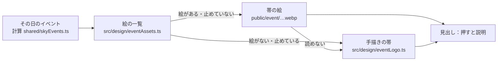

# イベントの日の見出し（設計と運用）

満月・日食・月食の日に、見出しのロゴを横長の帯の絵に替える仕組みの設計と、その運用の手順です（2026-11-20、渡辺さん「実際のサイト管理や運用方法を意識した設計」）。見た目は案 B（渡辺さんが用意した絵）に決まりました。#379 で入れた手描きの帯は、絵が読めないときの代わりとして残します。

この文書の目的は、次の3つです。

- **毎年の手作業をなくす**：いつ出すかはアプリが計算する。
- **絵の追加・差し替えを、コードを触らずにできるようにする**。
- **出す前に確かめられ、まちがいがあればすぐ止められるようにする**。

## 1. 全体の流れ

| 役割 | 置き場所 | 中身 |
| --- | --- | --- |
| いつ出すか | `shared/skyEvents.ts`（#379） | 満月・ブルームーン・観測地から見える日食・月食を、その年ごとに計算。年ごとの表は持たない |
| どの絵か | `src/design/eventAssets.ts`（新） | **絵の一覧（台帳）**。イベントの種類ごとに、ファイル名・版・テーマ・説明の文・止めるかどうか |
| 絵そのもの | `public/event/`（新） | 配る絵（webp）。アプリを入れたときにまとめて保存されるファイル（`/assets/`）とは分ける |
| 元の絵 | `design-src/event/`（新） | 渡辺さんが作った元の画像（png）。配らない。作り直し・切り抜き直しの元 |
| 代わりの帯 | `src/design/eventLogo.ts`（#379） | 絵が無い・読めない・止めているときの手描きの帯 |

## 2. 表示の決まり

1. **出す日**：日本時間で、その日に満月の時刻があるか、観測地（高知）で見える日食・月食の最大があるか。1日に2つ重なれば、日食 → 月食 → 満月の順で1つだけ出します。
2. **期間**：当日だけ（11/20 決定。「今日は満月」が正しい日だけ）。
3. **見出しの大きさは変えない**：帯はアイコンと文字の場所に1枚（高さ 36px・横 144px）。イベントの日だけ下の画面が動くことはない（`e2e/event.py`）。
4. **押せる**：帯を押すとその日の説明（EventSheet）。押せる範囲は 44px 以上。
5. **読み上げ**：帯の説明の文（「今日は満月（ビーバームーン）。押すと説明が開きます」）は一覧から。
6. **色の決まり**：帯の絵はテーマごとの3枚。アクセント色（選んでいるもの）は使わない。

## 3. 絵の決まり（作るときの仕様）

| 項目 | 決まり |
| --- | --- |
| 形 | 横 4：縦 1。配る大きさは 640×160 px（画面の 2倍） |
| 角・縁・影 | **付けない**（角の丸みと縁はアプリが付ける） |
| 文字 | **入れない**（11/20 決定、案②）：アプリの「Weather Note」を右側に重ねる。右の 6割は文字が読める落ち着いた地にする。文字の無い絵が届くまでは、見本から切り抜いた文字入りの絵を仮に使う（台帳の `text: "baked"`） |
| テーマ | 紺（Midnight）・白（Daylight）・緑（Mist）の3枚。地の色はそれぞれの見出しの地になじむ色 |
| 形式と重さ | webp、1枚 40KB まで |
| 名前 | `<種類>-<テーマ>.webp`。種類は下の表の英字（例：`beaver-navy.webp`） |

### 要る絵（20種類 × 3テーマ ＝ 60枚）

| 種類 | 英字 | 状態 |
| --- | --- | --- |
| ウルフムーン（1月） | wolf | 見本あり |
| スノームーン（2月） | snow | 見本あり |
| ワームムーン（3月） | worm | 見本あり |
| ピンクムーン（4月） | pink | 見本あり |
| フラワームーン（5月） | flower | 見本あり |
| ストロベリームーン（6月） | strawberry | 見本あり |
| バックムーン（7月） | buck | 見本あり |
| スタージョンムーン（8月） | sturgeon | 見本あり |
| コーンムーン（9月、ハーベストが10月の年） | corn | **まだ無い**（それまでは手描き） |
| ハーベストムーン（秋分にいちばん近い満月） | harvest | 見本あり |
| ハンターズムーン（10月） | hunter | 見本あり |
| ビーバームーン（11月） | beaver | 見本あり |
| コールドムーン（12月） | cold | 見本あり |
| ブルームーン | blue | 見本あり |
| 皆既月食・部分月食・半影月食 | lunar-total・lunar-partial・lunar-penumbral | **まだ無い** |
| 皆既日食・金環日食・部分日食 | solar-total・solar-annular・solar-partial | **まだ無い** |

「まだ無い」ものは手描きの帯で出ます。絵が届いたら、4章の手順で足します。

## 4. 運用の手順

### E-01 絵を足す・差し替える

1. 渡辺さん：元の画像（png）をメインのスレッドに渡す。
2. メイン：元の画像を `design-src/event/<種類>-<テーマ>.png` に置き、`node scripts/event-images.ts <種類>` で 640×160 の webp に整える（大きさ・重さの確認まで）。文字の無い絵に替えたときは、台帳の `text` を `overlay` にする。
3. メイン：台帳（`eventAssets.ts`）のその種類の**版（rev）を1つ上げる**。版はファイルの URL に付くので、差し替えた絵が古いまま残らない。
4. メイン：PR を出す。CI が 6章の確認をし、PR には全部の帯を並べた画像を付ける。
5. 渡辺さん：端末の 設定 → イベントの見出し（確認用）（5章）で見て OK を出す。
6. メイン：マージ。デプロイのあと、次にアプリを開いたときから新しい絵。

### E-02 出した絵にまちがいがあったとき（その日のうち）

1. 台帳のその種類を `off: true` にして PR → マージ。その日は手描きの帯に戻る（見出しは空にならない）。
2. 絵を直して E-01 の手順で戻す。

止めるのにデプロイが要るのは、アプリが静的なファイルで動いているためです。マージからデプロイまでは数分です。

### E-03 年に1回の見通し（12月）

1. 設定 → イベントの見出し（確認用）の「これからの1年」で、翌年の満月・食の日と、出る絵を見る。
2. 絵の無い食がその年にあれば、その絵を用意するかを決める（無ければ手描きの帯で出る）。

ふだんの年は、ここで見るだけで作業はありません。

## 5. 端末での確かめ方（設定 → イベントの見出し（確認用））

管理者にだけ出ます（ふだんの画面とほかの人の設定には出ない）。「帯の一覧と、この日として表示」を押すと開きます（`src/ui/EventPreviewSheet.tsx`）。見えるのはいまのテーマなので、3つを見るには 設定 → 表示 → テーマ を替えます。

1. **この日として見出しを表示**
   - 日付を選んで「見出しに出す」と、見出しだけがその日のイベントになる（例：2029/1/1 → 皆既月食）。
   - 天気のデータやほかの画面は替わらない。端末に保存せず、アプリを開き直すか「元に戻す」で戻る（`src/ui/eventPreview.ts`）。
2. **これからの1年**
   - 翌年までのイベントの日と、出る帯（絵か手描きか）。行を押すと、その日として見出しに出す。
3. **全部の種類**
   - 20種類の帯を、見出しと同じ物（同じ部品）で並べる。台帳の状態（絵・版・文字入りの仮／手描き：絵がまだ無い・止めている）と、次に出る日（15年先まで。高知から見える食だけ）。
   - 帯を押すと、その日の説明（EventSheet、見出しは「1/22 はウルフムーン」）。
   - 食の日に重なった満月は、食の帯が出る（例：2027/7/19 は半影月食なので、バックムーンの次は 2029/7/25）。

## 6. 自動の確認（PR ごとの CI）

| 確認 | どこで |
| --- | --- |
| 台帳の全部の種類 × 3テーマの絵がある（`off` と「まだ無い」は除く）。形が 4：1、重さが 40KB まで | 単体テスト |
| 満月の呼び名（`shared/fullMoonNames.ts`）と台帳の種類が一対一。呼び名を足して台帳を足し忘れたら落ちる | 単体テスト |
| イベントの日（時計を合わせる）に、390px と 360px、3テーマで：帯が「比較｜1日」と重ならない、見出しの高さがふだんの日と同じ、押すと説明が開き閉じると元の位置 | e2e |
| 絵をわざと読めなくすると手描きの帯に戻る | e2e |
| 確認ページ：20種類の帯と状態、これからの1年、押すとその日の説明、「この日として見出しを表示」と「元に戻す」 | e2e |
| 確認ページの一覧（日ごとに探さない早い計算）が、見出しの計算（skyEventOn）と1年の毎日・15年の食の日で同じ | 単体テスト |
| ふだんの日は絵を1枚も読み込まない | e2e |

## 7. 配り方とキャッシュ

- 絵は `public/event/` に置き、**アプリを入れたときにまとめて保存しない**（全部の絵を全員に配らない）。読むのは、その日の1枚（40KB まで）を、その日だけ。
- URL に版を付ける（`/event/beaver-navy.webp?v=2`）。サーバーの応答は1年キャッシュしてよい（`public/_headers` に `/event/*`）。差し替えは版を上げて行う。
- **前日に読んでおく**：イベントの前日にアプリを開いたとき、電波があれば翌日の絵を端末に取っておく。当日に電波が弱くても絵が出る。
- 当日に絵が読めなければ、手描きの帯で出す。

## 8. この先の広げ方

台帳（`eventAssets.ts`）は、種類ごとに「いつ出すか（計算）」と「どの絵か」を分けて持ちます。流星群・二十四節気などを足すときも、計算を `shared/` に足し、台帳に種類を足し、絵を置けば同じ運用で回ります。

## 9. 作業の分け方（PR）

1. **仕組み**（#382）：台帳・`public/event/`・版つきの URL・前日に読んでおく・手描きへの戻り・CI の確認（`e2e/event.py`）。絵は見本から切り抜いた仮のもの（文字入り、満月13種類 × 3テーマ）。
2. **確かめる画面**：設定の「イベントの見出し（確認用）」（管理者だけ）。
3. **絵**：文字の無い満月の13種類 × 3テーマに差し替える（届いたら E-01 で）。
4. **あとから**：コーンムーンと日食・月食の絵（届きしだい E-01 で）。

## 10. 決めたこと（2026-11-20 渡辺さん「それでよろしくお願いします」）

| 項目 | 決めたこと |
| --- | --- |
| 見た目 | 案 B（渡辺さんが用意した絵） |
| 出す期間 | 当日だけ（満月も食も） |
| 絵の文字 | 案②：文字の無い絵にアプリの文字を重ねる。届くまでは見本の文字入りの絵を仮に使う |
| 元の絵の置き場所 | リポジトリ（`design-src/event/`） |
