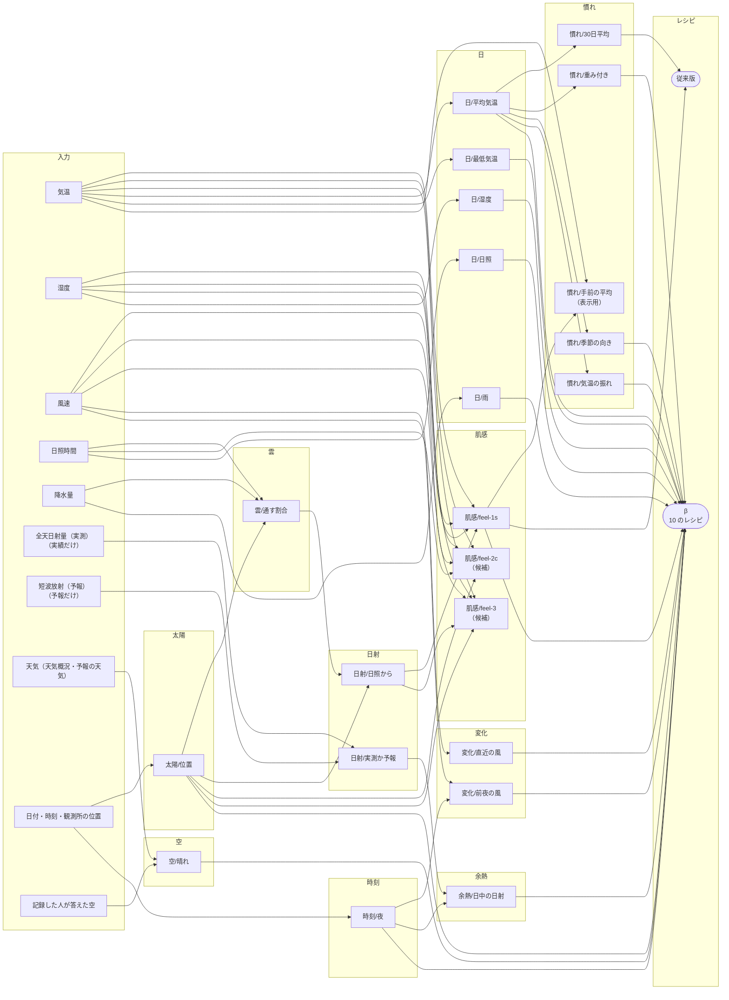

# モデルの地図（計算の変数・計算式・使う所）

<!-- このファイルは src/model/catalog.ts から作る（npm run model-map）。手で直さない。 -->

体感の計算を、**部品**（1つの量を出す計算）・**要因**（部品の出力をモデルに入れる形に）・**レシピ**（どの要因で何を動かすか）に分けて登録してある（#189）。モデルはレシピで、候補を足すときはレシピを1行足す。

- **決まり**：計算式を足す・変える・外すときは `src/model/catalog.ts` を同じ PR で直し、`npm run model-map` でこの地図を作り直す（テストが見張る）
- ID（`慣れ/重み付き` など）で呼ぶ。数式の正本は `research/comfort-model/mathematical-contract.md`（MATH-01〜09）
- 状態：**使用中**（画面か学習に効く）／**候補**（研究用）／**表示用**（見せるだけで、ほかの計算に入らない）

## 全体の流れ

## 入力

| ID | 中身 | 実績 | 予報 | メモ |
|---|---|---|---|---|
| `入力/気温` | 気温 | ○ | ○ |  |
| `入力/湿度` | 湿度 | ○ | ○ |  |
| `入力/風` | 風速 | ○ | ○ | 実績は観測所の高さ、予報は10m |
| `入力/日照` | 日照時間 | ○ | ○ |  |
| `入力/雨` | 降水量 | ○ | ○ |  |
| `入力/日射の実測` | 全天日射量（実測） | ○ | — | 日射を測っている観測所だけ |
| `入力/日射の予報` | 短波放射（予報） | — | ○ |  |
| `入力/日の天気` | 天気（天気概況・予報の天気） | ○ | ○ |  |
| `入力/日付と地点` | 日付・時刻・観測所の位置 | ○ | ○ | 計算で出す（太陽の位置・日の出入り） |
| `入力/記録の空` | 記録した人が答えた空 | ○ | ○ | 記録のときだけ。なければ日の天気 |

## 部品

### 太陽

| ID | 中身 | 状態 | 入力 | 単位 | 期間 | 実装 | メモ |
|---|---|---|---|---|---|---|---|
| `太陽/位置` | 太陽の高さ | 使用中 | `入力/日付と地点` | ° | — | shared/sunTimes.ts solarAltitude |  |

### 時刻

| ID | 中身 | 状態 | 入力 | 単位 | 期間 | 実装 | メモ |
|---|---|---|---|---|---|---|---|
| `時刻/夜` | 夜か（日の入り〜日の出） | 使用中 | `入力/日付と地点` | 夜=1 | — | src/beta/engine/observations.ts nightOf |  |

### 雲

| ID | 中身 | 状態 | 入力 | 単位 | 期間 | 実装 | メモ |
|---|---|---|---|---|---|---|---|
| `雲/通す割合` | 雲で弱める割合（快晴に対して通す光） | 使用中 | `入力/日照` `入力/雨` `太陽/位置` | 0〜1 | — | shared/brightness.ts sunshineFactor | 日照 0 で 1/3、雨は 1/7 から降水量で暗く。係数は仮（高知 2025-11-01 の実測で日照 0 は 0.21） #132 |

### 日射

| ID | 中身 | 状態 | 入力 | 単位 | 期間 | 実装 | メモ |
|---|---|---|---|---|---|---|---|
| `日射/日照から` | 日照と雨から出す日射 | 使用中 | `雲/通す割合` `太陽/位置` | W/m² | — | shared/mrt.ts hourRadiation・sunshineRadiation | #103 |
| `日射/実測か予報` | 日射（実測、なければ予報） | 使用中 | `入力/日射の実測` `入力/日射の予報` | W/m² | — | shared/feel.ts radiationOf | 日射を測っていない地点では、実績の日に値がない。日射/日照から にそろえるかは #132 の後で決める #103 |

### 肌感

| ID | 中身 | 状態 | 入力 | 単位 | 期間 | 実装 | メモ |
|---|---|---|---|---|---|---|---|
| `肌感/feel-1s` | 肌感（日なた・日かげ）feel-1s | 使用中 | `入力/気温` `入力/湿度` `入力/風` `日射/日照から` | ℃ | — | shared/feel.ts feelOf | 体感温度（オーストラリア気象局）＋日なたは日射の上乗せ |
| `肌感/feel-2c` | 肌感の候補 feel-2c：体に当たる直射 | 候補 | `入力/気温` `入力/湿度` `入力/風` `入力/日照` `太陽/位置` | ℃ | — | shared/sunLoad.ts feel2Warming | #96 |
| `肌感/feel-3` | 肌感の候補 feel-3：UTCI と平均放射温度 | 候補 | `入力/気温` `入力/湿度` `入力/風` `日射/日照から` `太陽/位置` | ℃ | — | shared/mrt.ts feel3 | #96 |

### 日

| ID | 中身 | 状態 | 入力 | 単位 | 期間 | 実装 | メモ |
|---|---|---|---|---|---|---|---|
| `日/平均気温` | 日平均気温 | 使用中 | `入力/気温` | ℃ | — | 気象庁の日の値（予報は毎時の平均） |  |
| `日/最低気温` | 日最低気温 | 使用中 | `入力/気温` | ℃ | — | 気象庁の日の値 |  |
| `日/湿度` | 日平均湿度 | 使用中 | `入力/湿度` | % | — | 気象庁の日の値 |  |
| `日/日照` | 日照時間（日） | 使用中 | `入力/日照` | 時間 | — | 気象庁の日の値 |  |
| `日/雨` | 降水量（日） | 使用中 | `入力/雨` | mm | — | 気象庁の日の値 |  |

### 空

| ID | 中身 | 状態 | 入力 | 単位 | 期間 | 実装 | メモ |
|---|---|---|---|---|---|---|---|
| `空/晴れ` | 晴れているか | 使用中 | `入力/記録の空` `入力/日の天気` | 晴れ=1 | — | src/beta/engine/observations.ts reportedSunny |  |

### 慣れ

| ID | 中身 | 状態 | 入力 | 単位 | 期間 | 実装 | メモ |
|---|---|---|---|---|---|---|---|
| `慣れ/30日平均` | 過去30日の日平均気温の単純平均（5〜30℃で頭打ち） | 使用中 | `日/平均気温` | ℃ | 30日（平均の古さ 約15日） | shared/season.ts mean30・seasonShift | #111 |
| `慣れ/重み付き` | 日平均気温の重み付きの平均 θrm（最近の基準） | 使用中 | `日/平均気温` | ℃ | α 0.6〜0.95 を記録から選ぶ（標準 0.8：半減 約3日）、最大60日 | src/beta/adaptation.ts runningMean | β の出発点は従来版の傾き 0.7 を借りるが、掛ける相手は 慣れ/30日平均 ではなくこちら #54 |
| `慣れ/季節の向き` | 2週間の日平均気温の傾き | 使用中 | `日/平均気温` | ℃/週 | 14日 | src/beta/engine/observations.ts trendOf |  |
| `慣れ/気温の振れ` | 1週間の日平均気温の標準偏差 | 使用中 | `日/平均気温` | ℃ | 7日 | src/beta/engine/observations.ts driversFrom（v7） |  |
| `慣れ/手前の平均` | 同じ時刻の手前の平均（時間帯のグラフ） | 表示用 | `肌感/feel-1s` `入力/気温` | 項目の単位 | 1週・2週・1か月 | src/hourAverage.ts meanByHour | 見せるだけで、ほかの計算に入らない |

### 変化

| ID | 中身 | 状態 | 入力 | 単位 | 期間 | 実装 | メモ |
|---|---|---|---|---|---|---|---|
| `変化/直近の風` | 直近6時間の平均風速 | 使用中 | `入力/風` | m/s | 6時間 | src/beta/reports.ts・useBaseline.ts（wind6h） |  |
| `変化/前夜の風` | 前夜の平均風速（日の入り〜日の出） | 使用中 | `入力/風` `時刻/夜` | m/s | — | src/beta/useBaseline.ts lastNightWind |  |

### 余熱

| ID | 中身 | 状態 | 入力 | 単位 | 期間 | 実装 | メモ |
|---|---|---|---|---|---|---|---|
| `余熱/日中の日射` | 日中の日射の合計（夜は直近の昼の分） | 使用中 | `日射/実測か予報` `時刻/夜` | MJ/m² | — | src/beta/reports.ts radDayOf・observations.ts nightOf | #103・#86 |

## 要因（β）

| 要因 | 中身 | 単位 | 部品 |
|---|---|---|---|
| `a` | 最近の基準 | 1℃ | `慣れ/重み付き` |
| `aLim` | 最近の基準（5〜30℃で頭打ち） | 1℃ | `慣れ/重み付き` |
| `dT1` | 前日の気温の変化（前日 − 基準） | 1℃ | `日/平均気温` `慣れ/重み付き` |
| `h7` | 1週間の湿度 | 10% | `日/湿度` |
| `h1` | 前日の湿度 | 10% | `日/湿度` |
| `hNow` | 今の湿度 | 10% | `日/湿度` |
| `v7` | 1週間の気温の振れ | 1℃ | `慣れ/気温の振れ` |
| `sun1` | 前日の日照 | 3時間 | `日/日照` |
| `sun7` | 1週間の日照 | 3時間 | `日/日照` |
| `rain1` | 前日の雨 | log(1+mm) | `日/雨` |
| `rain7` | 1週間の雨 | log(1+mm) | `日/雨` |
| `sky` | 晴れている（日中） | 晴れ=1 | `空/晴れ` `時刻/夜` |
| `trend` | 季節の向き（2週間の気温の傾き） | 1℃/週 | `慣れ/季節の向き` |
| `spring` | 暦の春らしさ | 春=+1, 秋=−1 | `太陽/位置` |
| `radNight` | 日中の日射の余熱（夜） | 5MJ/m² | `余熱/日中の日射` `時刻/夜` |
| `radNightWind` | 余熱 × 直近6時間の風 | 5MJ/m² × 2m/s | `余熱/日中の日射` `時刻/夜` `変化/直近の風` |
| `coldNight` | 前夜の冷え込み（前日の最低 − 基準） | 3℃ | `日/最低気温` `慣れ/重み付き` `時刻/夜` |
| `coldNightWind` | 前夜の冷え込み × 前夜の風 | 3℃ × 2m/s | `日/最低気温` `慣れ/重み付き` `時刻/夜` `変化/前夜の風` |

## レシピ

| レシピ | 値 | 肌感 | 中心 | 幅 | 場所 | 部品を直接 | 版 | メモ |
|---|---|---|---|---|---|---|---|---|
| `従来版` 肌感を7段の境目で切る | 固定 | `肌感/feel-1s` | — | — | — | `慣れ/30日平均` | 境目は設定、慣れ 1℃につき 0.7（5〜30℃） | 値は固定（学ばない）。表・グラフ・肌感マップの段、通知 |
| `β/M0` 一定 | 学習 | `肌感/feel-1s` | — | — | — | — | comfort-7 | 成績で混ぜる（MATH-05）。出発点は従来版の傾き 0.7 を 慣れ/重み付き に掛ける |
| `β/M1` 慣れ | 学習 | `肌感/feel-1s` | a | — | — | — | comfort-7 | 成績で混ぜる（MATH-05）。出発点は従来版の傾き 0.7 を 慣れ/重み付き に掛ける |
| `β/M2` 慣れ＋1週間 | 学習 | `肌感/feel-1s` | a, h7 | v7, hNow | — | — | comfort-7 | 成績で混ぜる（MATH-05）。出発点は従来版の傾き 0.7 を 慣れ/重み付き に掛ける |
| `β/M3` 慣れ＋前日 | 学習 | `肌感/feel-1s` | a, dT1, h1, sun1, rain1 | v7, h1 | — | — | comfort-7 | 成績で混ぜる（MATH-05）。出発点は従来版の傾き 0.7 を 慣れ/重み付き に掛ける |
| `β/M4` 慣れ＋季節の向き | 学習 | `肌感/feel-1s` | a, trend | v7, trend | — | — | comfort-7 | 成績で混ぜる（MATH-05）。出発点は従来版の傾き 0.7 を 慣れ/重み付き に掛ける |
| `β/M5` 前日・1週間・天気・季節の向き | 学習 | `肌感/feel-1s` | a, dT1, trend, h7, h1, sun1, sun7, rain1, rain7, sky | v7, hNow, h1, sun1, sky, trend | radNight, radNightWind, coldNight, coldNightWind | — | comfort-7 | 成績で混ぜる（MATH-05）。出発点は従来版の傾き 0.7 を 慣れ/重み付き に掛ける |
| `β/M6` 慣れ＋暦の季節（確認用） | 学習 | `肌感/feel-1s` | a, spring | v7, spring | — | — | comfort-7 | 成績で混ぜる（MATH-05）。出発点は従来版の傾き 0.7 を 慣れ/重み付き に掛ける |
| `β/M7` 慣れ＋季節の向き＋日射の余熱 | 学習 | `肌感/feel-1s` | a, trend | v7 | radNight, radNightWind | — | comfort-7 | 成績で混ぜる（MATH-05）。出発点は従来版の傾き 0.7 を 慣れ/重み付き に掛ける |
| `β/M8` 慣れ＋季節の向き＋地面の熱（余熱と前夜の冷え、風付き） | 学習 | `肌感/feel-1s` | a, trend | v7 | radNight, radNightWind, coldNight, coldNightWind | — | comfort-7 | 成績で混ぜる（MATH-05）。出発点は従来版の傾き 0.7 を 慣れ/重み付き に掛ける |
| `β/M9` 慣れ（頭打ち） | 学習 | `肌感/feel-1s` | aLim | — | — | — | comfort-7 | 成績で混ぜる（MATH-05）。出発点は従来版の傾き 0.7 を 慣れ/重み付き に掛ける |

## データの原則（実績と予報の両方にある入力）

| 部品 | 片方にしかない入力 | 決める課題 |
|---|---|---|
| `日射/実測か予報` | `入力/日射の実測`、`入力/日射の予報` | #103 |
| `余熱/日中の日射` | `入力/日射の実測`、`入力/日射の予報` | #103 |

## 慣れを読む部品（どれがどこへ）

| 部品 | 期間 | 使うレシピ・要因 |
|---|---|---|
| `慣れ/30日平均` | 30日（平均の古さ 約15日） | `従来版` |
| `慣れ/重み付き` | α 0.6〜0.95 を記録から選ぶ（標準 0.8：半減 約3日）、最大60日 | `a`、`aLim`、`dT1`、`coldNight`、`coldNightWind` |
| `慣れ/季節の向き` | 14日 | `trend` |
| `慣れ/気温の振れ` | 7日 | `v7` |
| `慣れ/手前の平均` | 1週・2週・1か月 | （表示だけ） |

