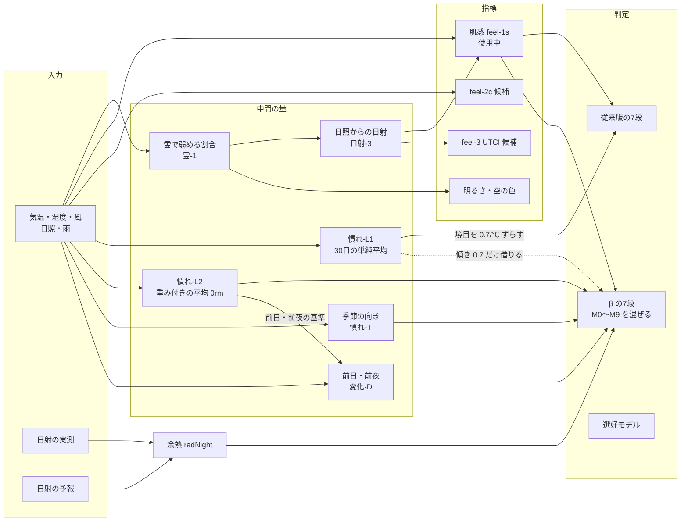

# モデルの地図（計算の変数・計算式・使う所）

1つの変数（たとえば「慣れ」）に計算式の候補がいくつもあるのは、研究としてよいこと。ただし、どの式がどこで使われ、どの式と組み合わさって答えになっているかが見えないと、何がよくて何がいけないのかを確かめられない。この文書はその地図。

- **決まり**：計算式を足す・変える・外すときは、同じ PR でこの地図を直す（表の行と、下の図）
- 式には ID を付ける（例：`慣れ-L1`）。課題・PR・研究メモでは ID で呼ぶ
- 数式の正本は `research/comfort-model/mathematical-contract.md`（MATH-01〜09）。ここは「どれがどこにつながっているか」だけを書く
- 状態：**使用中**（画面か学習に効く）／**候補**（研究用。比較板や記録の列にだけ出る）／**表示用**（見せるだけで、ほかの計算に入らない）

2026-11-15 時点。

## 全体の流れ

## 変数ごとの表

### 日射（W/m²）
| ID | 計算式 | 状態 | 使う所 |
|---|---|---|---|
| 日射-1 | 気象庁の実測（測っている地点だけ） | 使用中 | β の余熱（`radDay`、実測を優先） |
| 日射-2 | 予報（Open-Meteo の短波放射） | 使用中 | β の余熱（実測がないとき） |
| 日射-3 | 日照と雨から：快晴の日射 × 雲-1（`shared/mrt.ts` `hourRadiation`） | 使用中 | 肌感（日なた）feel-1s、feel-3、太陽の比較板 |

**ずれ**：同じ日でも、画面の肌感（日射-3）と β の余熱（日射-1/2）が別の材料。測っていない地点では、β の余熱が実績の日に抜ける → #103 第2段（#132 の後）

### 雲で弱める割合（快晴に対して通す光）
| ID | 計算式 | 状態 | 使う所 |
|---|---|---|---|
| 雲-1 | 日照の割合 s から `throughShare`：日照 0 で 1/3、雨は 1/7 から降水量で暗く（`shared/brightness.ts`） | 使用中（係数は仮） | 明るさ、空の色、日射-3、明るさの移り変わり |

**確かめ中**：日照 0 の 1/3 が強すぎるかもしれない（高知 2025-11-01 の実測で 0.21）→ #132 H-02（PR #188 のジョブ）

### 肌感（日なた・日かげ、℃）
| ID | 計算式 | 状態 | 使う所 |
|---|---|---|---|
| feel-1s | 体感温度（オーストラリア気象局）＋日なたは日射-3 の上乗せ（`shared/feel.ts`） | 使用中（`FEEL_TRANSFORM`） | 表・グラフ・肌感マップ・時間帯、従来版の段、β の答えの土台 |
| feel-2c | 立っている人に当たる直射（投影面積）を足す（`shared/sunLoad.ts`） | 候補 | 記録の列（研究用）。#96 |
| feel-3 | UTCI ＋ 平均放射温度（SolarCal）、日なた・日かげを同じ熱収支で（`shared/mrt.ts`） | 候補 | 太陽の比較板だけ |

**未決**：候補2つを、実データ（冬の日なたの記録）がたまるまで残すか → #96

### 慣れ（長い期間）
| ID | 計算式 | 期間の目安 | 状態 | 使う所 |
|---|---|---|---|---|
| 慣れ-L1 | 過去30日の日平均気温の**単純平均**、5〜30℃で頭打ち（`shared/season.ts`） | 平均の古さ 約15日 | 使用中 | 従来版の段の境目（1℃につき 0.7 ずらす） |
| 慣れ-L2 | 日平均気温の**重み付きの平均** θrm = (1−α)·昨日 + α·前の θrm（`src/beta/adaptation.ts`）。α は記録から 0.6〜0.95 を選ぶ、それまで 0.8 | α 0.8 で半減 約3日 | 使用中 | β の要因 `a`・`aLim`、`dT1`・`coldNight` の基準、画面の「適応基準との差」 |
| 慣れ-T | 2週間の気温の傾き（季節の向き） | 2週間 | 使用中 | β の要因 `trend`（M4・M5・M7・M8） |
| 慣れ-D | 同じ時刻の手前の平均（1週・2週・1か月） | 選べる | 表示用 | 時間帯のグラフの参考線と「手前◯との差」 |
| 慣れ-S | （空き）半日の肌感の重み付きの平均と今の差 など | 数時間 | 候補にしたい | — |

**ずれ**：
1. **β の出発点（事前分布）は、従来版の傾き 0.7 を借りているが、掛ける相手が違う**。従来版は 慣れ-L1（30日の単純平均）、β は 慣れ-L2（半減 約3日）。comfort-7 で「そろえた」のは傾きと頭打ちの幅だけで、慣れの物差しは別のまま
2. 慣れ-D は名前が「手前の平均」で、慣れ-L1・L2 と混同しやすい（表示用で計算には入らない）
3. 短い時間（1〜3時間前・半日）の慣れは、どの式にもない（慣れ-S が空き）

### 前日・前夜・数時間（変化）
| ID | 計算式 | 状態 | 使う所 |
|---|---|---|---|
| 変化-D | 前日の気温の変化（前日 − 慣れ-L2）、前夜の冷え込み（前日の最低 − 慣れ-L2）、前日の湿度・日照・雨 | 使用中 | β の要因 `dT1`・`coldNight`・`h1`・`sun1`・`rain1` |
| 変化-W | 1週間の湿度・日照・雨・気温の振れ | 使用中 | β の要因 `h7`・`sun7`・`rain7`・`v7` |
| 余熱 | 日中の日射（日射-1/2）の合計 → 夜の余熱、直近6時間の風で弱める | 使用中 | β の要因 `radNight`・`radNightWind`（M7・M8） |

### 判定（感じ方の段）
| ID | 計算式 | 状態 | 使う所 |
|---|---|---|---|
| 従来版 | feel-1s を 7段の境目（設定）で切る。境目は 慣れ-L1 で動く | 使用中 | 表・グラフ・肌感マップの段、通知 |
| β | 7段の確率モデル。候補 M0〜M9（要因の組み合わせ）を成績で混ぜる（`MODEL_VERSION` comfort-7） | 使用中 | 比較の要約の β、計算の根拠、記録のあとの予測 |
| 選好 | 暖かくしたいか・飲み物の温度（MATH-09） | 使用中（指数は記録がたまってから） | 計算の根拠 |

β の候補（`src/beta/engine/model.ts`）：

| モデル | 中心を動かす要因 | 幅を動かす要因 | そのほか |
|---|---|---|---|
| M0 一定 | — | — | |
| M1 慣れ | a | — | |
| M2 慣れ＋1週間 | a, h7 | v7, hNow | |
| M3 慣れ＋前日 | a, dT1, h1, sun1, rain1 | v7, h1 | |
| M4 慣れ＋季節の向き | a, trend | v7, trend | |
| M5 前日・1週間・天気・季節の向き | a, dT1, trend, h7, h1, sun1, sun7, rain1, rain7, sky | v7, hNow, h1, sun1, sky, trend | radNight, radNightWind, coldNight, coldNightWind |
| M6 慣れ＋暦の季節（確認用） | a, spring | v7, spring | |
| M7 ＋日射の余熱 | a, trend | v7 | radNight, radNightWind |
| M8 ＋地面の熱 | a, trend | v7 | radNight, radNightWind, coldNight, coldNightWind |
| M9 慣れ（頭打ち） | aLim | — | |

### 明るさ・空の色
| ID | 計算式 | 状態 | 使う所 |
|---|---|---|---|
| 明るさ | 快晴の照度 × 雲-1、夜は街の明かり | 使用中（模式） | 日差しの時間帯、明るさの移り変わり |
| 空の色 | 太陽の高さ × 雲-1 の模式 | 使用中（模式） | 太陽の帯・太陽のシート |

## 見直しの順（2026-11-15）
1. 雲-1 を実測で確かめる（#132 H-02）→ 日射を1つの材料に（#103 第2段）
2. 慣れを「長い基準」と「短い基準」の2本に整理：従来版と β の長い基準を同じ定義にするか決める（予測の版が変わる、承認が要る）。慣れ-D は表示用として名前で区別
3. 慣れ-S（短い時間の慣れ）を β の要因の候補に。#113（長い時間の変化の幅）と並べて実データで比べる
4. 肌感の候補（feel-2c・feel-3）の扱いを、冬の記録で決める（#96）
