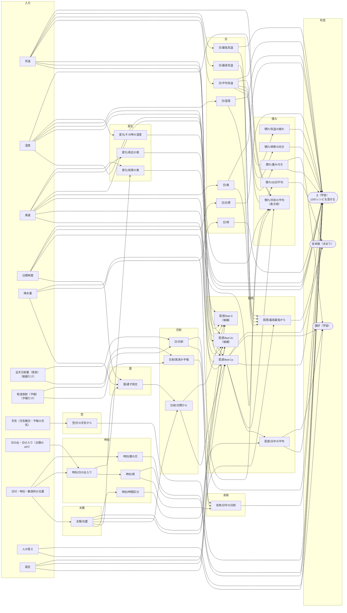

# モデルの地図（計算の変数・計算式・使う所）

<!-- このファイルは src/model/catalog.ts から作る（npm run model-map）。手で直さない。 -->

体感の計算を、**部品**（1つの量を出す計算）・**要因**（部品をモデルに入れる形に）・**レシピ**（学ぶモデルが、どの要因で何を動かすか）・**決まり**（学ばずに部品を使う規則：従来版）に分けて登録してある（#189）。

- **決まり**：計算式を足す・変える・外すときは `src/model/catalog.ts` を同じ PR で直し、`npm run model-map` でこの地図を作り直す（テストが見張る）
- ID（`慣れ/重み付き` など）で呼ぶ。数式の正本は `research/comfort-model/mathematical-contract.md`（MATH-01〜09）
- 状態：**使用中**（画面か学習に効く）／**候補**（研究用）／**表示用**（見せるだけ）
- 学ぶモデルの版は1つ：`comfort-7`（レシピの集まり・要因の作り方・出発点をまとめた版）
- S1（今）：登録は今のコードを説明しているだけ。S2 で計算そのものを部品に移す

## 全体の流れ

## 入力

| ID | 中身 | 種類 | 実績 | 予報 | メモ |
|---|---|---|---|---|---|
| `入力/気温` | 気温 | 気象 | ○ | ○ |  |
| `入力/湿度` | 湿度 | 気象 | ○ | ○ |  |
| `入力/風` | 風速 | 気象 | ○ | ○ | 予報は10m。実績の測る高さは 設定/風速計の高さ |
| `入力/日照` | 日照時間 | 気象 | ○ | ○ |  |
| `入力/雨` | 降水量 | 気象 | ○ | ○ |  |
| `入力/日射の実測` | 全天日射量（実測） | 気象 | ○ | — | 日射を測っている観測所だけ |
| `入力/日射の予報` | 短波放射（予報） | 気象 | — | ○ |  |
| `入力/日の天気` | 天気（天気概況・予報の天気） | 気象 | ○ | ○ | 日の値だけ（毎時の記録の多くに天気の文はない） |
| `入力/日の出入り` | 日の出・日の入り（太陽の API） | 気象 | ○ | ○ | なければ計算（日付と地点） |
| `計算/日付と地点` | 日付・時刻・観測所の位置 | 計算 |  |  |  |
| `設定/風速計の高さ` | 風速計の高さ（地点ごと、初期 10m） | 設定 |  |  |  |
| `設定/周りの様子` | 周りの様子（風の弱まり α） | 設定 |  |  |  |
| `設定/吸収率` | 日差しの吸収率 | 設定 |  |  |  |
| `答え/感じ方` | 感じ方（7段） | 答え |  |  |  |
| `答え/いる場所` | いる場所（日なた・日かげ） | 答え |  |  |  |
| `答え/感じた風` | 感じた風（強い・弱い・ない） | 答え |  |  |  |
| `答え/空` | 答えた空 | 答え |  |  |  |
| `答え/選好` | 暖かく・涼しくしたいか、飲み物の温度 | 答え |  |  |  |

## 部品

### 太陽

| ID | 中身 | 状態 | 入力 | 単位 | 期間・条件 | 値 | 実装 | メモ |
|---|---|---|---|---|---|---|---|---|
| `太陽/位置` | 太陽の高さ | 使用中 | `計算/日付と地点` | ° | — | — | shared/sunTimes.ts solarAltitude |  |

### 時刻

| ID | 中身 | 状態 | 入力 | 単位 | 期間・条件 | 値 | 実装 | メモ |
|---|---|---|---|---|---|---|---|---|
| `時刻/日の出入り` | 日の出・日の入り（API、なければ計算） | 使用中 | `入力/日の出入り` `計算/日付と地点` | 時刻 | — | — | src/beta/engine/observations.ts riseSet・shared/dayParts.ts dayEdges |  |
| `時刻/夜` | 夜か（日の入り〜日の出）と、日の入りからの時間 | 使用中 | `時刻/日の出入り` | 夜=1・時間 | — | — | src/beta/engine/observations.ts nightOf |  |
| `時刻/時間区分` | 時間区分（朝・日中・昼・夕方・夜） | 使用中 | `太陽/位置` | 区分 | — | — | shared/dayParts.ts dayParts |  |
| `時刻/暦の日` | 年の何日目か | 使用中 | `計算/日付と地点` | 日 | — | — | src/beta/engine/observations.ts dayOfYear |  |

### 雲

| ID | 中身 | 状態 | 入力 | 単位 | 期間・条件 | 値 | 実装 | メモ |
|---|---|---|---|---|---|---|---|---|
| `雲/通す割合` | 雲で弱める割合（快晴に対して通す光） | 使用中 | `入力/日照` `入力/雨` `太陽/位置` | 0〜1 | — | 日照 0：1/3 雨：1/7 から降水量で暗く（−0.25 乗） | shared/brightness.ts sunshineFactor | 係数は仮。気象庁の実測で確かめる（#132、PR #188 のジョブ） #132 |

### 日射

| ID | 中身 | 状態 | 入力 | 単位 | 期間・条件 | 値 | 実装 | メモ |
|---|---|---|---|---|---|---|---|---|
| `日射/日照から` | 日照と雨から出す日射 | 使用中 | `雲/通す割合` `太陽/位置` | W/m² | — | — | shared/mrt.ts hourRadiation・sunshineRadiation | #103 |
| `日射/実測か予報` | 日射（実測、なければ予報） | 使用中 | `入力/日射の実測` `入力/日射の予報` | W/m² | — | — | shared/feel.ts radiationOf | 日射を測っていない地点では、実績の日に値がない。日射/日照から にそろえるかは #132 の後で決める #103 |
| `日/日射` | 日射の日の合計（実測、なければ予報） | 使用中 | `入力/日射の実測` `入力/日射の予報` | MJ/m² | — | — | 日の値 row.radiation |  |

### 肌感

| ID | 中身 | 状態 | 入力 | 単位 | 期間・条件 | 値 | 実装 | メモ |
|---|---|---|---|---|---|---|---|---|
| `肌感/feel-1s` | 肌感（日なた・日かげ）feel-1s | 使用中 | `入力/気温` `入力/湿度` `入力/風` `日射/日照から` `設定/風速計の高さ` `設定/周りの様子` `設定/吸収率` | ℃ | — | — | shared/feel.ts feelOf | 体感温度（オーストラリア気象局）＋日なたは日射の上乗せ。11/14 0時台より前の記録は feel-1（日射/実測か予報）で保存 |
| `肌感/日中の平均` | 日中（朝の終わり〜夕方）の肌感の平均 | 使用中 | `肌感/feel-1s` `時刻/時間区分` | ℃ | — | — | shared/feel.ts daytimeFeel | β の日ごとの予測の場所の肌感、選好の日、比較の要約の「適応基準との差」 |
| `肌感/最高最低から` | 日の最高・最低から出す肌感（日射なし） | 使用中 | `日/最高気温` `日/最低気温` `日/湿度` `日/風` `設定/風速計の高さ` `設定/周りの様子` `設定/吸収率` | ℃ | — | — | shared/feel.ts estimatedBands | 毎時がない日の表の肌感の帯（従来版の段） |
| `肌感/feel-2c` | 肌感の候補 feel-2c：体に当たる直射 | 候補 | `入力/気温` `入力/湿度` `入力/風` `入力/日照` `太陽/位置` `設定/風速計の高さ` `設定/周りの様子` `設定/吸収率` | ℃ | — | — | shared/sunLoad.ts feel2Warming | 記録の列（研究用） #96 |
| `肌感/feel-3` | 肌感の候補 feel-3：UTCI と平均放射温度 | 候補 | `入力/気温` `入力/湿度` `入力/風` `日射/日照から` `太陽/位置` | ℃ | — | — | shared/mrt.ts feel3 | 設定の太陽の比較板に出る #96 |

### 日

| ID | 中身 | 状態 | 入力 | 単位 | 期間・条件 | 値 | 実装 | メモ |
|---|---|---|---|---|---|---|---|---|
| `日/平均気温` | 日平均気温 | 使用中 | `入力/気温` | ℃ | — | — | 日の値 row.temp（予報は毎時の平均） |  |
| `日/最高気温` | 日最高気温 | 使用中 | `入力/気温` | ℃ | — | — | 日の値 row.max |  |
| `日/最低気温` | 日最低気温 | 使用中 | `入力/気温` | ℃ | — | — | 日の値 row.min |  |
| `日/湿度` | 日平均湿度 | 使用中 | `入力/湿度` | % | — | — | 日の値 row.humidity |  |
| `日/風` | 日平均風速 | 使用中 | `入力/風` | m/s | — | — | 日の値 row.wind |  |
| `日/日照` | 日照時間（日） | 使用中 | `入力/日照` | 時間 | — | — | 日の値 row.sun |  |
| `日/雨` | 降水量（日） | 使用中 | `入力/雨` | mm | — | — | 日の値 row.rain |  |

### 変化

| ID | 中身 | 状態 | 入力 | 単位 | 期間・条件 | 値 | 実装 | メモ |
|---|---|---|---|---|---|---|---|---|
| `変化/その時の湿度` | その時刻の湿度（毎時・10分値） | 使用中 | `入力/湿度` | % | — | — | src/beta/reports.ts（snapshot.humidity） |  |
| `変化/直近の風` | 直近6時間の平均風速 | 使用中 | `入力/風` | m/s | 6時間 | — | src/beta/reports.ts windMemory（wind6h） |  |
| `変化/前夜の風` | 前夜の平均風速（日の入り〜日の出） | 使用中 | `入力/風` `時刻/日の出入り` | m/s | — | — | src/beta/reports.ts windMemory（windLastNight） | 古い記録は 18〜6時で保存。計算の根拠の表示もまだ「18〜6時」 |

### 空

| ID | 中身 | 状態 | 入力 | 単位 | 期間・条件 | 値 | 実装 | メモ |
|---|---|---|---|---|---|---|---|---|
| `空/日の天気から` | 晴れか（日の天気の文から） | 使用中 | `入力/日の天気` | 晴れ=1 | — | — | src/beta/useBaseline.ts（weatherGroup） |  |

### 慣れ

| ID | 中身 | 状態 | 入力 | 単位 | 期間・条件 | 値 | 実装 | メモ |
|---|---|---|---|---|---|---|---|---|
| `慣れ/30日平均` | 過去30日の日平均気温の単純平均 | 使用中 | `日/平均気温` | ℃ | 30日（24日以上そろうとき。平均の古さ 約15.5日） | — | shared/season.ts mean30 | #111 |
| `慣れ/重み付き` | 日平均気温の重み付きの平均 θrm（最近の基準） | 使用中 | `日/平均気温` | ℃ | 最大60日。前日の値と、重みの8割がそろうとき | α：0.6・0.7・0.8・0.85・0.9・0.95 から選ぶ。記録が少ないうちは 0.8（半減 約3.1日）（学ぶ：β/M2 の成績（記録 30件以上）） | src/beta/adaptation.ts runningMean | β の出発点は従来版の傾き 0.7 を借りるが、掛ける相手は 慣れ/30日平均 ではなくこちら（model.ts PRIOR.slope は数を直接書いている） #54 |
| `慣れ/季節の向き` | 2週間の日平均気温の傾き | 使用中 | `日/平均気温` | ℃/週 | 14日（10日以上そろうとき） | — | src/beta/engine/observations.ts trendOf |  |
| `慣れ/気温の振れ` | 1週間の日平均気温の標準偏差 | 使用中 | `日/平均気温` | ℃ | 7日（3日以上） | — | src/beta/engine/observations.ts driversFrom（v7） |  |
| `慣れ/手前の平均` | 同じ時刻の手前の平均（時間帯のグラフ） | 表示用 | `肌感/feel-1s` `入力/気温` `入力/湿度` `入力/風` `入力/日照` `入力/雨` | 選んでいる項目の単位 | 1週・2週・1か月 | — | src/hourAverage.ts meanByHour | 見せるだけで、ほかの計算に入らない |

### 余熱

| ID | 中身 | 状態 | 入力 | 単位 | 期間・条件 | 値 | 実装 | メモ |
|---|---|---|---|---|---|---|---|---|
| `余熱/日中の日射` | 直近の昼の日射の合計と、日の入りからの時間 | 使用中 | `日射/実測か予報` `日/日射` `時刻/夜` | MJ/m²・時間 | — | — | src/beta/reports.ts radDayOf・observations.ts storedSunOf | 夕方はその日の途中までの合計、日の出前は前日の日の合計 #103・#86 |

## 要因

学習は保存した記録から、日ごとの予測はストアから組み立てる。違いのある要因は下の「学習と予測の違い」にも載せる。

| 要因 | 中身 | 単位 | 学習 | 日ごとの予測 |
|---|---|---|---|---|
| `E` | 場所の肌感（日なた・日かげ） | ℃ | `肌感/feel-1s` `答え/いる場所` （記録に保存した値） | `肌感/日中の平均` |
| `windFelt` | 感じた風（強い・弱い） | 強い・弱い | `答え/感じた風` | — |
| `a` | 最近の基準 | 1℃ | `慣れ/重み付き` | `慣れ/重み付き` |
| `aLim` | 最近の基準（5〜30℃で頭打ち） | 1℃ | `慣れ/重み付き` | `慣れ/重み付き` |
| `dT1` | 前日の気温の変化（前日 − 基準） | 1℃ | `日/平均気温` `慣れ/重み付き` | `日/平均気温` `慣れ/重み付き` |
| `h7` | 1週間の湿度 | 10% | `日/湿度` | `日/湿度` |
| `h1` | 前日の湿度 | 10% | `日/湿度` | `日/湿度` |
| `hNow` | 今の湿度 | 10% | `変化/その時の湿度` （記録に保存した値） | `日/湿度` |
| `v7` | 1週間の気温の振れ | 1℃ | `慣れ/気温の振れ` | `慣れ/気温の振れ` |
| `sun1` | 前日の日照 | 3時間 | `日/日照` | `日/日照` |
| `sun7` | 1週間の日照 | 3時間 | `日/日照` | `日/日照` |
| `rain1` | 前日の雨 | log(1+mm) | `日/雨` | `日/雨` |
| `rain7` | 1週間の雨 | log(1+mm) | `日/雨` | `日/雨` |
| `sky` | 晴れている（日中） | 晴れ=1 | `答え/空` `時刻/夜` | `答え/空` `空/日の天気から` `時刻/夜` |
| `trend` | 季節の向き（2週間の気温の傾き） | 1℃/週 | `慣れ/季節の向き` | `慣れ/季節の向き` |
| `spring` | 暦の春らしさ | 春=+1, 秋=−1 | `時刻/暦の日` | `時刻/暦の日` |
| `radNight` | 日中の日射の余熱（夜） | 5MJ/m² | `余熱/日中の日射` `時刻/夜` （記録に保存した値） | `余熱/日中の日射` `日/日射` `時刻/夜` |
| `radNightWind` | 余熱 × 直近6時間の風 | 5MJ/m² × 2m/s | `余熱/日中の日射` `時刻/夜` `変化/直近の風` （記録に保存した値） | `余熱/日中の日射` `日/日射` `時刻/夜` `変化/直近の風` |
| `coldNight` | 前夜の冷え込み（前日の最低 − 基準） | 3℃ | `日/最低気温` `慣れ/重み付き` `時刻/夜` | `日/最低気温` `慣れ/重み付き` `時刻/夜` |
| `coldNightWind` | 前夜の冷え込み × 前夜の風 | 3℃ × 2m/s | `日/最低気温` `慣れ/重み付き` `時刻/夜` `変化/前夜の風` `日/風` （記録に保存した値） | `日/最低気温` `慣れ/重み付き` `時刻/夜` `変化/前夜の風` `日/風` |
| `y` | 答えた感じ方（選好のモデル用） | 7段 | `答え/感じ方` | — |

## 学習と予測の違い

同じ要因でも、学習と日ごとの予測で材料が違うもの。S2 で1つの組み立てにそろえ、残る違いはテストで固定する。

| 要因 | 違い |
|---|---|
| `E` | 学習は答えた時刻・場所の肌感（保存したときの式：feel-1 が混ざる）、日ごとの予測は日中の平均の日なた |
| `windFelt` | 答えにしかない。日ごとの予測では使わない |
| `hNow` | 学習は答えた時刻の湿度、日ごとの予測は日平均の湿度 |
| `sky` | 学習は答えた空だけ、日ごとの予測は答えがなければ日の天気の文 |
| `radNight` | 学習は記録に保存した日射、日ごとの予測はストアの日の値 |
| `radNightWind` | 学習は記録に保存した日射と風、日ごとの予測はストアの値 |
| `coldNightWind` | 学習は記録に保存した前夜の風、日ごとの予測はストアの毎時から計算し直す |
| `y` | 答えにしかない。日ごとの選好の予測では 0（ちょうどよい） |

## レシピ（学ぶモデル、版 `comfort-7`）

| レシピ | 中身 | 共通の要因 | 中心 | 幅 | 場所 | メモ |
|---|---|---|---|---|---|---|
| `β/M0` | 一定 | E, windFelt | — | — | — |  |
| `β/M1` | 慣れ | E, windFelt | a | — | — |  |
| `β/M2` | 慣れ＋1週間 | E, windFelt | a, h7 | v7, hNow | — |  |
| `β/M3` | 慣れ＋前日 | E, windFelt | a, dT1, h1, sun1, rain1 | v7, h1 | — |  |
| `β/M4` | 慣れ＋季節の向き | E, windFelt | a, trend | v7, trend | — |  |
| `β/M5` | 前日・1週間・天気・季節の向き | E, windFelt | a, dT1, trend, h7, h1, sun1, sun7, rain1, rain7, sky | v7, hNow, h1, sun1, sky, trend | radNight, radNightWind, coldNight, coldNightWind |  |
| `β/M6` | 慣れ＋暦の季節（確認用） | E, windFelt | a, spring | v7, spring | — | 確認用（暦の季節）。重みづけには加わる |
| `β/M7` | 慣れ＋季節の向き＋日射の余熱 | E, windFelt | a, trend | v7 | radNight, radNightWind |  |
| `β/M8` | 慣れ＋季節の向き＋地面の熱（余熱と前夜の冷え、風付き） | E, windFelt | a, trend | v7 | radNight, radNightWind, coldNight, coldNightWind |  |
| `β/M9` | 慣れ（頭打ち） | E, windFelt | aLim | — | — |  |
| `選好/温熱` | 暖かく・涼しくしたいか（MATH-09） | E, a, y | — | — | — | 指数は記録がたまってから。計算の根拠に出る |
| `選好/飲み物` | 温かい・冷たい飲み物（MATH-09） | E, a | — | — | — |  |

## 決まり（学ばない）

| 決まり | 中身 | 読む部品 | 値 | 実装 | メモ |
|---|---|---|---|---|---|
| `従来版` | 従来版の段：肌感を7段の境目で切る | `肌感/feel-1s` `肌感/最高最低から` `慣れ/30日平均` | 境目：設定 慣れの傾き：1℃につき 0.7（5〜30℃で頭打ち、基準 15℃） | shared/feel.ts levelOf・shared/season.ts seasonShift・src/feelSeason.ts | 学ばない決まり。表・グラフ・肌感マップの段 |

## データの原則（実績と予報の両方にある入力）

| 部品・要因 | 片方にしかない入力 | 決める課題 |
|---|---|---|
| `日射/実測か予報` | `入力/日射の実測` `入力/日射の予報` | #103 |
| `日/日射` | `入力/日射の実測` `入力/日射の予報` | #103 |
| `余熱/日中の日射` | `入力/日射の実測` `入力/日射の予報` | #103 |
| `要因 radNight` | `入力/日射の実測` `入力/日射の予報` | #103 |
| `要因 radNightWind` | `入力/日射の実測` `入力/日射の予報` | #103 |

## 慣れを読む部品（どれがどこへ）

| 部品 | 期間・条件 | 使う決まり・要因 |
|---|---|---|
| `慣れ/30日平均` | 30日（24日以上そろうとき。平均の古さ 約15.5日） | `従来版` |
| `慣れ/重み付き` | 最大60日。前日の値と、重みの8割がそろうとき | `a`、`aLim`、`dT1`、`coldNight`、`coldNightWind` |
| `慣れ/季節の向き` | 14日（10日以上そろうとき） | `trend` |
| `慣れ/気温の振れ` | 7日（3日以上） | `v7` |
| `慣れ/手前の平均` | 1週・2週・1か月 | （表示だけ） |

