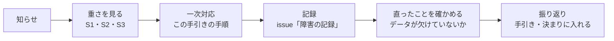

# 障害とイレギュラーの手引き

知らせが来たとき・いつもと違うことが起きたときに、**誰が・何を見て・何をして・いつ終わりとするか**を決めておく手引きです（2026-11-18、渡辺さん「障害時対応とイレギュラーの対応を仕組みで回す」）。

知らせの1行1行には、ここの手順の番号と重さが付いています。例：「雨雲レーダーの保存が…（手順 R-03・S1）」。番号は `shared/runbook.ts` で知らせの key から引きます。新しい知らせを足したら、ここに手順を足します。足し忘れると `test/runbook.test.ts` が落ち、知らせには「（手順 なし：手引きに足す）」と出ます。

## 1. 流れ

1. **受ける**：知らせはメインのスレッド「天気アプリ」に持ってきます（スクリーンショットか文面）。毎朝の点検と GitHub の監視の issue（ラベル `health`）も同じ扱いです。いちばん手早いのは、アプリの設定 → **データの保守** →「まとめてコピー」を貼ることです（今の状態・取得の様子・エラーの文言・大きさが1つにまとまります。エラーの文言だけなら「エラーをコピー」）。
2. **重さを見る**：下の表の S1・S2・S3 です。S1 は取り戻せる期限があるので、ほかの作業より先にします。
3. **一次対応**：2章の手順に沿います。その前に、アプリ自身が一時的な失敗をやり直していることを踏まえます（2026-11-19、`worker/src/retry.ts`）：気象庁の取得は 5xx・429・接続の切れを 0.5秒 → 2秒 と待って3回まで、定時処理の段は一時的な D1 の失敗のあと1秒待って1回だけ。それでも残った失敗だけが知らせになります。手順に書いていないことはしません。迷ったら、PR か issue のコメントに書いて止まります。
4. **記録**：S1 と S2 は issue「障害の記録」（テンプレートあり）を開きます。同じ出来事には1つだけです。S3 は issue を開かず、工程表の「待っている判断」か「次の候補」に入れます。
5. **直ったことを確かめる**：知らせが「直りました」になるだけでは終わりにしません。データが欠けていないかを、次の毎朝の点検で確かめます。取り戻せなかった分は、欠けとして記録に書きます。
6. **振り返り**：同じことが2回起きたら、仕組み（コード・見張り・決まり）に入れます。1回きりのことは記録だけにします（`docs/thread-rules.md`「いつも守ること」）。

### 重さ

| 重さ | 意味 | 一次対応の目安 |
| --- | --- | --- |
| **S1** | このままだと**データが取り戻せなくなる**（期限がある） | 知らせを受けたら、ほかの作業より先に。期限は各手順に書く |
| **S2** | 止まっている・失敗しているが、**後から取り戻せる** | その日のうちに |
| **S3** | 余裕が減っている・無駄がある・確かめられない | 次の工程の見直しで |

### 誰が何をするか

| すること | 誰が |
| --- | --- |
| 知らせをメインに持ってくる。Cloudflare のダッシュボード（Workers Logs・D1・R2）を見る。管理画面の操作 | 渡辺さん |
| 手順に沿った見立て・コードの直し・PR・記録・振り返り | メインのスレッド |
| マージ、元に戻せない操作（データの削除・秘密の鍵の変更・プランの変更） | **渡辺さんの OK のあと**、メインのスレッドが行う |

見るところ：
- `/api/health`：状態・余裕・無駄。定時処理は `room.cron`（決まった288回の窓、記録の無い回、Cloudflare 自身の記録）。
- 毎朝の点検：24時間の回数と、欠けた時刻。
- Workers Logs（D1 とは別の記録）：`"wn":"cron-start"`・`"wn":"cron-stage"` の行。

## 2. 知らせごとの手順

### R-01 予報の電文が取れない・届かない（S1）
- **知らせの key**：`forecastStale`・`forecastGap`・`alert:fetch`・`alert:missing`・`fetchFailures`
- **期限**：気象庁の長い一覧は7日です。数時間なら次の回で取り戻せます。**その時点の予報は後から作れない**ので、7日を過ぎた発表は永久に欠けます。
- **一次対応**
  1. 毎朝の点検と `/api/health` で、取得の失敗（`waste.fetchFailuresLastDay`）か、届かない回（`alert:missing:種類`）かを見ます。
  2. 取得の失敗なら、気象庁が止まっているか、こちらが止まっているかを見ます（R-06 も見る）。気象庁が止まっているなら待ちます。
  3. 届かない回で、取得は成功しているなら、気象庁がその発表を出していない可能性があります。「取れなかった」と「出ていない」を分けて記録します（R5-1）。
  4. `forecastGap`（間の欠け）は、最新が届いていても**途中の定時の発表が抜けている**ことです（`worker/src/completeness.ts`）。`/api/health` の `state.completeness.forecast` で、どの回かを見ます。3時間で注意、5日で異常です（残り2日）。
- **終わり**：知らせが「直りました」になり、該当の発表がアプリの「この日の予報の移り変わり」に出ていること。

### R-02 台風の電文が取れない・読めない（S1）
- **知らせの key**：`typhoonStale`・`alert:collector`・`alert:json`・`alert:mismatch`・`alert:problems`
- **期限**：長い一覧は7日。台風が近いときは、表示が止まることのほうが問題です。
- **一次対応**：取れない（`typhoonStale`・`collector`）か、読めない（`json`・`problems`）か、食い違い（`mismatch`）かを分けます。読めないなら、気象庁の形の変化を疑います（R-08）。電文の原本は D1 と R2 に残っているので、直した後に読み直せます。
- **終わり**：台風の画面に最新の発表が出ていること。

### R-03 雨雲レーダー・解析雨量が保存できない（S1）
- **知らせの key**：`radarStale`
- **期限**：**雨雲レーダーは約3時間**（気象庁の一覧）、解析雨量は約12時間。2時間で異常の知らせが来るので、残りは約1時間です。
- **一次対応**
  1. R-06（定時処理）と同時かを見ます。定時処理が止まっているなら、そちらが原因です。
  2. 気象庁のタイルが取れないのか（`radar_fetch_log` のエラー）、R2 に書けないのかを見ます。
  3. 原因が直った後、残りが短ければ、設定 → データの保守 →「取得の様子」の雨雲レーダー・解析雨量の「今すぐ取り直す」を押します（要るときだけ出ます）（1時間に3回まで、記録が残ります）。押さなくても、次の回から1回に1時刻ずつ、一覧から間もなく消える時刻を先に取り戻します（#342）。
- **終わり**：毎朝の点検の「雨雲レーダーの保存：48時刻中…」で欠けた時刻を確かめ、取り戻せなかった時刻を記録に書くこと。

### R-04 警報・注意報の電文が保存できない（S1）
- **知らせの key**：`warningStale`（1日で注意、3日で異常）
- **期限**：長い一覧の7日。一覧から外れた電文は名前が分からないので、取りに行けません（#267）。
- **一次対応**：R-01 と同じ見方です。3日を過ぎたら、ほかの作業より先にします。
- **終わり**：`/api/health` の `state.warnings.lastOk` が新しくなり、その間の電文が保存されていること。

### R-05 天気図・長い先の予報・アメダスの観測・空気質が保存できない（S2）
- **知らせの key**：`chartsStale`・`longRangeStale`・`amedasStale`（アメダスは半日で注意、2日で異常）・`airStale`（空気質は2日で注意。2023-01 から取り直せるので急がない）
- **期限**：長い先の予報は一覧の7日。**予想天気図は最新の1回だけ**なので、止まっている間の分は取れません。アメダスの10分ごとの JSON は約10日（KC-04）。8日前までは保存の処理が自分で埋め直します。
- **一次対応**：R-06 と同時かを見ます。単独なら、気象庁の URL や形の変化を疑います。
- **終わり**：保存が再開し、欠けた日を記録に書くこと。

### R-06 定時処理が抜ける・失敗する・遅い（S2）
- **知らせの key**：`cronRuns`・`cronFailed:段`・`cronSlow:段`
- **一次対応**（3段階で判断する。#297・#298）
  1. **起動しているか**：予定の288回・Cloudflare 自身の記録・D1 の記録を照らし合わせます（`room.cron.cloudflare` の「始めたのに D1 に残らなかった回」「始まらなかった回」）。**記録が無い＝起動しなかった、とは決めつけません**（D1 に書けなかった場合があります）。Workers Logs でも確かめます。
  2. **時間が重なっているか**：記録の無い時間と、アカウントの処理の失敗（R-07）の時刻を重ねます。重なっていれば、D1 が混んでいるか止まっています。
  3. **データが欠けたか**：処理の回が欠けたことと、データが実際に欠けたことを分けます（R-01〜R-05 の期限）。
- **遅い**：`room.cron.stages` の `avg_ms` と `avg_d1_ms` を比べます。D1 の待ちが大きいか、気象庁・R2 の待ちが大きいかで、直す所が変わります。
- **終わり**：決まった288回のうち、記録のある回が戻ること。原因が分かったら記録に書くこと。

### R-07 アカウントの処理（同期・通知・管理）の失敗（S2）
- **知らせの key**：`accountErrors`
- **データへの影響**：肌感の記録は、端末が次の同期で送り直します。重なりません（#298 で確認）。なので、同期の失敗だけなら記録は欠けません。
- **一次対応**：毎朝の点検の「アカウントの処理の失敗」（文言・時刻・場所）を見ます。文言は公開しません。R-06 と時間が重なるかを見ます。
- **終わり**：失敗が止まり、原因（D1 の混み合いなど）を記録に書くこと。

### R-08 電文が読めない・たまる（S2）
- **知らせの key**：`unparsed`・`parseFailed`
- **期限**：原本は残っているので、読み方を直せば後から読めます。
- **一次対応**：読めなかった電文の種類と、気象庁の形の変化（新しい要素・コード）を調べます。直し方は「調査」のスレッドに出すか、メインで解析器を直します。
- **終わり**：たまった電文が読まれ、`waste.unparsed` が減ること。

### R-09 余裕（S3）
- **知らせの key**：`d1Size`・`d1Writes`・`r2`・`cpuP99`・`month:…`・`usage…`
- **一次対応**：どの量が、どのくらいの速さで増えているかを見て、工程表の「待っている判断」に入れます。プランの変更やデータの削除は渡辺さんの判断です。
- **終わり**：見直しの判断が工程表に入ること。

### R-10 過去の記録の取り込み（S3）
- **知らせの key**：`importUnknown`・`import:月`
- **一次対応**：「取り込める月があります」の知らせが来たら、渡辺さんが管理画面の「予報の履歴：過去の記録の取り込み」から取り込みます（自動では取り込みません）。確かめられなかった場合は、記録のリポジトリが読めるかを見ます。
- **終わり**：その月が取り込まれ、次の月が「次」になること。

### R-11 取り戻せない欠けが出た（S2）
- **知らせの key**：`dataLost`
- **意味**：提供元の一覧から外れて、もう取り戻せない欠けが新しく見つかりました。`data_gaps` に1度だけ残り、消えません（明示する）。予報の電文は定時の発表の1回ずつ、雨雲レーダー・解析雨量は30分ごとの時刻の1つずつです。
- **取れなかった／出ていない**（2026-11-19、#299 P1）：一覧を読めた回があったのに、その時刻が一度も載らなかった回は「気象庁が出していない」として分けます（`data_absent`、欠けではないので知らせません）。載っていたのに取れなかった回と、証拠（`source_listed`）を取り始める前の回が、ここ（`data_gaps`）に残ります。
- **一次対応**
  1. どの範囲が欠けたかを `/api/health` の `state.completeness`（`lostAll`・各系列の `lost`）で見ます。
  2. 原因になった知らせ（R-01・R-03・R-06 など）の記録に、欠けた範囲を書きます。無ければ「障害の記録」を開きます。
  3. 別の出どころで埋められるかを見ます。予報は過去の記録（shiromatz）の取り込みで、その発表が入ることがあります。埋まると、毎時の見張りが `data_gaps` の行に「取り戻した日と手段」（`recovered_at`・`recovered_by`）を付けます。欠けた事実の行は消えません。毎朝の点検では「後で取り戻した欠け」として数えます。
- **終わり**：欠けた範囲と、その理由が記録に書かれること。同じ原因の2回目なら、仕組みに入れること。

## 3. イレギュラー（知らせが来なくても、いつもと違うとき）

| 起きること | 気づき方 | すること |
| --- | --- | --- |
| 台風が近い・大雨 | 台風の札・警報 | 台風・雨雲・警報の保存が S1 になります。毎朝の点検の欠けた時刻を、その日はよく見ます。ほかの変更（マージ・デプロイ）は控えめにします |
| 気象庁の形・URL が変わる | R-08、取れない知らせ | 原本を残したまま止めずに、読み方を直します。変化を `docs/data-map.md` に書きます |
| 気象庁・Cloudflare 側の障害 | 同時に多くの知らせ | 公式の障害情報を確かめ、こちらの変更は止めます。戻った後に、欠けた範囲を記録します |
| デプロイ・マージの後に動きがおかしい | 知らせ・画面 | 直前の PR を疑います。戻すなら、`revert` の PR を作って OK をもらいます |
| 月の変わり目・取り込み | R-10 | 取り込みは渡辺さんの操作。取り込んだ後に、その月の表示を確かめます |
| 容量・料金の上限に近い | R-09 | 消す・プランを変えるは渡辺さんの判断。先に量の見積もりを出します |
| 秘密の鍵・メールアドレス・アプリの URL を書いてしまった | 見つけたとき | すぐに消し、鍵なら渡辺さんに作り直しを頼みます（リポジトリの履歴に残るため） |

## 4. 記録と振り返り

- 記録は issue のテンプレート「障害の記録」と「イレギュラーの記録」を使います（`.github/ISSUE_TEMPLATE/`）。時刻は日本時間です（取得の記録は UTC のまま貼ってよい）。
- 「処理が抜けた」と「データが欠けた」を分けて書きます。取り戻せなかったデータは、範囲（いつからいつまで、何が）を書きます。
- 振り返りでは、**同じことの2回目**を仕組みに入れます。コード、見張りの知らせ、この手引き、`docs/thread-rules.md` のどれかです。
- 物差し（#299）：データの完全性・重複率・欠損の回復率・回復までの時間。
