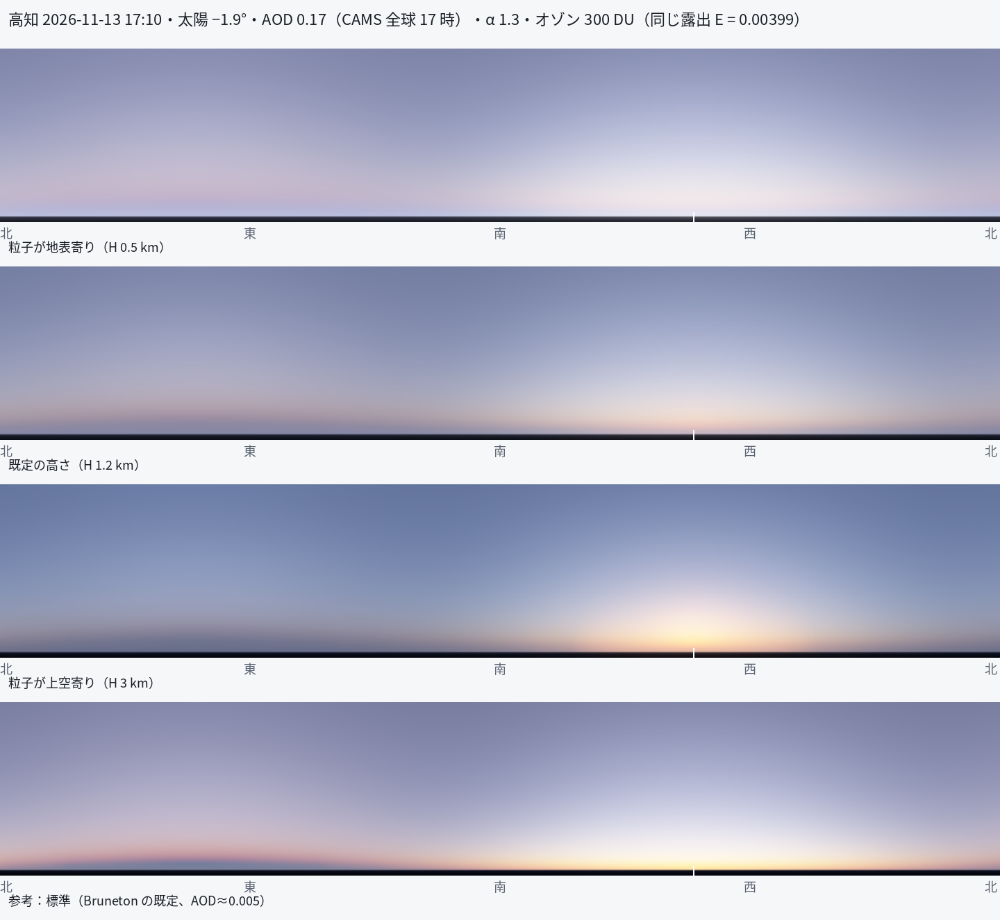
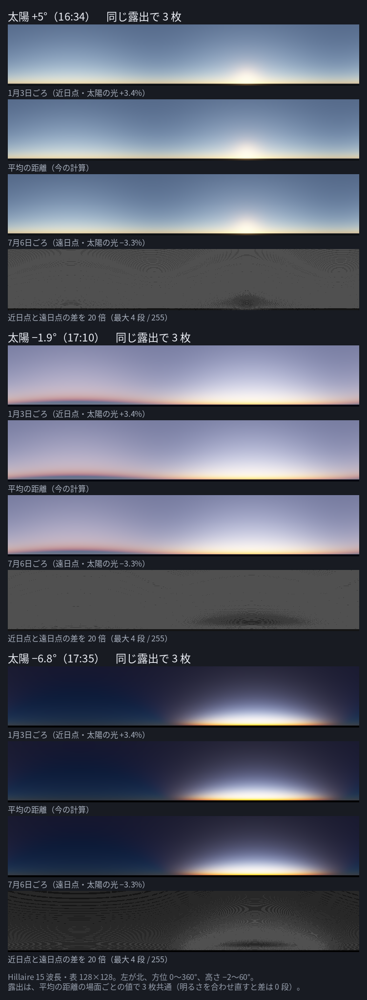
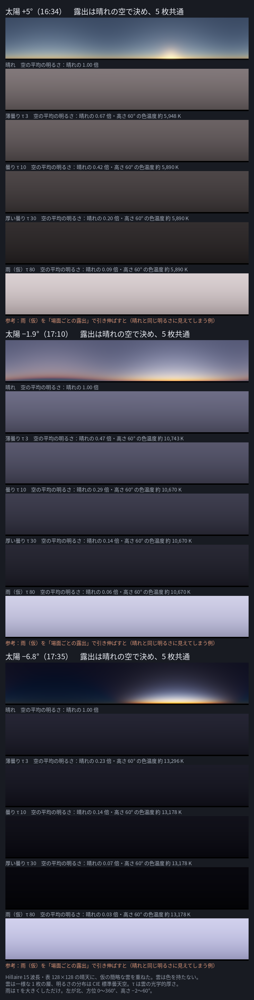
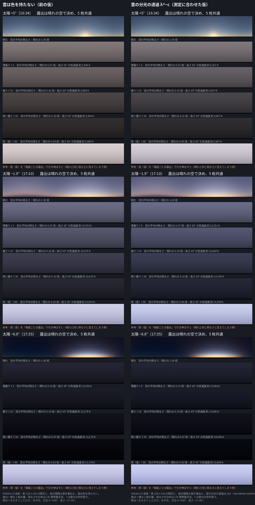

# β2 の最初の比較：結果（2026-11-27）

高知（47893）・2026-11-13 の晴天空、観測者は地表から 10 m。β1＝今の空の絵の晴天大気（`shared/skyScene.ts`、#544 まで）、
参照＝Bruneton のモデル（PC の OpenGL、Mesa llvmpipe）、WebGL 2＝同じ表を Chromium（SwiftShader）で読み出した値。

## 照合（OpenGL と WebGL 2）
- 同じ事前計算の表（半精度）・同じ視線で、放射輝度の差は最大 0.04%（0.1 mW/m²/sr/nm 超の視線）。暗い視線（薄明の反対側など）で数 % の差が出るのは半精度の丸め
- 時間（Chromium・ソフトウェア描画）：表の読み込み 約 120 ms、準備 約 35 ms、帯 720×125 の計算と読み戻し 約 17〜27 ms。iPhone は比較ページで測る
- OpenGL の事前計算：3 波長 約 34 秒、15 波長 約 165 秒（llvmpipe、2 コア）

## 色の比較（同じ露出 E＝10、白は太陽スペクトル。β1 は表示の色のまま）
暖かさ＝白で割った線形の (R − B) / (R + G + B)。

| 事例 | 視線 | β1 | 参照（同じ露出） | 参照の放射輝度 550 nm（mW/m²/sr/nm） | 暖かさ β1 | 暖かさ 参照 | 透過率 550 nm | WebGL/OpenGL |
|---|---|---|---|---|---|---|---|---|
| sun+5（5.0°） | 太陽側 3° | #f5cab2 | #f9f4cd | 227.38 | +0.24 | +0.33 | 0.140 | 1.0000 |
| sun+5（5.0°） | 横 3° | #b9a09d | #8da395 | 44.19 | +0.13 | -0.04 | 0.140 | 1.0000 |
| sun+5（5.0°） | 反対側 3° | #aba2a2 | #aebfa7 | 71.20 | +0.04 | +0.04 | 0.140 | 1.0000 |
| sun+5（5.0°） | 太陽側 20° | #bfa5b0 | #889dad | 39.91 | +0.07 | -0.21 | 0.664 | 1.0000 |
| sun+5（5.0°） | 横 20° | #9e98af | #51728e | 17.86 | -0.08 | -0.39 | 0.664 | 1.0000 |
| sun+5（5.0°） | 反対側 20° | #969ab1 | #688ca5 | 29.21 | -0.13 | -0.35 | 0.664 | 1.0000 |
| sun+5（5.0°） | 天頂 | #4985d0 | #314a66 | 6.82 | -0.61 | -0.46 | 0.868 | 1.0000 |
| sunset-1.9（-1.9°） | 太陽側 3° | #e8966a | #78593a | 10.26 | +0.53 | +0.46 | 0.140 | 1.0000 |
| sunset-1.9（-1.9°） | 横 3° | #ac8e88 | #3e2d27 | 2.55 | +0.18 | +0.30 | 0.140 | 1.0000 |
| sunset-1.9（-1.9°） | 反対側 3° | #9b908e | #221821 | 0.87 | +0.06 | +0.01 | 0.140 | 1.0000 |
| sunset-1.9（-1.9°） | 太陽側 20° | #ad8494 | #383744 | 3.81 | +0.13 | -0.14 | 0.664 | 1.0000 |
| sunset-1.9（-1.9°） | 横 20° | #94879e | #262530 | 1.79 | -0.05 | -0.15 | 0.664 | 1.0000 |
| sunset-1.9（-1.9°） | 反対側 20° | #8b88a1 | #302b34 | 2.34 | -0.12 | -0.05 | 0.664 | 1.0000 |
| sunset-1.9（-1.9°） | 天頂 | #5575c5 | #141521 | 0.74 | -0.57 | -0.27 | 0.868 | 0.9999 |
| dusk-6.8（-6.8°） | 太陽側 3° | #986c6d | #180d06 | 0.41 | +0.26 | +0.50 | 0.140 | 1.0001 |
| dusk-6.8（-6.8°） | 横 3° | #5f5672 | #010001 | 0.01 | -0.14 | +0.04 | 0.140 | 0.9933 |
| dusk-6.8（-6.8°） | 反対側 3° | #545372 | #000000 | 0.00 | -0.23 | -0.47 | 0.140 | 1.0059 |
| dusk-6.8（-6.8°） | 太陽側 20° | #5a567e | #020102 | 0.03 | -0.26 | -0.13 | 0.664 | 1.0010 |
| dusk-6.8（-6.8°） | 横 20° | #4f537f | #000000 | 0.00 | -0.36 | -0.23 | 0.664 | 0.9932 |
| dusk-6.8（-6.8°） | 反対側 20° | #4d527f | #000000 | 0.00 | -0.38 | -0.67 | 0.664 | 0.9944 |
| dusk-6.8（-6.8°） | 天頂 | #395099 | #000000 | 0.00 | -0.63 | -0.23 | 0.868 | 1.0251 |

| 事例 | 高さ 3° の方位差ごとの暖かさ（参照） 0°・30°・60°・90°・100°・120°・150°・180° | 同じく β1 | 太陽側 / 反対側 の 550 nm（参照） |
|---|---|---|---|
| sun+5 | +0.33 +0.06 -0.02 -0.04 -0.04 -0.02 +0.02 +0.04 | +0.24 +0.33 +0.24 +0.13 +0.10 +0.06 +0.05 +0.04 | 3.2 倍 |
| sunset-1.9 | +0.46 +0.39 +0.35 +0.30 +0.29 +0.26 +0.13 +0.01 | +0.53 +0.43 +0.33 +0.18 +0.14 +0.09 +0.07 +0.06 | 11.8 倍 |
| dusk-6.8 | +0.50 +0.50 +0.46 +0.04 -0.42 -0.55 -0.50 -0.47 | +0.26 +0.11 -0.05 -0.14 -0.17 -0.20 -0.22 -0.23 | 86.7 倍 |

## 分かったこと
- **太陽 +5°**：参照の暖色は太陽のごく近く（方位差 30° で +0.06）に集まり、横・反対側はほぼ中立。β1 は方位差 30°（+0.33）の方が太陽側（+0.24）より暖かく、60°・90° でも暖色が残る（#544 の弱め方 35°〜120° はこの高さには広い）。β1 の太陽側は太陽のまわりの白い明るさで桃色が薄まる
- **日没直後 −1.9°**：参照は暖色が横（90° で +0.30）まで広く残り、反対側の低空で中立、反対側 20° は淡い赤紫（R≈B > G、地球の影の上の帯）。β1 は横で弱めすぎ（+0.18）、反対側 20° は青み
- **薄明 −6.8°**：参照は太陽側の低空だけ暖かく（+0.50）、90° より向こうは青く暗い。同じ露出では太陽側と反対側で 87 倍の明るさの差（β1 は明るさの差を持たない）
- つまり、暖色の広がりは太陽の高さで大きく変わる（+5° で狭く、−2° 前後で広く、−7° で太陽側の低空に戻る）。β1 は一つの幅で弱めているので、β2 の計算か、β1 の幅を太陽の高さで変えるかの判断材料になる

## 追記（11/27 18:40）：15 波長の不具合の原因と、Hillaire の比較

### 15 波長（輝度）の計算は直った
- 色が崩れた本当の原因は、こちらの起動コードだった：Bruneton の Model は波長の配列を参照で持ち、Init() の中でその配列を読む。
  配列を作った関数を抜けてから Init() を呼んでいたため、事前計算が不定の値で行われていた（3 波長でもたまたま正しい回と、3 色が同じ値になる回があった）。
  前に書いた「Mesa のシェーダーのキャッシュが原因」は誤り（キャッシュは念のため使わないまま）
- 直したあとの 3 波長の値は、前回の値と同じ（渡辺さんの Prague・Hošek–Wilkie との比較に使った「Bruneton（既存値）」はそのまま有効）
- **足し合わせの経路の確かめ**（11/27 レビューで名前を直した。前は「独立の確かめ」）：15 波長を 3 つずつ 5 回、それぞれ放射輝度で計算し、CPU で CIE 1931 の等色関数に積分した色（`tools/spectral.py`）と、Bruneton の 15 波長の輝度の表は、どの視線でも 1% 以内で一致（例：+5° の天頂 R·G·B＝304·490·923 と 304·492·928 cd/m²、−6.8° の反対側 3° 0.005·0.323·0.963 と 0.005·0.323·0.964）。
  違うのは色の積分の経路だけ（GPU で 15 波長を事前計算に足し込む luminance と、3 波長ずつ 5 回の放射輝度を CPU で積分する spectral.py）。大気の散乱の計算と入力（同じ GLSL・半精度の表・15 点・CIE 表・XYZ→sRGB の行列）は共通なので、確かめられたのは「色の積分の経路が一致する」ことまで（今回の不具合の確認としては有効）。散乱の物理と、15 点で積分する粗さは確かめていない
- 比較ページの Bruneton は 15 波長の輝度で表示する。3 波長を RGB に当てる近似は表の列だけに残した

### Hillaire（2020）の方式（WebGL 2、`webgl/hillaire.ts`）
- 大気の条件は Bruneton と同じ（680・550・440 nm の Rayleigh・Mie・オゾン・太陽の放射照度・地面 0.1）。透過率（256×64）と多重散乱（32×32）の表をブラウザで作り、視線ごとに 96 段の積分。標本の点ごとに地球の影を判定するので、太陽 −6.8° も同じ式で計算できる
- 550 nm の放射輝度、Hillaire ÷ Bruneton（高さ 3°、方位差 0°・90°・180°。天頂）：
  - +5°：0.96・0.95・0.94、天頂 1.00。色（R/B）も近い（太陽側 3.85 と 3.63）
  - −1.9°：0.93・0.89・0.90、天頂 0.98
  - −6.8°：太陽側 0.99・0.96（30°）だが、**太陽から 90° より向こうは 2.5〜4 倍明るく**、天頂も 2.3 倍。天頂の色は青すぎる（R/B 0.26 と 0.64）。（この「多重散乱の近似で明るく出る」という説明は誤り。差の大半は、透過率の表の上端の行の崩れと、32×32 の多重散乱の表の粗さから来ていた。21:40 の追記）
- 時間（Chromium・ソフトウェア描画）：表を作る 30〜45 ms、帯 720×125 の全画素を 96 段で積分して 300〜400 ms。アプリでは Hillaire の空の見え方の表（sky-view LUT）にして画素ごとの積分を避ける前提。iPhone の GPU ではこの比較ページの数字で見る
- 露出：場面ごとの露出の値を見出しの下に出した。−6.8° は固定の約 1,200 倍（Bruneton）

### β2 の見立て（11/27 渡辺さん：深い薄明まで描くなら Bruneton を基準、Hillaire は比較候補）
- 日没直後まで（〜−2°）は、550 nm で Hillaire が Bruneton と最大約 11% の差（−1.9° の横で 0.89）で、表が小さく実装も軽い
- 深い薄明（−6.8°）の暗い側の 2.5〜4 倍の差は、**どちらが正しいかはまだ言えない**（11/27 レビュー）：Bruneton の参照は散乱を 4 次で止めている（Init() の既定）。Hillaire の多重散乱の表は 32×32 で、−6.8° は表の −9.3° と −5.6° の間の線形補間になる。Bruneton を 10 次で計算した場合と、Hillaire の表を細かくした場合を並べて切り分ける（21:40 の追記で切り分けた）
- 次：Hillaire を空の見え方の表（sky-view LUT）にして iPhone の負荷を測る、AOD だけを変えた比較、同じ方位・仰角で撮った写真との比べ（写真は渡辺さん）

## 追記（11/27 19:10）：エアロゾルの感度（Bruneton、15 波長の色と 3 波長の 550 nm）

β2 の基準は Bruneton、Hillaire は比較の候補（11/27 渡辺さん）。オゾンは標準（300 DU）に固定し、同じ時刻・同じ視線で、エアロゾルだけを変えた。
**Bruneton の既定の大気は AOD（550 nm）≈ 0.005 で、ほぼエアロゾルが無い**（τ(λ) = β·λ^−α、β 5.328e-3、α 0）。高知のふだんの AOD（0.1 前後）よりずっと澄んでいる。
高知 11/13 の実際の AOD は、この作業環境から取れなかった（Open-Meteo に届かない）ので、0.1・0.3 の代表値で振った。α は波長による弱まり方の差（Ångström 指数）、H は高さの尺度（地表寄り 0.5 km・既定 1.2 km・上空寄り 3 km）。
暖かさ＝(R − B)/(R + G + B)（15 波長の輝度、線形 sRGB）。

### sun+5（太陽 5.0°）

| 条件 | 550 nm mW/m²/sr/nm 太陽側・横・反対側（3°）・天頂 | 太陽側/反対側 | 暖かさ 太陽側・横・反対側（3°）・反対側 20° | 明るさ G cd/m² 太陽側・反対側（3°） |
|---|---|---|---|---|
| 標準（Bruneton、AOD≈0.005） | 227 · 44.2 · 71.2 · 6.82 | 3.2 倍 | +0.39 · +0.06 · +0.13 · -0.26 | 1.52e+04 · 4.97e+03 |
| AOD 0.1・α 0・H 1.2 km | 910 · 27.1 · 37.5 · 7.37 | 24.3 倍 | +0.50 · +0.03 · +0.05 · -0.22 | 5.97e+04 · 2.63e+03 |
| AOD 0.3・α 0・H 1.2 km（量） | 375 · 19.6 · 21.6 · 7.89 | 17.3 倍 | +0.46 · -0.02 · -0.08 · -0.20 | 2.47e+04 · 1.53e+03 |
| AOD 0.3・α 1.3・H 1.2 km（色） | 375 · 19.6 · 21.6 · 7.89 | 17.3 倍 | +0.60 · -0.01 · -0.05 · -0.15 | 2.38e+04 · 1.51e+03 |
| AOD 0.3・α 1.3・H 0.5 km（地表寄り） | 888 · 59.8 · 62.7 · 10.1 | 14.2 倍 | +0.51 · -0.11 · -0.19 · -0.20 | 5.75e+04 · 4.46e+03 |
| AOD 0.3・α 1.3・H 3 km（上空寄り） | 293 · 13 · 14.5 · 6.85 | 20.2 倍 | +0.64 · +0.11 · +0.09 · -0.14 | 1.84e+04 · 1e+03 |

### sunset-1.9（太陽 -1.9°）

| 条件 | 550 nm mW/m²/sr/nm 太陽側・横・反対側（3°）・天頂 | 太陽側/反対側 | 暖かさ 太陽側・横・反対側（3°）・反対側 20° | 明るさ G cd/m² 太陽側・反対側（3°） |
|---|---|---|---|---|
| 標準（Bruneton、AOD≈0.005） | 10.3 · 2.55 · 0.867 · 0.736 | 11.8 倍 | +0.44 · +0.26 · -0.10 · -0.08 | 666 · 60.6 |
| AOD 0.1・α 0・H 1.2 km | 4.83 · 1.52 · 0.976 · 0.731 | 5.0 倍 | +0.34 · +0.02 · -0.11 · -0.13 | 318 · 68.1 |
| AOD 0.3・α 0・H 1.2 km（量） | 2.4 · 1.21 · 1.13 · 0.744 | 2.1 倍 | -0.00 · -0.15 · -0.16 · -0.16 | 166 · 79.7 |
| AOD 0.3・α 1.3・H 1.2 km（色） | 2.4 · 1.21 · 1.13 · 0.744 | 2.1 倍 | +0.05 · -0.17 · -0.21 · -0.12 | 163 · 80 |
| AOD 0.3・α 1.3・H 0.5 km（地表寄り） | 6.68 · 3.83 · 3.78 · 0.926 | 1.8 倍 | -0.17 · -0.24 · -0.25 · -0.14 | 470 · 268 |
| AOD 0.3・α 1.3・H 3 km（上空寄り） | 2.85 · 0.642 · 0.529 · 0.563 | 5.4 倍 | +0.51 · -0.15 · -0.26 · -0.25 | 175 · 37.7 |

### dusk-6.8（太陽 -6.8°）

| 条件 | 550 nm mW/m²/sr/nm 太陽側・横・反対側（3°）・天頂 | 太陽側/反対側 | 暖かさ 太陽側・横・反対側（3°）・反対側 20° | 明るさ G cd/m² 太陽側・反対側（3°） |
|---|---|---|---|---|
| 標準（Bruneton、AOD≈0.005） | 0.407 · 0.00725 · 0.00473 · 0.00154 | 86.2 倍 | +0.36 · -0.29 · -0.74 · -0.83 | 27 · 0.323 |
| AOD 0.1・α 0・H 1.2 km | 0.132 · 0.00549 · 0.00227 · 0.00152 | 57.9 倍 | +0.20 · -0.33 · -0.74 · -0.83 | 8.98 · 0.202 |
| AOD 0.3・α 0・H 1.2 km（量） | 0.0366 · 0.00468 · 0.00171 · 0.00157 | 21.3 倍 | -0.07 · -0.36 · -0.64 · -0.77 | 2.59 · 0.128 |
| AOD 0.3・α 1.3・H 1.2 km（色） | 0.0366 · 0.00468 · 0.00171 · 0.00157 | 21.3 倍 | +0.09 · -0.34 · -0.63 · -0.75 | 2.48 · 0.126 |
| AOD 0.3・α 1.3・H 0.5 km（地表寄り） | 0.0892 · 0.0151 · 0.00567 · 0.00213 | 15.7 倍 | -0.08 · -0.34 · -0.56 · -0.67 | 6.27 · 0.431 |
| AOD 0.3・α 1.3・H 3 km（上空寄り） | 0.0262 · 0.00186 · 0.00063 · 0.000936 | 41.5 倍 | +0.21 · -0.46 · -0.80 · -0.86 | 1.74 · 0.0508 |

### 分かったこと
- **量**：+5° では、AOD が増えると太陽のまわりに光と暖色が集まり（太陽側 / 反対側 3.2 倍 → 17〜24 倍）、反対側は暗く青寄りになる。日没後は逆に、太陽側も赤くならず暗く中立に近づく（−1.9° の太陽側の暖かさ +0.44 → ±0.00、−6.8° で +0.36 → −0.07）。日没後の向き（AOD が増えると地平付近が暗く青寄り）は、Saito・Iwabuchi・Hayasaka（2013、薄明の写真と放射伝達計算の比較）の報告と同じ向き（外部の調査で挙がった文献。原文の数値はまだ確かめていない）
- **色（α）**：550 nm の値は同じ（作り方どおり）。太陽側の暖かさだけが変わる（+5° で +0.46 → +0.60、−1.9° で 0.00 → +0.05、−6.8° で −0.07 → +0.09）。横・反対側への効きは小さい
- **高さ**：いちばん効く。上空寄り（3 km）は日没後も太陽側に暖色が残り（−1.9° で +0.51、−6.8° で +0.21）、反対側は暗く青い。地表寄り（0.5 km）は低空全体が明るく白っぽくなり、太陽側の暖色が消える（−1.9° で −0.17）。同じ AOD でも、薄明の色の向きが逆になる
- 天頂も条件で変わる（11/27 レビューで前の「ほとんど変わらない」を直した）：+5° で 6.82〜10.1 mW（最大 +48%）、−6.8° で上空寄り（3 km）は −39%。変わり方は低空の方が大きい
- この計算の範囲（Bruneton・散乱 4 次・単散乱アルベド 0.9・g 0.8・α は高さによらない・1 日・1 地点・3 時刻）では、粒子の高さの影響が量・α より大きい。夕焼けの方位差を当てるには、高さの情報（CAMS の高度別、MERRA-2、ライダー）を取る価値がある。α（469・670 nm）は太陽側の色合いに効く
- 符号が変わる点（−1.9° の太陽側 ±0.00 など）は、下の「暖かさ」の定義で動くので、向きの目安としてだけ読む

### Hillaire の −6.8° の東の暗い弧（11/27 19:00 の切り分け）
- 反対側の縦の列で、高さ 27.5〜28° に段差。段数 96・192・256 で位置は変わらず、段の大きさは 47%・28%・22% と小さくなる
- 位置：視線が大気の上端（60 km）に届く前に日の当たる空気に入り始める高さを、幾何で計算すると 28.0°（太陽 −6.83°）。モデルの幾何（大気の上端と地球の影）から来る位置
- 鋭さ：Bruneton には同じ所に段が無い（隣どうしで 4% 以内）。ここで「遠くを粗く刻む積分で強調されている」と書いたのは誤り。**原因は透過率の表の上端の行の崩れ**だった（下の 21:40 の追記）

## 追記（11/27 19:40）：11/13 の AOD（0.17）で粒子の高さだけを変える

- AOD：CAMS 全球（Open-Meteo）の 2026-11-13 の過去日のモデル値。16 時 0.17・17 時 0.17・18 時 0.18（要求 33.56°N・133.53°E、返った格子 33.6°・133.5°。渡辺さんが取得）。現地の観測値や、当時アプリが受信した予報とは別のもの
- 17:10（−1.9°）は 0.17。17:35 を再現するときは 17 時と 18 時の線形補間で約 0.176（補間値と記録する）
- α 1.3（暫定）・オゾン 300 DU。粒子の高さの尺度 H だけを 0.5・1.2・3 km に

| H | 暖かさ 太陽側・横・反対側（3°）・反対側 20° | 明るさ G cd/m² 太陽側・反対側（3°） |
|---|---|---|
| 0.5 km（地表寄り） | ±0.00 · −0.13 · −0.19 · −0.11 | 372 · 156 |
| 1.2 km（既定） | +0.28 · −0.04 · −0.15 · −0.11 | 218 · 71 |
| 3 km（上空寄り） | +0.64 · −0.05 · −0.22 · −0.23 | 373 · 47 |

- AOD 0.3 で見えた向き（地表寄りは太陽側の暖色が消えて白っぽく、上空寄りは太陽側に暖色が残り反対側が暗い）は、その日のモデル値に近い 0.17 でも残る
- 地表寄りは低空全体が明るく、反対側も白っぽい（太陽側 / 反対側 2.4 倍）。上空寄りは太陽側の地平に黄〜橙の明るい弧、反対側の低空は暗い（7.9 倍）
- 11/13 に粒子が実際にどの高さに多かったかは、AOD だけからは分からない。この差の大きさなら、高度別のデータ（CAMS の高度別・MERRA-2・ライダー）を取る価値がある

## 雨とエアロゾルの扱い（11/27 渡辺さん）
- 大気の濁りは CAMS の AOD を使う。CAMS は湿度による粒子の膨らみを光学特性に入れているので、地上の湿度で AOD を増やさない（二重になる）。降水量で AOD や粒子の高さを上書きしない
- 雨雲の暗さと雨滴による見通しの悪化は、エアロゾルと別の処理（雲・雨の層）。全雲量は雲の広がり、降水は雨の有無と強さの手がかり。雨の最中に視程が悪いだけでは、粒子が増えたと判断しない
- 最初に見たい事例：雨がやんで雲が切れた日。雨の前から雨上がりまで、降水・湿度・風向・視程・CAMS の AOD を同じ時間軸に並べ、雲が切れた時間の空と遠景を見る（雨の最中の灰色は雲・雨の表現、雨上がりの霞や夕焼けは大気の表現）

## 記録して保留
- ~~15 波長（luminance）の計算は、この環境では使えなかった~~（18:40 に原因が分かり直った。上の追記）：Bruneton の 15 波長の事前計算（3 波長ずつ 5 回の足し合わせ）の結果が、色として不自然（R・G・B の比が崩れる）。Mesa のシェーダーのキャッシュで別の回の版を取り違える不具合を見つけて消したが（3 波長はこれで正しい値に戻った）、15 波長はまだ崩れる。実機の GPU（デスクトップ）か、Bruneton の CPU の参照実装（`atmosphere/reference`）で確かめる
- 今の参照の色は 680・550・440 nm の 3 波長を RGB として見たもの（Bruneton のデモと同じ近似）。横・反対側の低空がわずかに緑に寄る（例：+5° の反対側 3° #aebfa7）のはこの近似による
- 露出：同じ E では、日没後は暗くて色が読みにくい。比較ページの「場面ごとの露出」で色を見る（明るさの比較には使わない）
- 太陽の円盤、雲、AOD を変えた比較は次の段階

## 追記（11/27 21:00）：外部レビュー（2 本）を受けた直し

- 「暖かさ」の定義が表ごとに違っていた：最初の表（summarize.ts）は 3 波長を白（太陽のスペクトル）で割った値、エアロゾルの表（aerosol_table.py）は 15 波長の輝度で白で割らない値。同じ標準の大気の +5° の反対側 3° が +0.04 と +0.13 になる。**表をまたいで数字を比べない**。1 つの定義にそろえ、最初の表を 15 波長で作り直すのは次の回
- 直したもの：`kochi_ref.cc` の説明（luminance の透過率も 680・550・440 nm に計算し直される／散乱の表はまとめない／散乱 4 次）、2 層の分布の入力の確かめ（W/S1 が 8 を超えると止める。Bruneton が層の係数を小数 6 桁で書くため。縦の積分は 60 km まで）、`cams_aer_profile.py` の探索も W/S1 ≤ 8、Hillaire の透過率の表（上端の行で距離を求め直さず、表の割り付けの距離をそのまま使う）、Hillaire の段数を 1〜256 に、`tools/spec.sh` をリポジトリに入れ README の手順を直した
- まだのもの：Bruneton の 10 次と 4 次の比較、Hillaire の多重散乱の表を細かくする、Hillaire の弧（日の当たり始めで区間を分ける）、暖かさの定義をそろえた作り直し。数字を出し直した表は、ここまで前のまま

## 追記（11/27 21:40）：レビューの切り分け（暖かさの定義、散乱の次数、Hillaire の表）

### 暖かさを 1 つの定義にそろえた
定義：**15 波長の輝度（線形 sRGB、白で割らない）の (R − B)/(R + G + B)**。エアロゾルの表と同じ。最初の表を、この定義で作り直した（`summarize.ts` の最後の表）。

| 事例 | 高さ 3° の方位差ごと 0°・30°・60°・90°・100°・120°・150°・180°（参照） | 同じく β1 | 太陽側・横・反対側 20°・天頂（参照） | 同じく β1 |
|---|---|---|---|---|
| sun+5 | +0.39 +0.15 +0.08 +0.06 +0.06 +0.08 +0.12 +0.13 | +0.24 +0.33 +0.24 +0.13 +0.10 +0.06 +0.05 +0.04 | -0.12 -0.29 -0.26 -0.36 | +0.07 -0.08 -0.13 -0.61 |
| sunset-1.9 | +0.44 +0.38 +0.33 +0.26 +0.23 +0.17 +0.02 -0.10 | +0.53 +0.43 +0.33 +0.18 +0.14 +0.09 +0.07 +0.06 | -0.14 -0.16 -0.08 -0.26 | +0.13 -0.05 -0.12 -0.57 |
| dusk-6.8 | +0.36 +0.35 +0.25 -0.29 -0.65 -0.75 -0.74 -0.74 | +0.26 +0.11 -0.05 -0.14 -0.17 -0.20 -0.22 -0.23 | -0.31 -0.43 -0.83 -0.42 | -0.26 -0.36 -0.38 -0.63 |

- 最初の「分かったこと」の向きは、この定義でも変わらない：+5° は太陽の近くに暖色が集まり（0° +0.39、30° +0.15）、β1 は 30°（+0.33）の方が太陽側（+0.24）より暖かい。−1.9° は横（90° +0.26）まで暖色が残り、β1 の横（+0.18）は弱い。−6.8° は太陽側の低空だけ暖かく、90° より向こうは寒色
- 変わった所：+5° の横・反対側は「ほぼ中立」ではなく、少し暖かい（+0.06〜+0.13。旧定義では −0.04〜+0.04）

### Bruneton の散乱の次数（4 次と 10 次）
- 同じ条件で `KOCHI_ORDERS=10` と 4（既定）を計算し、550 nm の放射輝度を比べた（太陽側・横・反対側 3°、反対側 20°、天頂）
- 差は 0.4% 以内（+5° で最大 +0.2%、−1.9° の反対側 3° で +0.4%、−6.8° は 0.1% 未満）。この 3 事例では、4 次で止めたことは結果をほとんど変えない
- 事前計算の時間は 42 秒 → 126 秒（llvmpipe）

### Hillaire の深い薄明の差の原因
2 つの直しで、−6.8° の暗い側の差が大きく変わった。どちらも、1 つだけ変えた前後で比べた。

1. **透過率の表の上端の行**（直しの前後、ほかは同じ）：−6.8° の反対側の縦の列の、高さ 28° の段（隣どうしで 1.47 倍）が消えた（直したあとは、8° より上で隣どうし 3% 以内）。天頂の Hillaire ÷ Bruneton も 2.26 → 1.83。段の高さは、視線が日の当たる空気に入り始める所で、そこは大気の上端に近く、太陽の透過率を表の上端の行から読む。前に書いた「遠くを粗く刻む積分」は原因ではなかった
2. **多重散乱の表の大きさ**（透過率の表を直したあと、段数 96、表の大きさだけを変えた）。Hillaire ÷ Bruneton（10 次）の 550 nm：

| 表 | −6.8° 太陽側 3°・横 3°・反対側 3°・反対側 20°・天頂 | −1.9° 同じ順 |
|---|---|---|
| 32×32（前の既定） | 0.99 · 2.37 · 2.69 · 3.47 · 1.83 | 0.93 · 0.89 · 0.90 · 0.92 · 0.98 |
| 64×64 | 0.94 · 1.10 · 1.03 · 1.43 · 0.98 | 0.93 · 0.94 · 0.82 · 0.93 · 1.01 |
| 128×128 | 0.93 · 0.85 · 0.74 · 1.04 · 0.81 | 0.92 · 0.90 · 0.73 · 0.91 · 0.98 |
| 256×256 | 0.93 · 0.86 · 0.69 · 0.99 · 0.82 | 0.91 · 0.88 · 0.71 · 0.91 · 0.98 |

- 128 と 256 はほぼ同じ（段数を 256 にしても同じ）。−6.8° の暗い側の「2.5〜4 倍明るい」は、32×32 の表を線形に補間したことから来ていた。表を細かくすると、Hillaire は Bruneton の 0.69〜0.99 倍になる
- +5° は表の大きさでほとんど変わらない（0.94〜1.00）
- 表を細かくすると、−1.9° の反対側 3° は 0.90 → 0.71 と離れる。32×32 で近かったのは、粗い表の誤差が打ち消し合っていた可能性がある（推測）
- 言えること：Hillaire の方式は、多重散乱の表を 128×128 以上にすれば、この 3 事例で Bruneton の 0.69〜1.00 倍。どちらが実際の空に近いかは、この比較からは言えない（Bruneton も近似で、観測とは比べていない）
- 前の「β2 の見立て」で 2.5〜4 倍としていた差の大半は、この 2 つの不具合と粗い表から来ていた
- 道具：`tools/hil_ratio.py`（Hillaire ÷ Bruneton の表）、比較ページの `?ms=`（多重散乱の表の大きさ）、kochi_ref の `KOCHI_ORDERS`

## 追記（11/27 22:10）：Hillaire（表 128×128）の色の向きと、並べた絵

比較ページの Hillaire は多重散乱の表 128×128 に変えた（32×32 は `?ms=32`）。Hillaire の下に、同じ 3 波長・同じ表示・同じ露出の Bruneton の帯を足した（`<case>.radpano.f16`）。

### 色の向き（暖かさ）
Hillaire は 3 波長しか持たないので、方式の違いだけを見るために両方とも「3 波長の放射輝度を太陽の白で割った (R − B)/(R + G + B)」で比べた（`tools/hil_color.py`）。右の列は Bruneton の統一の定義（15 波長）。

| 事例 | 視線 | Hillaire（3 波長・白で割る） | Bruneton（同じ定義） | 差 | Bruneton（統一の定義、15 波長） |
|---|---|---|---|---|---|
| sun+5 | d0-a3 | +0.34 | +0.33 | +0.01 | +0.39 |
| sun+5 | d30-a3 | +0.08 | +0.06 | +0.02 | +0.15 |
| sun+5 | d60-a3 | +0.00 | -0.02 | +0.02 | +0.08 |
| sun+5 | d90-a3 | -0.03 | -0.04 | +0.02 | +0.06 |
| sun+5 | d120-a3 | +0.01 | -0.02 | +0.02 | +0.08 |
| sun+5 | d150-a3 | +0.05 | +0.02 | +0.02 | +0.12 |
| sun+5 | d180-a3 | +0.06 | +0.04 | +0.02 | +0.13 |
| sun+5 | d0-a20 | -0.20 | -0.21 | +0.00 | -0.12 |
| sun+5 | d90-a20 | -0.39 | -0.39 | +0.00 | -0.29 |
| sun+5 | d180-a20 | -0.34 | -0.35 | +0.01 | -0.26 |
| sun+5 | zenith | -0.46 | -0.46 | -0.00 | -0.36 |
| sunset-1.9 | d0-a3 | +0.47 | +0.46 | +0.01 | +0.44 |
| sunset-1.9 | d30-a3 | +0.41 | +0.39 | +0.03 | +0.38 |
| sunset-1.9 | d60-a3 | +0.38 | +0.35 | +0.03 | +0.33 |
| sunset-1.9 | d90-a3 | +0.33 | +0.30 | +0.03 | +0.26 |
| sunset-1.9 | d120-a3 | +0.29 | +0.26 | +0.03 | +0.17 |
| sunset-1.9 | d150-a3 | +0.09 | +0.13 | -0.04 | +0.02 |
| sunset-1.9 | d180-a3 | -0.13 | +0.01 | -0.14 | -0.10 |
| sunset-1.9 | d0-a20 | -0.13 | -0.14 | +0.01 | -0.14 |
| sunset-1.9 | d90-a20 | -0.15 | -0.15 | +0.00 | -0.16 |
| sunset-1.9 | d180-a20 | -0.03 | -0.05 | +0.02 | -0.08 |
| sunset-1.9 | zenith | -0.27 | -0.27 | -0.00 | -0.26 |
| dusk-6.8 | d0-a3 | +0.51 | +0.50 | +0.02 | +0.36 |
| dusk-6.8 | d30-a3 | +0.52 | +0.50 | +0.02 | +0.35 |
| dusk-6.8 | d60-a3 | +0.50 | +0.46 | +0.04 | +0.25 |
| dusk-6.8 | d90-a3 | -0.00 | +0.04 | -0.04 | -0.29 |
| dusk-6.8 | d120-a3 | -0.26 | -0.55 | +0.29 | -0.75 |
| dusk-6.8 | d150-a3 | -0.28 | -0.50 | +0.23 | -0.74 |
| dusk-6.8 | d180-a3 | -0.28 | -0.47 | +0.19 | -0.74 |
| dusk-6.8 | d0-a20 | -0.09 | -0.13 | +0.04 | -0.31 |
| dusk-6.8 | d90-a20 | -0.19 | -0.23 | +0.04 | -0.43 |
| dusk-6.8 | d180-a20 | -0.56 | -0.67 | +0.12 | -0.83 |
| dusk-6.8 | zenith | -0.24 | -0.23 | -0.01 | -0.42 |

最大の差 0.29

- 日没直後まで（+5°・−1.9° の反対側 3° を除く）と、−6.8° の太陽側（方位差 0〜90°）は、差 0.04 以内
- 離れるのは 2 か所。−1.9° の反対側 3°（Hillaire −0.13、Bruneton +0.01。Hillaire の方が青い）と、−6.8° の方位差 120° より向こう（Hillaire −0.26〜−0.28、Bruneton −0.47〜−0.55。Hillaire の方が青みが弱い）。明るさも同じ所で離れていた（0.69〜0.86 倍）
- 3 波長で表すこと自体のずれの方が大きい所がある：−6.8° の反対側 3° は、同じ Bruneton でも 3 波長（白で割る）で −0.47、15 波長（統一の定義）で −0.74。Hillaire を 3 波長のまま使うと、このずれも残る。Hillaire を多波長にする（3 波長ずつ数回）かは、別に考える

### 並べた絵（Chromium・ソフトウェア描画で確かめた）
- −6.8° の場面ごとの露出：太陽側の明るい弧と、その上の紫がかった空は、Hillaire と Bruneton でほぼ同じに見える。違いは東の低空で、Bruneton の方が青い帯がはっきりしている
- 数字と見た目のどちらでも、差が出るのは太陽と反対側の低空（日没直後・深い薄明）に限られる

### まだのもの
- iPhone での表を作る時間・描く時間（比較ページの見出しの下に出る）
- どちらが実際の空に近いかは、写真との比べ（#537 の手順）

### iPhone での確かめ（11/27 21:22、渡辺さん）
- Hillaire の帯の時間：15・11・10 ms（3 事例、視線あたり 96 段・多重散乱の表 128×128）。表を作る時間は画面写真に入っていない
- 並べた絵：−1.9°・−6.8° とも、Hillaire と同じ表示の Bruneton（3 波長）は、見た目ではほとんど区別がつかない
- 目立つ違いは方式ではなく波長の数：−6.8° の東の低空の深い青の帯は、15 波長の Bruneton（WebGL 2・場面ごとの露出）にだけ出て、3 波長の 2 つ（Hillaire・Bruneton）には出ない。表の色見本も同じ（反対側 3° は 15 波長 #02365c、3 波長はどちらも #000000 付近）
- つまり、アプリで描くときに効くのは「Hillaire か Bruneton か」より「3 波長か多波長か」。次は Hillaire を多波長（3 波長ずつ数回）にしたときの見た目と時間を見る

## 追記（11/27 22:40）：Hillaire の 15 波長

- 作り方：Hillaire を 15 波長（3 波長ずつ 5 組。定数は kochi_ref の spectral と同じ作り方、`tools/hillaire_spectral_ts.py` → `webgl/hillaire_spectral.ts`）で計算し、Bruneton と同じ等色関数・行列で輝度（線形 sRGB）にした。表は 128×128、段数 96
- iPhone（11/27 21:25、渡辺さん。3 波長の版）：Hillaire の表を作る 13 ms、帯 9・12・11 ms。Bruneton の WebGL 2 は帯 3・4・3 ms（ただし事前計算の表 約 22 MB を読み込む。読み込み 113 ms）。15 波長の版の iPhone の時間はまだ
- Chromium（ソフトウェア描画）での時間：15 波長は 3 波長の約 5 倍（帯 1.3〜1.9 秒 と 0.30〜0.37 秒、表 170〜250 ms と 27〜39 ms）

Hillaire 15 波長 ÷ Bruneton 15 波長（G、cd/m²）と暖かさ（統一の定義）：

| 事例 | 視線 | G の比 | 暖かさ Hillaire | 暖かさ Bruneton |
|---|---|---|---|---|
| sun+5 | 太陽側 3° | 0.96 | +0.40 | +0.39 |
| sun+5 | 反対側 3° | 0.94 | +0.15 | +0.13 |
| sun+5 | 天頂 | 1.01 | −0.37 | −0.36 |
| sunset-1.9 | 太陽側 3° | 0.92 | +0.45 | +0.44 |
| sunset-1.9 | 横 3° | 0.90 | +0.28 | +0.26 |
| sunset-1.9 | 反対側 3° | 0.75 | −0.22 | −0.10 |
| sunset-1.9 | 天頂 | 0.99 | −0.27 | −0.26 |
| dusk-6.8 | 太陽側 3° | 0.93 | +0.38 | +0.36 |
| dusk-6.8 | 横 3° | 0.80 | −0.23 | −0.29 |
| dusk-6.8 | 方位差 120°・3° | 1.06 | −0.40 | −0.75 |
| dusk-6.8 | 反対側 3° | 0.83 | −0.42 | −0.74 |
| dusk-6.8 | 反対側 20° | 1.00 | −0.64 | −0.83 |
| dusk-6.8 | 天頂 | 0.78 | −0.37 | −0.42 |

- +5° と −1.9° の太陽側・横・天頂は、15 波長でも 0.02 以内で合う
- 15 波長にすると、Hillaire にも −6.8° の東に青みが出る。ただし Bruneton の深い青の帯（くっきりした弧）ほど青くなく、境目もはっきりしない（反対側 3° の暖かさ −0.42 と −0.74）
- 前の追記の「効くのは方式より波長の数」は言い過ぎだった。3 波長同士では方式の差が見えなかったが、15 波長にすると、深い薄明の太陽と反対側で方式の差が残る。どちらが実際の空に近いか、差の原因（多重散乱の近似か、ほかか）はまだ確かめていない

### iPhone での確かめ（11/27 21:42、渡辺さん、5G）
- Hillaire 15 波長：表を作る 134 ms（5 組）、帯 83・73・81 ms
- Hillaire 3 波長：表を作る 13 ms、帯 20・16・15 ms
- Bruneton（WebGL 2）：帯 4・3・3 ms。ただし事前計算の表の読み込みが 2,001 ms（21:25 の回は 113 ms。通信の状態で大きく変わる。表は約 22 MB）
- 見た目（画面写真）：+5°・−1.9° は Hillaire 15 波長と Bruneton 15 波長でほぼ同じ。−6.8° の東は、Bruneton に縁のはっきりした深い青の弧があり、Hillaire 15 波長は青みが弱く一様に広がる

## 追記（11/27 21:55）：地球と太陽の距離の比較

渡辺さん「本当に違いが出ないか、まず比較検証」。太陽の放射照度だけに倍率 k＝(1 au / r)² を掛けて、Hillaire 15 波長を計算し直した（比較ページの `?sun=`、`tools/sun_distance_check.py`）。
k は astronomy-engine の地球の太陽からの距離で、2026-01-03（近日点付近）0.98330 au → 1.0343、2026-07-06（遠日点付近）1.01665 au → 0.9675（11/13 は 0.98969 au → 1.0209）。3 事例・21 視線。

## 倍率 k = 1.0343
- 輝度 ÷ 基準 と k のずれ（R・G・B の最大）：6.55e-04
- 暖かさの差の最大：0.0002
- 表示の色の差の最大（0〜255 の段）：固定の露出 2・場面ごとの露出（ページ）2・自分に合わせた露出 0

## 倍率 k = 0.9675
- 輝度 ÷ 基準 と k のずれ（R・G・B の最大）：6.08e-04
- 暖かさの差の最大：0.0002
- 表示の色の差の最大（0〜255 の段）：固定の露出 2・場面ごとの露出（ページ）2・自分に合わせた露出 0

- 輝度は、どの視線・どの波長でも k 倍（ずれ 0.07% 以内）。暖かさ（色の向き）の差は 0.0002 以内
- 表示の色は、露出を固定すると最大 2 段（0〜255）変わる（中間の明るさの所）。露出を明るさに合わせ直すと 0 段
- 言えること：この 3 事例・この表示の作り方では、距離で変わるのは明るさだけで、色の向きは変わらない。表示で見える差は最大 2 段。距離は現行の計算に入っていない（放射照度は平均の距離の値）

- 帯の全画素で見ると、近日点と遠日点の表示の差は最大 4 段（0〜255）。平均の距離との差は、その半分ほど（視線では最大 2 段）。差は、太陽のまわりと薄明の低空の、中くらいの明るさの所に出る

## 追記（11/27 22:20）：晴れ・曇り・雨を同じ時刻で（仮の簡略な雲）

渡辺さん「まず代表的な晴・曇り・雨を同じ時刻で何パターンか」。`tools/weather_sim.py`。露出は**晴れの空で決め、同じ時刻の天気で共通**（雨の日が暗く見えるように）。

空の平均の明るさ（G、晴れ＝1）：

| 時刻 | 薄曇り τ 3 | 曇り τ 10 | 厚い曇り τ 30 | 雨（仮）τ 80 |
|---|---|---|---|---|
| 太陽 +5° | 0.67 | 0.42 | 0.20 | 0.09 |
| 太陽 −1.9° | 0.47 | 0.29 | 0.14 | 0.06 |
| 太陽 −6.8° | 0.23 | 0.14 | 0.07 | 0.03 |

雲は仮の簡略モデル（一様な 1 枚の層、全体の透過は 2 流近似 T = 1/(1 + 0.75(1 − g)τ)、g 0.85、雲の下の明るさの分布は CIE 標準曇天空、雲は色を持たない）。晴天の水平面照度は、帯の積分（60° より上は天頂へ線形）と、直達（Kasten–Young の大気路程と Hillaire と同じ定数）から。+5° で 5,780（G、lx 相当）、−1.9° で 315、−6.8° で 1.2。

このモデルで**描けていないこと**（見た目に大きく効くもの）：
- 薄い雲の太陽のまわりの明るさ（前方へ強く散る光）。今は雲の下の光を一様に広げるので、薄曇りでも太陽の側が明るくならない
- 雲の高さ。日没前後は、地上より高い雲の底や側面に太陽の光が当たる（夕焼けの雲）。今は地表の照度で雲を照らすので、日没後の雲が暗すぎる
- 雲のすき間・まだら、雨のかすみ、雲底の高さ
- 数字は、この 3 時刻・標準の大気・仮の雲での値

### 雲を通った光の色（11/27 22:40、渡辺さん「雲は間接の光源。乱反射して降りてくる光の成分を調べる必要」）

- 文献：Lee・Hernández-Andrés（2005、Applied Optics 44(27), 5712–5722「Colors of the daytime overcast sky」）。4 地点・曇天の放射照度 4,278 本の測定で、曇天は晴天の昼光より青い（相関色温度の平均 6,358 K、中央 6,341 K、範囲 5,799〜9,316 K）。透過は λ^−c に比例し、薄い層雲で c ≈ 0.270、厚い層雲で c ≈ 0.611（厚いほど青い）。仕組みは、多重散乱で長くなった光路で、水滴の弱い吸収（590 nm より長い側）が強まること（MODTRAN4 の計算）。雲頂の高さや地面の色の効きは小さい。**測定は太陽 5° 以上だけ**（それより低いと曇天の色のふるまいが違う、と書かれている）
- 別の研究（Dalhousie 大の論文の要旨）では、雲の効果が「定数 ＋ (λ/490)^−4 の項」の形で、地域や雲の種類で変わる
- シミュレーション（`CLOUD_SPECTRAL=1`）：雲の下の光に λ^−c（c は τ 3 で 0.27、τ 30 で 0.611、その間は log τ で線形。**仮の割り当て**）を掛けた。雲の上の光の分光は、直達（太陽の分光 × 大気の透過）と天空（太陽の分光 × λ^−4）の照度の比で混ぜた近似
- 結果（高さ 60° の相関色温度、McCamy の式）：太陽 +5° で、雲に色なし 5,890〜5,948 K → λ^−c で 6,357〜6,897 K。測定の範囲（5,799〜9,316 K）に入る。見た目は、茶色がかった灰から、中立〜わずかに青い灰に変わる（images/weather-sim-compare.png）
- 薄明（−1.9°・−6.8°）は 10,000〜20,000 K の計算になったが、測定の範囲の外で、McCamy の式もこの範囲では確かではない。薄明の曇天の色は、別の測定か放射伝達の計算（libRadtran など）で確かめる必要がある

